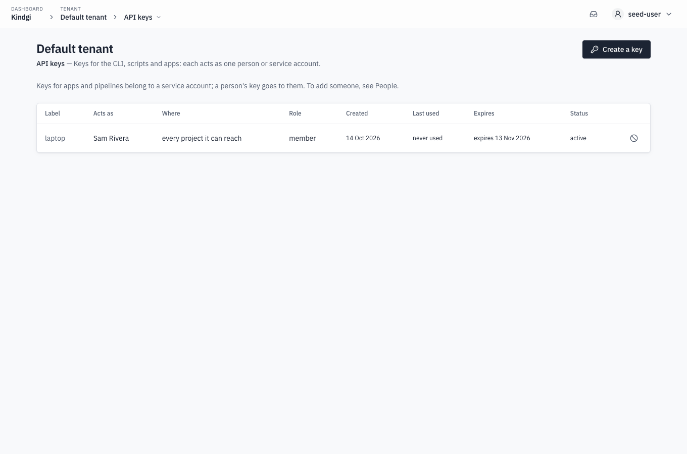
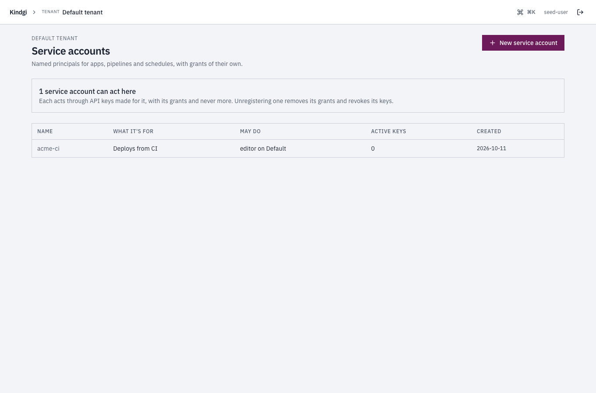
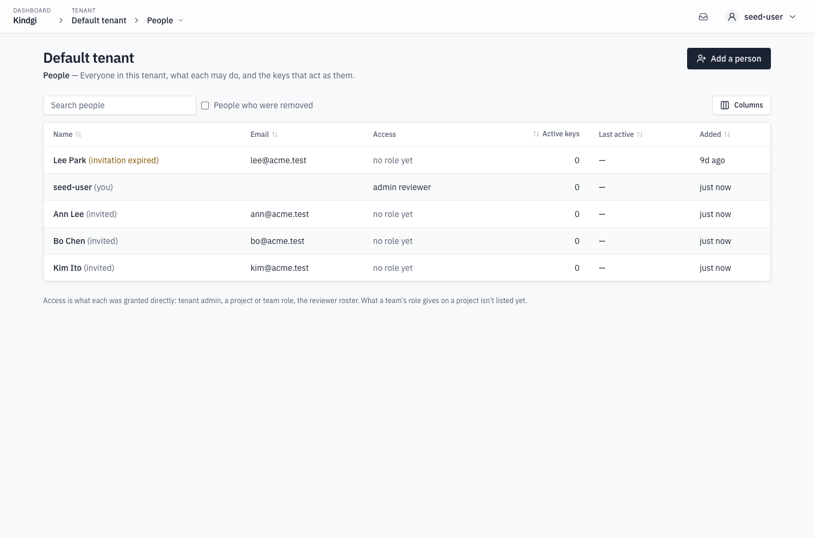
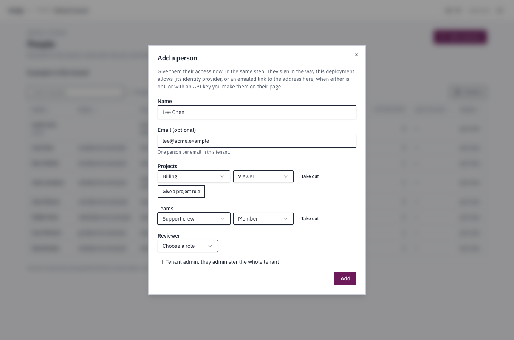

When you finish this page, your deployment's people have their own
sign-ins and API keys, and your pipelines have service accounts. With
[authorization](../authorization/) on, each has a role, with only what they
need. You can also remove someone in one step.

A tenant has **people**, each with their own sign-in and API keys. It also
has **service accounts**, which act for a pipeline or an app. A **tenant
admin** adds them. With authorization on, what each may do is kept in
OpenFGA, and the first tenant admin is the runtime's seed user:
`KINDGI_SEED_USER_ID`, or the API token's user. The runtime makes the seed
user a tenant admin at every start. Without authorization, roles aren't
checked ([Without authorization](#without-authorization)).

:::note[On Kindgi Cloud]
Whoever signs up is the workspace's first tenant admin. Authorization is
always on, and Kindgi runs OpenFGA. The runtime's `KINDGI_*` settings, such
as `KINDGI_SEED_USER_ID`, are Kindgi's.
:::

## Before you start

- **For roles:** authorization on for your runtime
  ([Run with authorization](../authorization/)). Without it, see
  [Without authorization](#without-authorization).
- **You're a tenant admin,** such as the seed user.
- **The `kindgi` CLI reaches your runtime as you,** with the runtime's address
  exported as `KINDGI_API_URL` and your API key as `KINDGI_API_TOKEN`. The
  `curl` examples read the same two variables.
- **For `kindgi` commands:** Kindgi 0.2's CLI, which runs from any folder as
  `npx --yes @kindgi/cli@0.2` ([Install](../../start/install/)). Inside a pack
  project, `pnpm exec kindgi` runs the project's pinned CLI instead.

## Who can do what

With authorization on:

- **A tenant admin** does everything in the tenant. They add and remove
  people, make keys for anyone, and change tenant-wide settings: providers,
  policies, signing keys, deployments and identity providers.
- **A tenant member** reads the tenant's settings, not its projects: its
  providers, policies, adapters and signing keys. Everyone you add is one.
  A deployment is read in the project it serves: a member lists and reads
  only those in projects they read. One deployed without a project is the
  Default project's.
- **A role on a project** gives the work in it: its agents, runs and
  conversations. The roles are `owner`, `admin`, `editor` and `viewer`
  ([Project memberships](../authorization/#project-memberships)).
- **A service account** has only what it's granted. It isn't a tenant member
  unless you make it one.
- **A capability** is needed on top of the role to trust signing keys
  (`signing-keys:write`) and to write secrets and environment values
  (`secrets:write`, `env:write` and the like). A tenant's first admin, the
  person it was created with on a runtime serving many tenants, holds every
  one but `secrets:reveal`, and no other person holds any. A key carries
  those it was made with ([API keys](#api-keys)).

Lists hold only what the caller may read.

:::caution[One company per tenant]
Everyone in a tenant reads its settings. Give people from different
companies different tenants, not different projects of one tenant.
:::

## Without authorization

A runtime without an authorization store, with no `KINDGI_OPENFGA_API_URL`,
suits one tenant whose people trust each other: one operator, or a small
team. `kindgi dev` runs this way. Serving many tenants needs authorization:
with `KINDGI_TENANCY=multi`, the runtime doesn't start without a store.

- **Everyone it lets in works in every project,** by a sign-in or a key:
  its agents, runs, conversations and deployments. Writing secrets and
  environment values still takes its capability: a key made with it
  carries it, and a sign-in carries none ([API keys](#api-keys)).
- **Tenant settings are the tenant admin's.** Anyone reads the tenant's
  policies, model providers, adapters, identity providers and signing keys,
  and only the tenant admin changes them. Webhook endpoints and compliance
  evidence are the tenant admin's to read too, as are people, keys for
  others and service accounts. Anyone else gets `403 permission-denied`.
- **The tenant admin is whoever uses the runtime's API token,** or an
  `admin` key made for the seed user, and a console signed in with either
  ([Signing in with an API token](../self-hosted/sign-in/#signing-in-with-an-api-token)).
  Someone signed in through an identity provider or an emailed link isn't
  one, the seed user included.
- **Roles aren't checked.** A project role you record, and a service
  account's grants, give nothing more here. Making a person a tenant admin
  answers `501 person-grants-unsupported`.
- **Schedules and webhook triggers keep to their owners** (runtime 0.2.0 or
  later). Only a tenant admin changes, pauses, fires or unregisters someone
  else's personal one, changes what a shared one runs, sets one's tools
  allowed unattended, or takes one over
  ([Shared or personal](../../guides/runs/run-on-a-schedule/#shared-or-personal)).

[Run with authorization](../authorization/) when people need different
access, or more than one person needs to be a tenant admin.

## Add a person

Adding a person gives them a place in the tenant, so they can sign in and
get keys:

```sh
npx --yes @kindgi/cli@0.2 people add --name="Sam Rivera" --email=sam@acme.example
```

- `--name` is their name, as people see it.
- `--email` is the email they sign in with. It's unique among the tenant's
  people. A person added with one is [invited](#their-invitation).
- `--no-invite` doesn't email them the invitation, for when you tell them
  yourself. They're still invited.

It prints the new person, and says on stderr what being added gives them.
With sign-in off, nobody is [invited](#their-invitation):

```text
{
  "userId": "002ee784-0b05-47fb-918e-34d192be94c1",
  "displayName": "Sam Rivera",
  "email": "sam@acme.example"
}
Added to the tenant: they can read its settings. With authorization on, give them a project role to work on its agents and runs; without it, they can work in every project already. Then their first key: kindgi tokens create --for=user:002ee784-0b05-47fb-918e-34d192be94c1
```

An email another person already has is refused with
`409 identity-user-email-taken`.

With authorization on, give them a role on a project next. A tenant admin,
or an admin of that project, adds them by email or by id:

```sh
curl -X POST "$KINDGI_API_URL/v1/projects/<project-id>/memberships" \
  -H @<(printf 'Authorization: Bearer %s\n' "$KINDGI_API_TOKEN") -H 'content-type: application/json' \
  -d '{"email":"sam@acme.example","role":"editor"}'
```

- `<project-id>` is the project's id.
- `email` names the person. `userId` names them by id instead.
- `role` is their role on the project: `owner`, `admin`, `editor` or
  `viewer`.

The email matches whatever its case, and the answer names the person. Here a
project admin added a viewer as `GUS@acme.test`:

```json
{"projectId":"ea6e0f95-301e-4017-b2d4-82590cc6ec64","userId":"74e4beb8-6aa4-47ef-9f2a-e0245ee62343","role":"viewer"}
```

Someone who isn't one of the tenant's people, or who was removed, isn't
added:

```json
{"error":{"code":"identity-user-not-found","message":"No one with email \"outsider@example.com\" is a member of this tenant","requestId":"req-304865e8-9499-48cd-afca-2f8c87e8f05d"}}
```

In the TypeScript client, it's
`projects.memberships.add(projectId, { email, role })`. They can then
[sign in to the console](../self-hosted/sign-in/), or use a key you make them.

### Their invitation

Where people [sign in to the console](../self-hosted/sign-in/), a person added with an
email is invited: the runtime emails them an invitation, through the
[sign-in email](../self-hosted/sign-in/#sign-in-links-by-email) sender you set up. It
says who added them, to which workspace, and when it expires, and links to
the console's sign-in page with their email filled in. The link holds no
secret and signs no one in: they sign in on that page, a way the deployment
allows, with that email. From a runtime at `http://localhost:18096`, an
invitation read:

```text
From: Kindgi <sign-in@acme-live.example>
Subject: You're invited to Default tenant on Kindgi

seed-user added you to Default tenant on Kindgi.

Sign in with this email address here:

http://localhost:18096/console/login#email=ann%40acme.test

This invitation expires on 2026-10-24 15:06 UTC.
If you weren't expecting it, ignore this email.
```

The invitation is open for 7 days from the add, or from the last time it
was sent. It's `pending` until their first sign-in, then it's gone: they've
joined. Once the 7 days pass with no sign-in it's `expired`, and every way
in refuses them, an identity provider too, until a tenant admin sends it
again. A key you made them still works. With sign-in off, nobody is
invited: people work with the keys you make them.

With sign-in on, `kindgi people add` prints the invitation, and says on
stderr whether it went out:

```text
{
  "userId": "f9054f5f-3a4b-40af-8aa9-317c32eead7c",
  "displayName": "Ann Lee",
  "email": "ann@acme.test",
  "invite": {
    "state": "pending",
    "expiresAt": "2026-10-24T15:06:45.522Z",
    "sentAt": "2026-10-17T15:06:45.552Z"
  },
  "inviteEmail": {
    "sent": true
  }
}
Added to the tenant: they can read its settings. With authorization on, give them a project role to work on its agents and runs; without it, they can work in every project already. Then their first key: kindgi tokens create --for=user:f9054f5f-3a4b-40af-8aa9-317c32eead7c
The invitation went to ann@acme.test: they sign in with it before it expires (2026-10-24T15:06:45.522Z).
```

The person's record keeps `invite` until their first sign-in, with a
`state` of `pending` or `expired`. `sentAt` is when it was last emailed;
it's absent when it never was. People added before the runtime invited,
the people the runtime adds itself (such as the seed user), and people with
no email aren't invited, so they have no `invite`.

When the invitation wasn't emailed, `inviteEmail.reason` says why, and so
does the line on stderr:

| Reason | Why it wasn't emailed |
|---|---|
| `not-requested` | `--no-invite` (`sendInvite: false`). |
| `not-configured` | The runtime has no sign-in email sender, so there's no emailed link: they sign in through Google, Microsoft, GitHub or the workspace's identity provider, with that email. |
| `send-failed` | The mail server refused it or didn't answer. |
| `capped` | The tenant, or the whole deployment, has sent as many invitation emails as it may in 24 hours (below). |
| `no-email` | They have no email, so they aren't invited. |

With `--no-invite`, the line reads:

```text
Invited, not emailed (--no-invite): tell them to sign in with bo@acme.test before it expires (2026-10-24T15:06:46.142Z).
```

Unless it's `no-email`, they're invited all the same: tell them to sign in
with their email, or send it again. To send it again, open for 7 days from
then:

```sh
npx --yes @kindgi/cli@0.2 people invite <user-id>
```

Someone who has joined, or was never invited, is refused with
`409 identity-user-not-invited`. Sending one person's again within a
minute, more than 5 times in 24 hours, or past the invitation emails the
tenant, or the whole deployment, may send in 24 hours, is refused with
`429 invite-capped` and a `Retry-After`, and changes nothing.

In 24 hours a tenant sends at most 100 invitation emails, or 10 while it
isn't allowed [production](../../guides/projects/organize-by-org-and-project/#put-a-project-in-production)
(with `KINDGI_PRODUCTION_GATE` set to `on`). The whole deployment sends at
most 500 by default, all its tenants together
(`KINDGI_AUTH_INVITE_EMAIL_DAILY_CAP`).

The people invited who haven't signed in yet, with a STATE of `pending` or
`expired`:

```sh
npx --yes @kindgi/cli@0.2 people list --pending --table
```

Here Lee Park's invitation expired before they signed in:

```text
ID                                    NAME      EMAIL          STATE    ADDED
────────────────────────────────────  ────────  ─────────────  ───────  ────────────────────────
8e4e2291-7af5-42cd-8799-e4a7b5dc8c03  Lee Park  lee@acme.test  expired  2026-10-08T15:06:49.559Z
f9054f5f-3a4b-40af-8aa9-317c32eead7c  Ann Lee   ann@acme.test  pending  2026-10-17T15:06:45.522Z
d94a41a9-939d-43a3-89ac-84406d0cffed  Bo Chen   bo@acme.test   pending  2026-10-17T15:06:46.142Z
bd6453a9-b1f5-4cba-89f2-a172675bdee6  Kim Ito   kim@acme.test  pending  2026-10-17T15:06:47.404Z
```

To take an invitation back, [remove the person](#remove-a-person): in the
console, **Revoke the invitation** on their page.

In the TypeScript client, `users.create(spec)` answers with the person
added; its `inviteEmail` says whether the invitation was emailed, and is
absent on a runtime that doesn't invite. `users.resendInvite(userId)`
sends it again, and `users.list({ pending: true })` lists the invited.

## Make someone a tenant admin

A tenant admin can do everything in the tenant. `grant` makes someone one,
and `ungrant` takes it away:

```sh
npx --yes @kindgi/cli@0.2 people grant <user-id> --tenant-admin
npx --yes @kindgi/cli@0.2 people ungrant <user-id> --tenant-admin
```

`<user-id>` is the person's id, as `kindgi people add` printed it. The grant
holds from their next request.

`kindgi people grants <user-id> --table` lists what someone holds, as
granted directly: tenant admin, tenant member, project and team roles, and a
reviewer role. What a team or an org gives isn't expanded. Sam, newly added,
holds only the tenant membership:

```text
WHERE   ROLE
──────  ───────────────────────────
tenant  member (reads its settings)
```

Everyone's grants come in one read: the people list takes `include=grants`.
In TypeScript, that's `users.list({ includeGrants: true })`, and in Python
`identity.users.list(include="grants")`. Each person then carries `grants`,
the same shape as their own grants read. A runtime without an authorization
store lists the people without them.

Taking tenant admin away is refused in two cases:

- `409 last-tenant-admin`: they're the only one. Make someone else a tenant
  admin first.
- `409 seed-user-admin`: they're the seed user, whom the runtime makes a
  tenant admin again at every start. Unset `KINDGI_SEED_USER_ID` and restart
  the runtime first.

If the first admin stops being a tenant admin, the capabilities they held
are revoked, and the audit entry lists them. A key acts as the person or
service account it's for, whoever made it. So their own keys keep their
capabilities, but until the first admin is a tenant admin again, those keys
can't trust signing keys, and can't change secrets or environment values
where they aren't an admin. A key they made for another tenant admin, or
for a service account that's one, keeps working.

Making the first admin a tenant admin again doesn't give their own
capabilities back, so the console offers them none. A key that carries
capabilities makes new keys with them
(`kindgi tokens create --capability=<cap>`, in [API keys](#api-keys)):
their own keys, once they're an admin again, or one made for another
tenant admin or a service account that's one. Before you revoke the last
key that carries a capability, or let it expire, make its replacement with
it. If the first admin doesn't hold a capability and no key in the tenant
carries it, contact support.

Make the key that carries these capabilities for a service account that's
a tenant admin, not for the first admin. It keeps working if the first
admin stops being a tenant admin or is removed, and as a tenant admin,
whoever holds it can make new keys with its capabilities:

```sh
npx --yes @kindgi/cli@0.2 service-accounts create acme-admin --description="Trusts signing keys and sets secrets" --tenant-admin
npx --yes @kindgi/cli@0.2 tokens create --for=sa:<service-account-id> --role=admin --capability=signing-keys:write --capability=secrets:write --label=admin --expires=90d
```

It can trust signing keys, so keep it out of CI: trusting CI's signing key
is a person's step, and CI's keys are made for each step
([The keys CI uses](../ship-from-ci/#the-keys-ci-uses)). On Kindgi Cloud,
CI's deploy key is a tenant admin's key too, with no capability. It can
still promote to prod, replace release gate policies, and make service
accounts and keys, so main's own protection is what guards prod there
([The deploy key](../ship-from-ci/#the-deploy-key)).

## What you may do

`GET /v1/identity/me/permissions` answers what you, the caller, may do, with
your API key's limits applied. Unlike `grants`, it counts every way you hold
a role.

- **`tenant`:** `{admin, member}`.
- **`reviewer`:** when you're a reviewer, it has:
  - your role;
  - your reviewer `id`, which an approval assigned to you names in
    `assignedTo`, and which is absent without a roster row;
  - the approvals' roles you may decide: your rank and those under it;
  - whether you can decide at all.
- **`key`:** when you call with an API key, its role and the project it's
  limited to.
- **`tokenCapabilities`:** what your token itself carries for secret, env and
  signing-key writes. A sign-in session carries the ones you hold as a person.
  A tenant's first admin, the person it was created with, holds every one but
  `secrets:reveal`; no one else holds any. An API key carries those it was
  minted with, none by default, and only ones its minter holds.
- **`projects`:** each project you may read, with your highest role in it and
  every way you hold one (`via`):
  - `direct`, or through a `team`, with `since` when the runtime keeps it;
  - `org-admin`, as an admin of the org it sits in;
  - `tenant-admin`.
- **`orgs` and `teams`:** your own, with your role in each.
- **`capabilities`:** what each project role allows on the project and on
  each kind of object in it, read from the runtime's authorization model.
  Your project role's entry is what you may do there.
- **`readOnlyNotice`:** the line the console shows someone who may only
  view a project, when a tenant admin set one. It's in the tenant config,
  `kind: 'config'`, key `console.readOnlyNotice`, plain text on one line, at
  most 280 characters.

A key limited to a project sees that project alone. A `member` key is never
a tenant admin. You see only what you may read: no project you can't read,
and no one else's role.

The console hides actions by it
([The console, by role](../authorization/#the-console-by-role)). The server
still checks every call.

On a runtime without an authorization store, it answers
`501 permissions-unsupported`. In the TypeScript and Python clients, it's
`client.identity.me.permissions()`.

## API keys

Everyone can make their own keys, for the API, the CLI and the SDKs:

```sh
npx --yes @kindgi/cli@0.2 tokens create --label=laptop --expires=30d
```

- `--label` is a name for the key, to tell your keys apart.
- `--expires` is when it stops working: `30d`, `12h`, `90m` or a date. A key
  without it doesn't expire.

The secret is printed once, there. Store it, because nothing shows it
again.

A key can't outlive the key that makes it. Made with a key that expires,
the new key's `--expires` must be no later than that key's. A later one, or
none, is refused with `403 token-expiry-exceeds-minter`, naming the latest
date allowed. The same holds in a console signed in with a key. These
aren't limited this way:

- the deployment's token;
- a key without an expiry;
- a console signed in through SSO, a social sign-in or an emailed link.

Make longer-lived keys with one of those, such as the 90-day key in
[Service accounts](#service-accounts).

- **For someone else,** as a tenant admin only: `--for=user:<user-id>` or
  `--for=sa:<service-account-id>`.
- **`--role=member`,** the default, takes no admin action on the tenant,
  even for a tenant admin. A project admin's member key still manages that
  project's members. **`--role=admin`** is made only by a tenant admin, and
  only for a tenant admin. For anyone else, it's refused with
  `403 role-exceeds-principal`.
- **`--project=<project-id>`** limits the key to one project. A request that
  names another project is refused with `403 key-project-mismatch`. A
  promotion reads one project and writes another, so a key limited to a
  project is refused the same way on every promotion
  ([A promote key for each later environment](../ship-from-ci/#a-promote-key-for-each-later-environment)).
- **`--capability=<cap>`,** repeatable, puts a capability on the key, such as
  `signing-keys:write` or `secrets:write`
  ([Who can do what](#who-can-do-what)). You can give only those you hold,
  as `tokenCapabilities` lists them: another is refused with `403`, naming
  it. The key uses them only as far as its role goes: trusting signing keys
  takes `--role=admin`.

A tenant admin made Sam's first key:

```sh
npx --yes @kindgi/cli@0.2 tokens create --for=user:<user-id> --label=laptop --expires=30d
```

```text
{
  "meta": {
    "id": "16979e65-a65d-46aa-a348-1b64d1c7d41f",
    "principal": {
      "kind": "user",
      "id": "002ee784-0b05-47fb-918e-34d192be94c1"
    },
    "role": "member",
    "capabilities": [],
    "label": "laptop",
    "createdBy": "user:11111111-3333-4333-8444-000000000402",
    "createdAt": "2026-10-09T12:20:34.217Z",
    "expiresAt": "2026-11-08T12:20:34.178Z"
  },
  "secret": "kgi_ak_…"
}
⚠ The secret of key 16979e65-a65d-46aa-a348-1b64d1c7d41f is shown once, above: store it now.
```

```sh
npx --yes @kindgi/cli@0.2 tokens list --table
```

```text
ID                                    FOR                                        ROLE    PROJECT  LABEL   CREATED                   EXPIRES                   REVOKED  LAST USED
────────────────────────────────────  ─────────────────────────────────────────  ──────  ───────  ──────  ────────────────────────  ────────────────────────  ───────  ─────────
16979e65-a65d-46aa-a348-1b64d1c7d41f  user:002ee784-0b05-47fb-918e-34d192be94c1  member           laptop  2026-10-09T12:20:34.217Z  2026-11-08T12:20:34.178Z
```

`kindgi tokens list` lists your keys, and `--table` prints them as a table.
A tenant admin sees everyone's, and `--for=user:<id>` narrows it to one
person's. Someone else's key reads as `404`. `kindgi tokens revoke
<token-id>` refuses the key from its next request on, with `401`.

## Service accounts

A service account is for a pipeline or an app. It has no sign-in, only
keys, and only the grants you give it.

**Your own key acts as you:** a run it starts counts as one you started.
For automation, use a service account's key: its runs count as unattended,
so a tool that needs a person's yes when no one is watching waits for one
([When no person started the run](../../guides/approvals/ask-before-a-tool-runs/#when-no-person-started-the-run)).

- **A tenant's first admin key is a service account's.** It's the key
  `POST /v1/system/tenants` answers with when it names no `firstAdmin`, so
  the runs it starts count as unattended. For the work you start yourself,
  add yourself as a person ([Add a person](#add-a-person)) and use a key of
  your own ([API keys](#api-keys)).
- **On a runtime serving one tenant, the runtime's API token acts as the
  seed user,** a person, so the runs it starts count as a person's.

Make one:

```sh
npx --yes @kindgi/cli@0.2 service-accounts create acme-ci --description="Deploys from CI" --project=<project-id>:editor
```

- `acme-ci` is the account's name.
- `--description` says what it's for.
- `--project=<project-id>:<role>` gives it a role on a project. Repeat it
  for more projects.

```text
{
  "serviceAccountId": "04da5350-4207-4563-a4f9-c3c3463f33cf",
  "name": "acme-ci",
  "description": "Deploys from CI",
  "grants": [
    {
      "kind": "project",
      "projectId": "211244ea-cdac-45e5-be8c-30a3e0bc42f7",
      "role": "editor"
    }
  ],
  "createdBy": "user:11111111-3333-4333-8444-000000000402",
  "createdAt": "2026-10-09T12:20:35.334Z"
}
```

Then make it a key:

```sh
npx --yes @kindgi/cli@0.2 tokens create --for=sa:<service-account-id> --label=ci --expires=90d
```

`<service-account-id>` is the `serviceAccountId` that `create` printed.
Its grants are written before `create` answers, so its first key works at
once. You can grant `--tenant-admin`, `--tenant-member` and
`--project=<id>:<role>`, now or later with `kindgi service-accounts grant`
and `ungrant`.

Give `--tenant-member` only to an account whose job reads the tenant's
settings. Without it, such a read is refused, and the refusal says how to
grant it.

`kindgi service-accounts unregister <service-account-id>` takes its grants
away, and its keys stop working.

### A project's own account

A project can have one service account of its own (runtime 0.2.0 or
later). It runs only the triggers set to run as the project: shared
schedules, webhook triggers and mail triggers on a company mailbox. A
shared trigger that names a service account runs as that one instead.
The project's account is made the first time a trigger is set to run as
the project, when one is created or taken over
with `--run-as=project` (`runAsProject: true` in the API), which takes
`admin` on the project
([Run as a service account](../../guides/runs/run-on-a-schedule/#run-as-a-service-account)).
A project that never does that has none. A runtime that can't make one
answers `--run-as=project` with `501 trigger-operation-unsupported`: "This
runtime can't make a project's own account."

- **Its grant is fixed:** `editor` on its project, and nothing else, so its
  runs may do what the project's editors may. `grant` and `ungrant` on it
  are refused, `409 service-account-project-owned`. So, with an
  authorization store, a trigger runs as the project only if the project's
  editors can run its agent or flow. Setting it to run as the project, or
  giving it another agent or flow, is otherwise refused, `409
  trigger-owner-cannot-run-target`: "The project's own account runs only
  what the project's editors can." Run the trigger as a service account
  that can, or own it yourself; to change one the project's account owns,
  a project admin can take it over first.
- **It has no keys.** A key for it is refused the same way: "A project's
  own account has no keys: give an app a service account of its own."
- **It's named only as the project.** `--run-as=<service-account-id>` with
  its id is refused: a tenant admin is answered `409
  service-account-project-owned`, and anyone else gets the usual `403`.
- **Its name is `project-<project-id>`.**
  `kindgi service-accounts list --table` shows it with
  `project's own: <project-id>` in its grants. `list` and `get` without
  it, and the API, show its `projectId`. A trigger that runs as it has
  `isProjectAccount: true` in its `owner`. If a tenant admin already made
  an account of that name, `--run-as=project` is answered
  `409 service-account-name-taken`: "An account named
  `project-<project-id>` is already registered. A tenant admin can
  unregister it."
- **A tenant admin may unregister it.** The project's triggers that run as
  it then stop, until a project admin takes each over. A take-over with
  `--run-as=project` makes the project a new account.
- **Deleting the project unregisters it.**
- **Without an authorization store,** running a trigger as the project
  takes a tenant-admin key, and its grant is kept as a record only: each
  fire or delivery checks only that the account is registered.

For an account used across projects, with other grants, or with keys for
an app, make one of your own, as above.

## Who sees the tenant's people

Only a tenant admin lists them. Anyone else gets:

```json
{"error":{"code":"permission-denied","message":"Only a tenant admin lists the tenant's people","requestId":"req-6f9ecda9-4a1d-4ef4-83a8-c91d5c78e47f"}}
```

A person's record and sessions are for a tenant admin, or that person.

## Remove a person

Removing a person ends all their access at once:

```sh
npx --yes @kindgi/cli@0.2 people remove <user-id>
```

```text
{
  "user": {
    "userId": "e071f636-1e1e-4ee9-ac6e-ba1c1bd234ed",
    "tenantId": "d283f09b-debf-46f5-9c10-13595df0224d",
    "primaryEmail": "sam@acme.example",
    "displayName": "Sam Rivera",
    "createdAt": "2026-10-17T02:45:02.525Z",
    "unregisteredAt": "2026-10-17T02:45:03.717Z"
  },
  "keysRevoked": 1,
  "sessionsRevoked": 0,
  "grantsRemoved": 5
}
Removed Sam Rivera: 1 key(s) and 0 session(s) revoked, 5 role(s) and membership(s) taken away.
```

In one step, before it answers, their API keys are revoked, their sessions
end, and every grant, membership and capability is taken away, with what
their creates gave them: `owner` on each agent, flow, tool, guardrail and
eval suite they made, and `admin` on an org they made (runtime 0.1.9 or
later). What they made stays. The tenant's admins still manage all of it,
and an org's admins what's in their org; no one becomes its owner. The next
request with Sam's key:

```text
{"error":{"code":"auth-missing","message":"Bearer token is not recognized","requestId":"req-ea8f3a9a-f1df-4365-9f7c-7bab23beea86"}}
```

That's a `401`. Their record stays, so runs, approvals and the audit trail still
say who they were. Adding their email again makes a new person, with nothing
granted. A person a site signs in can be let back in instead, the same
person (runtime 0.1.10 or later):
[`kindgi sites restore-person`](../../sites/wordpress/#pause-re-key-or-remove).

Schedules and webhook triggers they own stop running as them (runtime
0.1.9 or later). Each fire is `refused` and counts toward pausing it:
after 5 in a row that were refused or failed, it
[pauses itself](../../guides/runs/run-on-a-schedule/#each-time-it-fires).
The fire's `detail`, in `kindgi schedules fires` or `kindgi webhooks fires`,
says why:

```text
The owner user:… was removed from the tenant, so flow acme.digest@1.0.0 no longer runs as them: take the schedule over, or delete it.
```

To keep one running, take it over, before or after you remove them:
[`kindgi schedules take-ownership <schedule-id>`](../../guides/runs/run-on-a-schedule/#each-time-it-fires)
or
[`kindgi webhooks take-ownership <trigger-id>`](../../guides/webhooks/start-runs-from-webhooks/#pause-change-and-remove).
A run of theirs that's already going isn't stopped: it fails at its next
check of what they may do.

For a person removed on an earlier runtime, their creates' `owner` and
`admin` entries stayed, and their schedules and webhook triggers could go on
running as them. To finish it: take over their schedules and webhook
triggers, upgrade the runtime, then remove them again.
`kindgi people list --include-removed` lists them, and `kindgi people remove`
on someone already removed takes what's left.

It's refused for yourself and for the seed user, with
`identity-user-unregister-refused`, and for the only tenant admin, with
`last-tenant-admin`. Removed people are left out of lists.
`kindgi people list --include-removed` shows them too.

## In the console

- **API keys** lists your keys, and a tenant admin's lists everyone's.
  **Create a key** makes one for you, with its role, project and expiry. A
  tenant admin can make one for a person or a service account too. The
  secret shows once, with a Copy button.

  When you hold capabilities, **What it can change** offers them, none
  ticked: **Trust signing keys**, **Store secrets**, **Rotate secrets**,
  **Revoke secrets**, **Revoke secrets for good**, **Read secret values**
  and **Change environment variables**, each with its name, such as
  `signing-keys:write`. A key that trusts signing keys is an **Admin** key,
  under **How far it goes**, with **Trust signing keys** ticked.

  
- **Service accounts,** for tenant admins: create one with its grants,
  change them, make it a key, or unregister it.

  

A project you have no role on shows **No access**, with the projects you can
open.

### People

**People**, for tenant admins, lists the tenant's people: each one's access
in words, such as "reads the tenant's settings, viewer on Support, member
of team Support crew, standard reviewer", their active keys, when they were
last active, and when they were added. Access is what each was granted
directly: what a team's role gives on a project isn't listed there. A
search box, sorting, **People who were removed** and **Columns** narrow and
order the list, and the page's address keeps them.

Someone [invited](#their-invitation) who hasn't signed in yet is marked
**(invited)**, and **(invitation expired)** once its 7 days pass:




**Add a person** adds someone with their access in one step: "Give them
their access now, in the same step." It takes a name, an optional email
("One person per email in this tenant."), project roles, teams, a reviewer
tier, and tenant admin.



Each part is a step of its own. When they all work, the person's page
opens. When one doesn't, the dialog says how each went:

- **They weren't added,** such as for an email someone has: "Sam Rivera
  wasn't added.", each step with why ("Someone in this tenant already has
  that email.") or "not tried: they weren't added", and **Change and try
  again**.
- **They were added, but not everything was given:** the steps that failed
  say why, with **Try again what failed**.
- **It isn't known whether they were added,** because the runtime didn't
  answer: it says so and offers **Look in People**, rather than adding them
  again.

Where the runtime invites, a dialog that stays open also says whether their
invitation went out, and when it didn't, what to do, such as "Invited, but
the invitation email didn't go out: send it again, or tell them to sign in."
Here the project role's step got no answer:


A person's page says what they may do and changes it in place, each part
where you may:

- **Projects and teams:** change a role, **Take away** one, or **Give
  access** to another project or team, with a role. Each project role says
  what it gives, such as "Also changes it: registers and runs agents,
  corrects answers, publishes." for an editor.
- **Reviewer:** their tier, or none; **Take off the roster**.
- **Tenant admin:** making or unmaking one. "A tenant always keeps one
  admin: removing the only one is refused."

Taking something away asks first: "Take Ada Lovelace off Support? From
their next request on, they can't work in Support. Their other access, and
what they did there, stay." The page also lists their keys, with **Make a
key for** them, where they're signed in, their sign-ins, and **Remove from
the tenant**.

Until they first sign in, their page has an **Invitation** section: when
it's open until and when it was emailed, or when it expired ("they can't
sign in until it's sent again"). **Send it again** opens it for 7 days from
then ("Renewed: open for 7 days from now."), and says whether it went out;
for an open one never emailed, it's **Send the invitation**. **Remove
from the tenant** reads **Revoke the invitation**: "They haven't signed in: revoking
removes them from the tenant, so the invitation no longer lets them in.
Adding their email again invites them anew."


### What needs you

A tenant admin's home in the tenant starts with what needs a look, such as
"8 people in 3 projects and 1 team. 3 people have no project of their own;
1 key expires this week.", or "Nothing needs you right now.":

- **No project of their own:** people who aren't a tenant admin and have no
  project role given them directly. A project they reach through a team or
  as an org admin isn't counted.
- **Keys:** those that expire this week, or have gone unused for 90 days,
  with **All keys**.
- **Recently refused:** requests the [access audit](../authorization/#the-access-audit)
  recorded as denied, with **All refused requests**. "Someone refused may be
  missing access they need."


It counts everyone, and never says all is clear before it has read
everything. While a read is still coming in, it says so, such as "Still
reading everyone's access…". A read that failed is named: "… couldn't be
read".

## Recorded

Each change is kept as evidence: `person-added`, `person-granted`,
`person-ungranted`, `person-unregistered`, `person-capabilities-granted`,
`person-capabilities-revoked`, `api-key-minted`,
`api-key-revoked`, `service-account-created`, `service-account-granted`,
`service-account-ungranted` and `service-account-unregistered`. A key's
secret is never in one. A project's own account is made with one
`service-account-created`, which has its `projectId` and
`projectAccount: true`, and no separate `service-account-granted`.

## Next

- [Turn on sign-in](../self-hosted/sign-in/): the ways your people sign in.
- [Run with authorization](../authorization/): project memberships, teams
  and the access audit.
- [Set up SSO](../../guides/sso/): a workspace's own identity provider.
