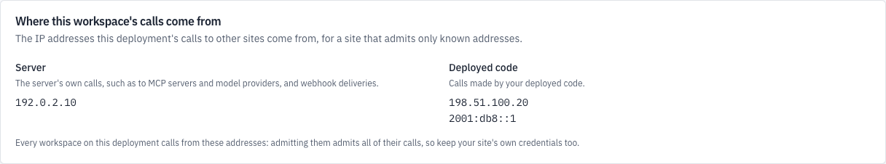

Some sites admit calls only from addresses they know: a shop's API behind a
firewall, an MCP server with an allowlist, a webhook receiver. A runtime can
publish the IP addresses its calls to other sites come from (runtime 0.1.9
or later), and anyone who belongs to one of its tenants prints them with
`kindgi egress`. Publishing them changes nothing about where calls go or
where they come from.

## Before you start

- **Addresses that stay the same,** where your runtime's calls leave your
  network. On Cloud Run, that's the module's
  [static NAT address](#on-cloud-run).
- **The runtime's settings:** `kindgi.env` for
  [Self-host Kindgi](../self-host/), or the module's `server_env` on
  [Cloud Run](../cloud-run/).
- **For `kindgi` commands:** Kindgi 0.2's CLI, which runs from any folder as
  `npx --yes @kindgi/cli@0.2` ([Install](../../../start/install/)). Inside a
  pack project, `pnpm exec kindgi` runs the project's pinned CLI instead.

## Publish them

Two settings, each a comma-separated list of IPv4 or IPv6 addresses:

- `KINDGI_EGRESS_SERVER_ADDRESSES`: where the server's own calls come from,
  such as its calls to MCP servers and model providers, and its webhook
  deliveries.
- `KINDGI_EGRESS_DEPLOYMENT_ADDRESSES`: where calls made by the code deployed
  to it come from, such as its tools' calls.

```sh
KINDGI_EGRESS_SERVER_ADDRESSES=192.0.2.10
KINDGI_EGRESS_DEPLOYMENT_ADDRESSES=198.51.100.20,2001:db8::1
```

Then [restart the runtime](../restart-and-check-health/). A value that isn't
an IP address, such as a range (`192.0.2.0/24`) or an address with an
interface (`2001:db8::1%eth0`), stops it from starting, with an error that
names the setting and the entry it can't read. Here,
`KINDGI_EGRESS_SERVER_ADDRESSES=nat.acme.example`:

```text
KINDGI_EGRESS_SERVER_ADDRESSES must be comma-separated IP addresses. Got "nat.acme.example".
```

Each address shows once, blank entries are left out, and with both settings
unset or empty nothing is published.

The addresses are the runtime's, the same for every tenant it serves.
Publish only addresses your calls really leave from, and that stay the same:
a site that admits them refuses calls from any other.

### On Cloud Run

With `network_mode = "direct"`, the server's calls to the internet leave
through the module's Cloud NAT. `nat_static_ip = true` reserves its address,
and `terraform output nat_ip` prints it. Put it in `server_env`, then run
`terraform apply` again:

```hcl excerpt
server_env = {
  # ...
  KINDGI_EGRESS_SERVER_ADDRESSES = "192.0.2.10"
}
```

Without `nat_static_ip`, Google picks the NAT's address and may change it,
so there's none to publish. Your pack's calls, and with
`network_mode = "connector"` the server's calls to the internet too, leave
through Cloud Run's own egress, which has no fixed address.

## See them

```sh
npx --yes @kindgi/cli@0.2 egress
```

```text
CALLS        ADDRESS
───────────  ─────────────
server       192.0.2.10
deployments  198.51.100.20
deployments  2001:db8::1

Every tenant on this deployment calls from these addresses: admitting them admits all of their calls, so keep your site's own credentials too.
```

- `CALLS` says whose calls come from the address: `server` for the server's
  own, `deployments` for the deployed code's.
- `--json` prints both lists, for a script that writes a site's firewall
  rule:

  ```json
  {
    "server": [
      "192.0.2.10"
    ],
    "deployments": [
      "198.51.100.20",
      "2001:db8::1"
    ]
  }
  ```

When the runtime publishes none, it says so, and exits `0`:

```text
This deployment publishes no egress addresses.
```

Anyone who belongs to the tenant reads them: every person added to it, and a
service account given `--tenant-member` or `--tenant-admin`
([Service accounts](../../people-and-keys/#service-accounts)). They're in
`GET /v1/tenant`'s `egress`, which is absent when none are published. In
the TypeScript client, it's `tenant.get()`'s `egress`. In the console, the
workspace's home page shows them under **Where this workspace's calls come from**:



## Admit them at a site

- **A site your deployed code calls,** such as a shop's API or a service of
  your own, admits the `deployments` addresses.
- **An MCP server the runtime calls, or a webhook receiver,** admits the
  `server` addresses.

Every tenant on the runtime calls from the same addresses, so admitting them
admits every tenant's calls, not only yours. Keep the site's own check too:
its API key, or a webhook's signature
([Verify a webhook](../../../guides/webhooks/verify-a-webhook/)).

## Next

- [Operate a self-hosted runtime](../operate/)
- [Cloud Run module reference](../cloud-run-reference/)
- [Environment variables](../../../reference/env-vars/#kindgi_egress_server_addresses)
