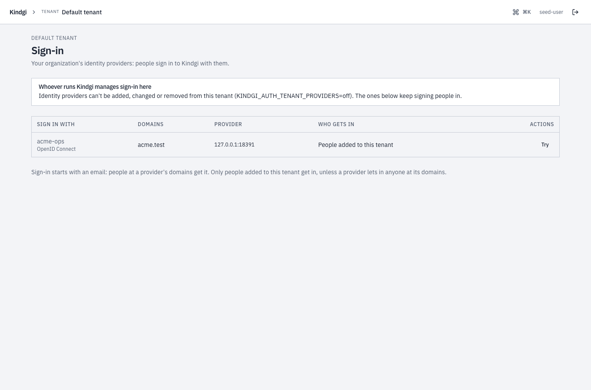
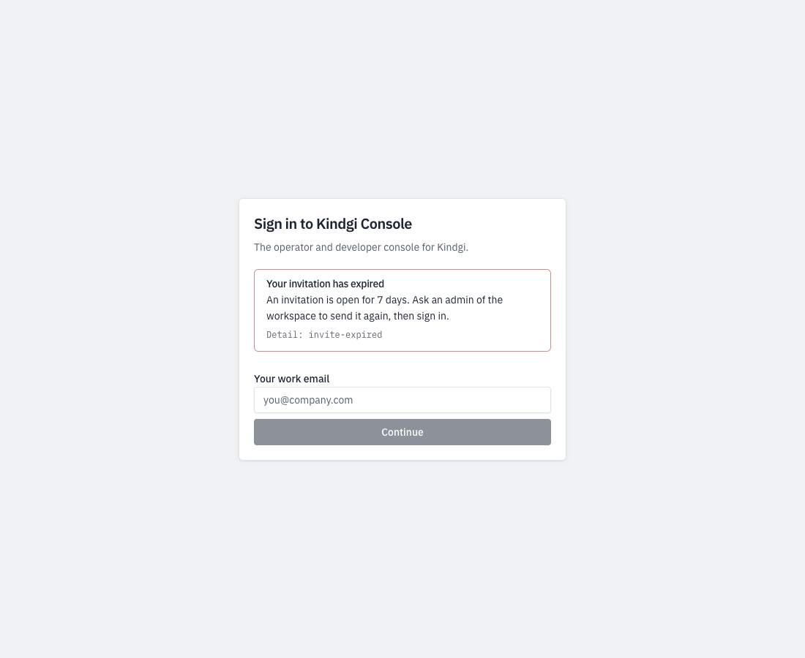

When you finish this page, people sign in to your runtime's console with
their workspace's own identity provider, with Google, Microsoft or GitHub,
or with a link sent by email. This page is for whoever runs the runtime.
What a person sees is in [Sign in to the console](../../../guides/sso/sign-in/).
Connecting a workspace's own identity provider is in
[Set up SSO](../../../guides/sso/).

People sign in to the console with their email first. The sign-in page then
offers the ways in that this deployment has. Whatever way someone signs in,
the runtime lets in **only people already added to a workspace**, by an
email their provider has proved. Nobody is created by signing in, and roles
stay Kindgi's. Without [authorization](../../authorization/), everyone signed
in works in every project, and the tenant's settings change only with the
API token or an `admin` key made for the seed user
([Without authorization](../../people-and-keys/#without-authorization)).

## Before you start

- **A runtime you deploy yourself,** whose settings you can change. This
  page writes them for Docker, in `kindgi.env` with secrets in files
  ([Self-host with Docker](../self-host/)). Kindgi's Terraform modules mount
  no files: on [Cloud Run](../cloud-run/#7-turn-on-sign-in) and
  [Azure Container Apps](../azure-container-apps/#7-turn-on-sign-in), plain
  values go in `server_env`, and secrets in `server_secret_env` by their
  value forms, such as `KINDGI_AUTH_GOOGLE_CLIENT_SECRET` rather than
  `KINDGI_AUTH_GOOGLE_CLIENT_SECRET_PATH`.
- **The address people reach it at,** over `https`, such as
  `https://kindgi.acme.com`.
- **A secrets store for the runtime,** set by `KINDGI_SECRETS_BACKEND`, for
  a workspace's own identity providers: their client secret and keys are
  references into it ([Keep secrets in your own secret manager](../secret-manager/),
  or the Postgres one). Without one, Continue with Google, Microsoft or
  GitHub and the emailed link still work, and adding or changing a
  workspace's own provider answers `409 identity-providers-need-secrets-store`.
- **`openssl`,** to make sign-in's own secret.
- **For `kindgi` commands:** Kindgi 0.2's CLI, which runs from any folder as
  `npx --yes @kindgi/cli@0.2` ([Install](../../../start/install/)). Inside a
  pack project, `pnpm exec kindgi` runs the project's pinned CLI instead.

## 1. Turn it on

Sign-in needs a secret of its own, which signs its sessions and sign-in
state. Make 32 random bytes in a file only you can read:

```sh
openssl rand 32 > auth-secret && chmod 600 auth-secret
```

- `openssl rand 32` prints 32 random bytes, and `>` writes them to
  `auth-secret`.
- `chmod 600` lets only the file's owner read and write it.

Mount the file where the runtime can read it, and set:

```sh
# kindgi.env
KINDGI_AUTH_SECRET_PATH=/run/secrets/auth-secret
KINDGI_PUBLIC_URL=https://kindgi.acme.com
```

- `KINDGI_AUTH_SECRET_PATH` is where the runtime reads the file. Where a
  file can't be mounted, `KINDGI_AUTH_SECRET` takes the same 32 bytes,
  base64-encoded.
- `KINDGI_PUBLIC_URL` is where identity providers send people back. So it's
  the address in every redirect URI on this page.

Start the runtime. Its start log says sign-in is on, with `/auth` under
that address:
`[sso] sign-in with identity providers is on: <KINDGI_PUBLIC_URL>/auth`.

Without the public URL, the runtime doesn't start:

```text
Sign-in with identity providers (KINDGI_AUTH_SECRET_PATH) needs KINDGI_PUBLIC_URL: the URL people reach the runtime at, where identity providers send them back.
```

Without the secret, sign-in is off. The other settings on this page are then
refused, naming the one to set first.

## 2. Choose the ways in

Turn on the ways in your people need:

- **[Continue with Google, Microsoft or GitHub](#continue-with-google-microsoft-or-github):**
  the deployment's own apps.
- **[Sign-in links by email](#sign-in-links-by-email),** sent through your
  SMTP service.
- **[Signing in with an API token](#signing-in-with-an-api-token),** off by
  default.

Each workspace's own identity provider needs nothing more from you: its
admins set it up ([Set up SSO](../../../guides/sso/)). Two settings decide how
that works:
[Which domains find a workspace's identity provider](#which-domains-find-a-workspaces-identity-provider),
and [Who manages a workspace's identity providers](#who-manages-a-workspaces-identity-providers).

## Signing in with an API token

Pasting an API token into the console's sign-in page is **off by default**,
except under `kindgi dev`. To keep it, set:

```sh
KINDGI_CONSOLE_TOKEN_SIGN_IN=on
```

The token signs in once and becomes a session: the browser never keeps the
token. Only a person's own full key signs in. A service account's key, or
one narrowed to a role or a project, is refused with
`token-sign-in-not-allowed`. That refusal is also in the access audit
(`GET /v1/audit/authz`), and so is `token-sign-in-off` while the setting is
off. API tokens work for the API, the CLI and the SDKs, whatever this
setting says.

The startup output says which ways in the console has. With only the token:

```text
Console sign-in: an API token (KINDGI_CONSOLE_TOKEN_SIGN_IN)
```

With neither, it warns, and so does `kindgi doctor`:

```text
⚠ Console sign-in: nobody can sign in to the console. KINDGI_CONSOLE_TOKEN_SIGN_IN=on allows an API token; KINDGI_AUTH_SECRET_PATH turns on sign-in with identity providers.
```

## Which domains find a workspace's identity provider

A workspace's own identity provider is offered to an email only when the
email's domain is **verified** for that workspace. Otherwise a workspace
could claim another company's domain and catch its people.

- **A runtime that serves one workspace** routes that workspace's domains
  with nothing to set.
- **A runtime that serves several** routes a domain only once you list it:

  ```sh
  KINDGI_AUTH_VERIFIED_DOMAINS=acme.com:acme,acme.co.uk:acme
  ```

  Each entry is a domain and the workspace it belongs to, by the
  workspace's id or its slug. The runtime checks the list when it starts.
  An entry it can't read, or a domain listed twice, stops it, naming the
  entry. An entry for a workspace it doesn't serve (no workspace has that
  id or slug, it was purged, or its setup hasn't finished) doesn't: the
  runtime warns, naming the domain and the workspace, and treats that
  domain as one not listed until it next starts with the workspace set up.

  Each replica reads its own list, as does any other runtime on the same
  database: give them all the same one.

  An entry by id keeps working through a rename (runtime 0.1.10 or later).
  While an entry names a workspace by its slug, that slug can't change, and
  no workspace can be renamed to a slug an entry names
  (`409 tenant-slug-in-config`). A rename is checked against the list of the
  replica that takes it. To change a slug an entry names, name the workspace
  by its id in the list, restart every replica and any other runtime on that
  database, then rename it.

The startup output lists what routes:

```text
Sign-in domains: the tenant's own, and acme-live.example (KINDGI_AUTH_VERIFIED_DOMAINS)
```

A domain that isn't verified can still sign in through its provider's own
link: `kindgi sso providers test` prints it.

## Who manages a workspace's identity providers

By default, each workspace's admins add, change and remove its own identity
providers, from the console's **Sign-in** page or `kindgi sso providers`
([Set up SSO](../../../guides/sso/)). The startup output says so:

```text
  Identity providers: each tenant's admins set up their own (KINDGI_AUTH_TENANT_PROVIDERS=off keeps that to this deployment's own token)
```

To manage sign-in yourself for every workspace, from your deployment's own
scripts for example, turn that off:

```sh
# kindgi.env
KINDGI_AUTH_TENANT_PROVIDERS=off
```

```text
  Identity providers: the operator's (KINDGI_AUTH_TENANT_PROVIDERS=off): only this deployment's own token adds, changes or removes them; the ones there keep signing people in
```

- **Only the deployment's own token** (`KINDGI_API_TOKEN`) can then add,
  change or remove a provider. A workspace admin's change is refused with
  `403 identity-providers-operator-managed`:

  ```text
  This deployment's operator manages sign-in (KINDGI_AUTH_TENANT_PROVIDERS=off): identity providers can't be added, changed or removed here, except with the deployment's own token (KINDGI_API_TOKEN).
  ```

- **The providers already there keep signing people in,** and anyone may
  still read them: the list says `changes: operator`.
- **The console's Sign-in page** says who manages it, and lists the
  providers with **Try** only:

  

`on` is the default. Like the other settings here, it needs sign-in on.

Without a secrets store (`KINDGI_SECRETS_BACKEND=none`), nobody adds or
changes a workspace's own provider, whichever the setting. The startup
output says so instead:

```text
  Identity providers: a tenant's own are off: their client secret and keys go in a secrets store, and this server has none (KINDGI_SECRETS_BACKEND)
```

A provider added while the deployment had a store signs nobody in once the
store is gone. People are sent back to the sign-in page with
`sign-in-unavailable`, and the runtime's log says why. On a domain verified
to its workspace, GitHub and the emailed link still don't sign people in
([Who gets in](#who-gets-in)). Remove the provider, or set up a store again.

## Continue with Google, Microsoft or GitHub

The deployment's own apps let people sign in with their Google, Microsoft or
GitHub account. Each needs an app you register with that provider, with this
redirect URI:

```text
<KINDGI_PUBLIC_URL>/auth/kindgi/social/callback/<google | microsoft | github>
```

The runtime logs the exact URI for each one it turns on, when it starts.
Store each app's secret as a file with the mode `0600`, and give the runtime
its path:

```sh
KINDGI_AUTH_GOOGLE_CLIENT_ID=…
KINDGI_AUTH_GOOGLE_CLIENT_SECRET_PATH=/run/secrets/google-client-secret
```

- `KINDGI_AUTH_GOOGLE_CLIENT_ID` is the app's client ID.
- `KINDGI_AUTH_GOOGLE_CLIENT_SECRET_PATH` is where the runtime reads its
  secret.

The same pair exists for `MICROSOFT` and `GITHUB`. A `…_CLIENT_SECRET`
variable takes the value itself, where a file can't be mounted. The startup
output names the apps it has:

```text
Continue with: Google, Microsoft, GitHub (the deployment's own apps)
```

### Google

In the Google Cloud console, under **APIs & Services → Credentials**, create
an OAuth client of type **Web application**. Under **Authorized redirect
URIs**, choose **Add URI**, enter the redirect URI ending in `google`, then
**Save**. A change can take a few minutes to apply. The app's consent screen
sets who may sign in with it
([Google: Manage App Audience](https://support.google.com/cloud/answer/15549945)).

### Microsoft

In the Microsoft Entra admin center, **Applications → App registrations →
New registration**:

- **Supported account types:** accounts in any organizational directory,
  and personal Microsoft accounts if you want them. Not "this
  organizational directory only": these sign-ins go through Microsoft's
  `common` endpoint, which a single-directory app can't use.
- **Redirect URI:** platform **Web**, the redirect URI ending in
  `microsoft`.
- **Overview → Application (client) ID** is the client id.
- **Token configuration → Add optional claim,** token type **ID**: `email`
  and `xms_edov`. `xms_edov` says the email's domain is verified by the
  person's own directory. Without it, every Microsoft sign-in is refused.
- **Certificates & secrets → New client secret:** copy the **Value** column,
  not "Secret ID". It's shown once.

This app is for Continue with Microsoft. A workspace that uses Microsoft
Entra ID as its own identity provider sets up a different, single-directory
app ([Microsoft Entra ID](../../../guides/sso/entra-id/)).

### GitHub

**Settings → Developer settings → OAuth Apps → New OAuth App,** with the
public URL as its homepage, and the redirect URI ending in `github` as its
callback. GitHub sign-ins use the account's **primary** email, which must be
verified.

### Who gets in

The buttons a person sees depend only on their email's domain, and grant
nothing. Access is decided after the provider signs them in:

1. **The provider proves the email:** Google's verified email, with its ID
   token checked, a verified GitHub email, or Microsoft's `xms_edov`.
2. **Google and Microsoft speak for a work email only through the company's
   own accounts.** Google: Gmail, or a Google Workspace account of that
   domain. Microsoft: a work account, or a personal account only on
   outlook.com, hotmail.com, live.com or msn.com. A personal account made on
   a work address is refused (`email-not-managed`).
3. **A workspace with its own identity provider signs its people in with
   it.** On a domain verified to such a workspace, sign-in offers and accepts
   only that provider and the Google or Microsoft accounts the domain
   manages. GitHub and the emailed link are refused, and the refusal
   (`identity-provider-required`) is audited. Guests on personal domains,
   such as gmail.com, keep every way in.
4. **That email belongs to someone already added to a workspace** this
   runtime serves, and not removed. In several workspaces, they choose one.
   In none, they're refused with `not-invited`, or with `invite-expired`
   where their [invitation](../../people-and-keys/#their-invitation) to one
   expired before they first signed in. That refusal is audited, and stands
   until an admin of that workspace sends the invitation again:

   
5. **The first sign-in links the provider account to the person.** A
   different account with the same email is refused afterwards, with
   `account-mismatch`. So an address that later moves to someone else can't
   take the person over.

No provider token is kept, and the session is stored by its hash.

### When a sign-in doesn't complete

The person sees "Sign-in didn't complete". When the email can't be proved,
they see the message for that instead. The runtime's log says why, and at
which step, without logging a token or a code:

```text
[sso] "Continue with Microsoft" didn't complete, <step>: <reason>
```

The steps are "at the provider", "exchanging the code", "checking the ID
token", "reading the account" and "proving the email". For Microsoft, the
reason names the optional claim to add.

## Sign-in links by email

A person can ask for a link instead. It works once, for ten minutes, and
signs them in to the console. The runtime sends it through any SMTP service:

```sh
KINDGI_AUTH_EMAIL_SMTP_URL_PATH=/run/secrets/smtp-url   # smtps://<user>:<password>@<host>:465
KINDGI_AUTH_EMAIL_FROM=Kindgi <sign-in@acme.com>
```

- `KINDGI_AUTH_EMAIL_SMTP_URL_PATH` is a file holding your SMTP service's
  URL, with its user and password.
- `KINDGI_AUTH_EMAIL_FROM` is the sender.

The From address must be on a domain your SMTP service has authenticated
with SPF and DKIM, or the mail lands in spam. Use a key that may only send
mail.

:::caution[Turn off click tracking for sign-in mail]
Some services, such as SendGrid and Mailgun, rewrite links to go through
their own servers. A sign-in link still works. But a one-time link that
signs someone in shouldn't pass through a tracker: turn click tracking off
for this mail.
:::

From a runtime at `http://localhost:18096`, the email read:

```text
From: Kindgi <sign-in@acme-live.example>
Subject: Your sign-in link for Kindgi

Sign in to Kindgi with this link:

http://localhost:18096/console/login?sign-in-link=…

It works once and expires in 10 minutes.
If you didn't ask to sign in, ignore this email: nobody can sign in without the link.
```

The page always answers the same, for any email, so it can't be used to
find out who has an account. No link goes to someone whose
[invitation](../../people-and-keys/#their-invitation) expired, and a link
opened after it expired is refused as a stranger's is, with `not-invited`.
The workspace's audit still records each as a sign-in refused for
`invite-expired`.
The limits:

- An address gets at most one link a minute, and three per 15 minutes.
- A backstop of 20 a day per address and client network
  (`KINDGI_AUTH_EMAIL_LINK_DAILY_CAP`).
- Each client may ask 3 times a minute.

The browser that already got a link for an address isn't held by the 15
minutes, so someone else's requests can't keep that person out.

Past 200 links in an hour across the whole deployment, the runtime logs a
warning, at most one every 10 minutes. Links still go out: it's an alert,
not a limit:

```text
[sso] emailed link: more than 200 links this hour across the deployment: check the sign-in-link-sent audit events for abuse, and turn on Turnstile if it's off
```

A link opened in the browser asks the person to continue before it signs
them in, so a mail scanner that opens it doesn't use it up.

**A captcha in front:** [Cloudflare Turnstile](https://developers.cloudflare.com/turnstile/).
Add a widget (mode Managed) whose hostname is the console's, and give the
runtime its keys:

```sh
KINDGI_AUTH_TURNSTILE_SITE_KEY=…
KINDGI_AUTH_TURNSTILE_SECRET_PATH=/run/secrets/turnstile-secret
```

A runtime that serves several workspaces doesn't start without it. With
one workspace, it's optional. The startup output says how links go out:

```text
Emailed sign-in link: on, from Kindgi <sign-in@acme-live.example> (Turnstile; 3 per 15 minutes and at most 20 a day per address)
```

With one of Cloudflare's test secrets, every request passes, and the start log
says so:

```text
[sso] Turnstile uses one of Cloudflare's test secrets: every request passes. Use your widget's own secret outside a test.
```

Without Turnstile, on a console others can reach, the startup output
recommends it. Others can reach it when `KINDGI_PUBLIC_URL` isn't on this
machine:

```text
  Emailed sign-in link: on, from Kindgi <sign-in@acme-live.example> (no captcha: KINDGI_AUTH_TURNSTILE_SECRET adds one; 3 per 15 minutes and at most 20 a day per address)
  ⚠ Emailed sign-in link without a captcha on a console others can reach: Turnstile is recommended (KINDGI_AUTH_TURNSTILE_SECRET, KINDGI_AUTH_TURNSTILE_SITE_KEY).
```

## A second factor

A person can add a second factor to signing in (runtime 0.1.9 or later):
the codes an authenticator app shows (TOTP, as in Google Authenticator,
1Password or Authy), and 10 recovery codes for when the phone is lost. They set it up in
the console, which shows the key as a QR code, once. From then on, signing
in by the emailed link, Google, Microsoft or GitHub asks for a code after the
first step, and no session is made until it's given. Each recovery code works
once; where the deployment sends email, they're told when one is used to
sign in.

A tenant admin can require one for the whole workspace:

```sh
npx --yes @kindgi/cli@0.2 sign-in settings --require-second-factor=on
```

- Someone without one sets one up at their next sign-in.
- A session made without one ends at its next request.
- Signing in to the console with an API token is refused
  (`second-factor-required`), since a token can't give a second factor.
- Signing in through the workspace's own identity provider is exempt: it owns
  the second factor there.
- A site's people, signed in through
  [site sign-in](../../../sites/wordpress/#a-sites-people-in-kindgi),
  are exempt too: the site owns their second factor.
- API keys aren't covered. Keep them to service accounts, and rotate them.

Turning it on from a session made without your own second factor is refused
(`second-factor-enroll-first`): it would end your session. Set yours up and
sign in again with it first.

After 5 wrong codes in one sign-in, that sign-in ends and the person starts
again from the first step. Ten wrong codes in 15 minutes lock their second
factor for the rest of that time (`second-factor-locked`). For a lost phone, a tenant admin removes
theirs, and they're told by email where the deployment sends it:

```sh
npx --yes @kindgi/cli@0.2 people reset-second-factor <user-id>
```

An admin's own isn't removed this way: they take it off on My access, with a
code from it, as anyone does.

The keys are kept encrypted under the sign-in secret (`KINDGI_AUTH_SECRET`).
When you rotate it, set the old one as
[`KINDGI_AUTH_PREVIOUS_SECRET_PATH`](../../../reference/env-vars/#kindgi_auth_previous_secret_path)
(or `KINDGI_AUTH_PREVIOUS_SECRET`): each key moves to the new secret at its
person's next code.
`kindgi sign-in settings` counts the keys still on the previous secret; keep
it until that is 0. A key that opens under neither secret can't be used
(`second-factor-unusable`): its person signs in with a recovery code, or an
admin removes it.

## Terms and privacy links

The console's sign-in page can link your terms and privacy policy
(runtime 0.1.9 or later). So can the console's other pages without its
menus, which are in the sign-in page's frame (runtime 0.2.0 or later): a
link to connect an app, the page the app sends a person back to, an
approval's link, signing out, and the console's error and not-found pages
when they show without the menus.

```sh
# kindgi.env
KINDGI_AUTH_TERMS_URL=https://www.acme-live.example/terms
KINDGI_AUTH_PRIVACY_URL=https://www.acme-live.example/privacy
```

Set either one, or both. Each is an absolute `https` URL, with no username
or password in it: with anything else, the runtime doesn't start. Unset,
the pages link neither. The links show beside kindgi.com and Docs, or on
a narrow screen under the form, or under what the page says. The pages
with the console's menus don't show these two; links for every page are
[your own links](#your-own-links-in-the-console).

## Your own links in the console

The console can show links of your own, such as your help desk, status
page or data processing terms (runtime 0.2.0 or later):

```sh
# kindgi.env
KINDGI_CONSOLE_LINKS={"Help":"https://help.acme-live.example","Status":"https://status.acme-live.example"}
```

Each name is the label shown, and each value is where it goes, in the
order you write them. They show in the menu under your name, below Docs,
and in a line at the foot of every page, the sign-in page too. Write the
JSON on one line with no quotes around it: an env file passes the value
as it is.

At most 8 links. A label is 1 to 40 characters once trimmed, isn't only
digits, and isn't another link's label once trimmed. It can't hold a
control or format character, such as a bidirectional override or a
zero-width space, since those can disguise what a label says. Each URL is
an absolute `https` URL with no username or password in it. With anything
else, the runtime doesn't start, and says why. Unset, the console
shows none.

The console reads the links once on each page load, from the sign-in
options, without an email. Sign-in's limit of 30 lookups a minute per
client counts only lookups with an email, so these reads don't spend it.

## Behind a load balancer

Sign-in's rate limits and records use the client's address. Behind a load
balancer or an ingress, set `KINDGI_TRUSTED_PROXIES`, or every client counts
as the proxy
([Behind a load balancer or ingress](../self-host/#behind-a-load-balancer-or-ingress)).

## Sessions

A session lasts 12 hours (`KINDGI_SESSION_TTL_MS`), and ends after an hour
without use (`KINDGI_SESSION_IDLE_TIMEOUT_MS`). Each is in milliseconds, at
least `60000`, and the idle can't be longer than the lifetime. So a
lifetime under an hour needs a shorter idle too:

```sh
KINDGI_SESSION_TTL_MS=1800000
KINDGI_SESSION_IDLE_TIMEOUT_MS=900000
```

Set alone, a lifetime under an hour stops the runtime at start, because the
hour's idle is then longer:

```text
KINDGI_SESSION_IDLE_TIMEOUT_MS (3600000, the default) can't be longer than KINDGI_SESSION_TTL_MS (1800000).
```

Both are for people signed in to the console, so they need a way to sign
in: sign-in [turned on](#1-turn-it-on), or
`KINDGI_CONSOLE_TOKEN_SIGN_IN=on`. With neither, setting one stops the
runtime at start too:

```text
KINDGI_SESSION_TTL_MS is for browser sessions, and nobody can open one here: turn on sign-in with an identity provider (KINDGI_AUTH_SECRET_PATH), or KINDGI_CONSOLE_TOKEN_SIGN_IN=on.
```

[Sessions](../../../guides/sso/sessions/) has the rest.

## Next

- [Set up SSO](../../../guides/sso/): a workspace connects its own identity
  provider.
- [People, API keys and service accounts](../../people-and-keys/): add the
  people who sign in.
- [Sign in to the console](../../../guides/sso/sign-in/): what your people
  see.
