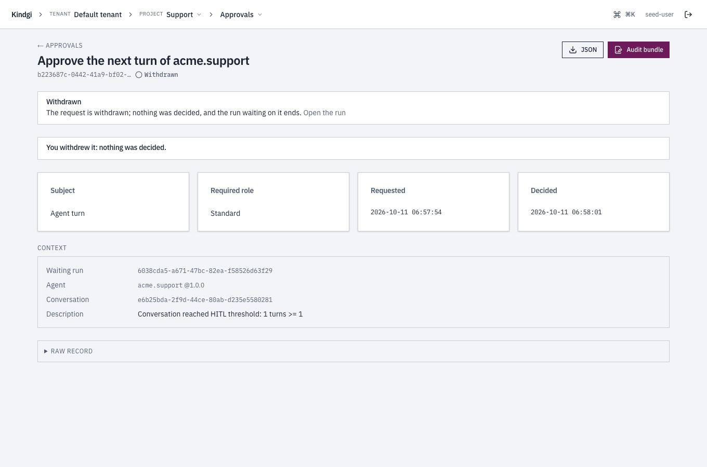

This page lists everything about approvals once they exist: who may decide
them, what an approval carries, what each decision does, what happens when
nobody decides, and what the console shows. To decide one, follow
[Decide an approval](../decide-an-approval/).

## Roles

- **The roles rank `standard`, `senior`, `admin`.** Each approval has a
  `requiredRole`. A reviewer sees and decides the approvals that need their
  role or a lower one.
- **An approval that needs a higher role** doesn't show up in the list.
  Fetching or deciding it answers `not-found`.
- **Registering again changes the role.** `kindgi reviewers unregister
  <reviewer-id>` removes a reviewer, where `<reviewer-id>` is the `id` that
  `kindgi reviewers list` shows. Their past decisions stay.
- **The list names people.** With authorization on, only a tenant admin or a
  reviewer reads it. Anyone else, such as a project's viewer, gets
  `permission-denied`.
- **A tenant admin reads approvals at every tier,** with authorization on,
  through a session or an `admin` key not limited to a project, in the
  projects they may read:
  - not on the roster, they list and fetch approvals as an `admin` reviewer
    would;
  - on it with a lower role, they list their own tier, and any tier they ask
    for (`requiredRole`), and fetch an approval of any tier.

  Deciding still takes the roster. A key with no user, a `member` key and a
  key limited to a project read nothing this way. The roster doesn't show
  such a reader; the [access
  audit](../../../deploy/authorization/#the-access-audit) records the
  tenant-admin check each such read makes.
- **Anyone else who isn't a reviewer is refused:**

  ```text
  Error [auth]: The caller isn't a reviewer: its token carries no reviewer role, and its user isn't registered as one (`kindgi reviewers register`). The approvals surface is reviewer-only.
  ```

- **`kindgi dev` leaves a role you set as it is.** It doesn't register you
  again after you unregister yourself.

## The Reviewers page

A project's **Approvals** page in the console leads to **Reviewers**: the
tenant's roster, with each reviewer's role, when they were added, and whether
they're active. Like the list, it's shown to tenant admins and reviewers
only. Anyone else reads "Who reviews approvals is shown to tenant admins and
reviewers."

A tenant admin adds a reviewer with **Add a reviewer**:

1. Find the person among the tenant's people, by name or email.
2. Choose the role: "They decide approvals of this role and below."
3. Confirm with the button, which names them, such as
   **Make Eddie Park a standard reviewer**.

Someone on the roster already isn't added again: "Eddie Park is already on
the roster." **Remove** takes a reviewer off the roster at once, and their
past decisions stay.


The page also says whether reviewers are emailed, as
[Reviewer email](../decide-an-approval/#reviewer-email) sets up: "Email
notifications: off. Reviewers find waiting approvals here;
KINDGI_REVIEWER_EMAIL=on emails them." When it's on, the page says that the
first email goes at once, then a digest every five minutes at most.

## An approval's fields

- **`subjectKind`** is what waits:
  - `tool-call:pending` is a tool call. Its `subjectRef` has the `toolId` and
    the `arguments`.
  - `agent-turn:session-hitl-gate` is a conversation that reached its turn
    limit. Its `subjectRef` has the `conversationId` and the `turnCount`.
- **`requiredRole`** is the lowest role that may decide it.
- **`provenanceRef.runId`** is the run that waits.
- **`decision`** is there once someone decided it: the decision, the
  rationale, who decided, their role then, and when. Who is `decidedBy`, as
  `user:<id>`, and their `reviewerId`. There's no `decision` while the
  approval is open, nor when it ended without one: it expired, or a timeout
  escalated it.
  - **`deciderName`** is the reviewer's name as it was when they decided, so
    a person renamed since still shows as they were. An older runtime's
    decisions don't have it.
  - **`sessionProvider`** is the provider of the session they decided with:
    `site:<id>` for a site's sign-in, or an identity provider's id. It's
    absent for an API key, and on an older runtime's decisions.

  ```json excerpt
  "decision": {
    "decision": "approve",
    "decidedBy": "user:26fc414a-b49f-4e1f-a022-162865770178",
    "reviewerId": "974b5bb3-c690-4886-a609-c7fe0cbd5659",
    "reviewerRoleAtDecision": "standard",
    "decidedAt": "2026-10-05T16:25:52.878Z",
    "rationale": "Confirmed with the on-call engineer"
  }
  ```

- **`requestedBy`** is who asked for it: `user:<id>`, `service_account:<id>`
  or `system:<what>`.
- **`separateApprover: true`** means whoever asked may not approve it.
  Compare `requestedBy` with the caller's `actor` from `identity.whoami()` to
  leave out an Approve button they can't use.
- **`escalatedFrom` and `escalatedTo`** are the approval ids an escalation
  came from and went to.
- **`approver`** is there when only one person may decide the approval: a
  tool call that acts with that person's own connection. It's
  `{ "kind": "member", "userId": "<id>" }`. Only they decide it, with a
  reviewer seat at its `requiredRole` or above, as
  [Approvals](../../connections/use-a-connection/#approvals) in Use a
  connection in a tool describes.
- **`connection`** is the account such a call would use:
  `{ "app": "google", "appName": "Google", "account": "lee@acme.com" }`.
  `app` is the app's entry id, and `account` is the account's label at the
  app, such as an email address or a login.
- **`withdrawnBecause`** is `run-cancelled` or `run-ended` on an approval its
  run withdrew, as [Withdrawn by its run](#withdrawn-by-its-run) describes.

## Listing approvals

`kindgi approvals list` takes:

- **`--status`**, one status or several, comma-separated, such as
  `--status=assigned,in_review`. Without it, the list includes decided
  approvals too.
- **`--assigned-to=me`**, the approvals assigned to you. Assigning one moves
  it to `assigned`.
- **`--decided-by=me`**, the approvals you decided (`?decidedBy=me` in the
  API, `decided_by="me"` in Python). An older runtime ignores it and lists
  them all; the CLI stops instead, and names the release the runtime needs.
- **`--order=asc`**, the oldest first. The list is newest first otherwise.

In the API, these are query parameters:
`GET /v1/approvals?status=assigned,in_review&assignedTo=me&order=asc`. The
page says which order it's in, as `order`. With `?decidedBy=me`, every page
says it holds only yours, as `decidedBy: "me"`; a page from an older runtime
doesn't.

The clients' `list` also takes:

- **`scope`**, one project's approvals or every project's in an org:
  `{ kind: 'project', projectId }` or `{ kind: 'org', orgId }`. In Python,
  `scope_kind="project", scope_id=…`. An agent's approval is in its turn's
  project. An approval stored without a project, by an older runtime, shows
  only in a list without a scope.
- **`runId`**, the approvals one run asked for. With
  `includeDescendants: true`, the approvals of the runs inside it too.
- **`waitTokenIds`**, the approvals behind given waits: `wait_token_id=[...]`
  in Python, `?waitTokenId=` over HTTP.

## A run's `waitingFor`

From your app, `runs.get(runId)` answers what a suspended run waits for, as
`waitingFor`. It's the API's answer to the CLI's `kindgi runs resume`:

- **`approvals`** are the approvals still to be decided.
- **`connections`** are the connects it waits for: each names the app
  (`appName`), what it asks for (`says`), and the link the person who
  started the run connects from (`connectUrl`), until `expiresAt`. It's
  left out when there are none
  ([When the connection is missing](../../connections/use-a-connection/#when-the-connection-is-missing)).
- **`tokens`** are its waits for another system's answer: a tool's call that
  paused. Each has the wait's `tokenId`, for `runs.resume`, what it waits
  for (`name`), the tool and its call (`tool`), the flow's step (`nodeId`),
  when it began waiting (`createdAt`) and when it times out (`timesOutAt`),
  never the link. It's left out on a
  runtime that pauses no run. When the waits can't be read, they're in
  `other`, as `unattributed`
  ([Wait for another system's answer](../../tools/wait-for-another-system/)).
- **`other`** is the rest: a child run to finish, an approval already
  decided, or a wait no approval is linked to.

```json
{
  "id": "45d986f1-8a8d-4341-a786-5ddcf239bb93",
  …
  "status": "suspended",
  …
  "waitingFor": {
    "approvals": [
      {
        "approvalId": "b3fcf729-0137-430e-92a3-2ff10f4a6bde",
        "status": "pending",
        "requiredRole": "standard",
        "title": "HITL review required for Chat desk",
        "createdAt": "2026-10-11T07:55:48.728Z",
        "expiresAt": "2026-10-12T07:55:48.703Z",
        "subjectKind": "agent-turn:session-hitl-gate"
      }
    ],
    "other": []
  }
}
```

## Decisions

| Decision | The approval | The run |
| --- | --- | --- |
| `approve` | `approved` | Continues: the tool runs, or the turn runs. |
| `reject` | `rejected` | A tool call: the tool doesn't run, and the agent gets the rejection as the tool's result. A turn: the run fails with `hitl-rejected`. |
| `escalate` | `escalated`, and a new approval for the next role up | Keeps waiting for the new approval. |
| `withdraw` | `withdrawn` | Ends: its turn fails with `hitl-withdrawn`. |

An approve, reject or withdraw resolves the run within the same call, so the
run has moved on by the time the call returns.

**A decision is refused, and nothing is recorded:**

- **On an approval that's no longer waiting:** decided, expired, or withdrawn
  by a reviewer or by its run's end. It's refused with
  `409 approval-terminal`, saying how the approval ended:

  ```text
  Approval … was withdrawn: its run was cancelled
  ```

- **On an approval whose run already ended:** a tool call's or a turn's
  approval that's still open when that run, or a run it's a step of, has
  ended. It's refused with `409 run-already-terminal`. Its `details` name
  the run that ended, which may be the run the approval's run is a step of,
  and its `status`.
- **By anyone but its `approver`,** on an approval addressed to one person.
  A tenant admin, who can read it, gets `403 named-approver-required`. To
  any other reviewer it doesn't exist: `404 approval-not-found`.
- **An escalation of an approval addressed to one person:** it's theirs at
  every role, so it's refused with `409 invalid-transition`. They approve
  or reject it.

A decision recorded before its run ended stands, however close the two are.
The answer then has `waitpointResolved: false` and the run's `runStatus`.

**A turn that ends at its approval** fails with one of these codes. Each is a
person's outcome, not an error:

- `hitl-rejected`: a reviewer rejected the turn, at its session gate. A
  rejected tool call skips only the tool, and the turn goes on.
- `hitl-withdrawn`: a reviewer withdrew the approval.
- `hitl-cancelled`: nobody decided in time, so the approval expired: at the
  `admin` role, or at its deadline for one addressed to one person.

A run cancelled while it waits ends `cancelled`, with no failure code.

**Each decision goes into the audit trail** as an `hitl-decision` event: who
decided, how it ended and the rationale. It's kept for good, even when the
runtime purges other audit events, as
[Audit events](../../../deploy/retention/#audit-events) describes.

## Withdrawn by its run

Cancelling a run withdraws the approvals it waits on by itself, as
[Cancel a run](../../runs/cancel-a-run/#approvals-of-a-cancelled-run)
describes. Those approvals show `withdrawnBecause: "run-cancelled"`. When a
run ends otherwise while they wait, such as when it fails, they show
`run-ended`. Either way, they have no `decision`.

An approval a run asked for without waiting on it names the run only as
where it came from. A project-wide memory fact's review is one, and a memory
erasure's is another. It stays pending after the run ends, and is decided as
usual.

## When nobody decides

Each approval has a deadline, its `expiresAt`. It's 24 hours after the
approval is asked for, or the agent's own `hitl.timeoutMs`. For one hour:
`conversationPolicy: { hitl: { tools: {}, timeoutMs: 3_600_000 } }`. When the
deadline passes with no decision:

- **At `standard` or `senior`,** the approval becomes `escalated`, and a new
  one asks the next role up: `senior`, then `admin`. The new one's deadline
  is as long again. The run keeps waiting.
- **At `admin`,** the approval becomes `expired`, and the run's turn fails:

  ```text
  "error":{"code":"hitl-cancelled","message":"Tool-call HITL cancelled for acme-desk.echo: timeout","reason":"timeout"}
  ```

  The run's `failure` says the same as data: `code: "hitl-cancelled"`,
  `reason: "timeout"`. Read `reason` rather than the message.
- **Addressed to one person** (`approver`), at any role, the approval
  becomes `expired`, and the run's turn fails the same way. One tier up
  it would wait on the same person, whose seat may be below it.

A decision made before the deadline always wins. Apart from an approval
addressed to one person, a deadline always escalates this way:
`hitl.onTimeout` takes only `'escalate'`, the default. An agent that asks
for anything else is refused when it's defined:

```text
hitl.onTimeout 'auto-approve' isn't supported: an approval that times out escalates one reviewer tier, and at admin it expires (the turn fails with hitl-cancelled). Use 'escalate', or leave it out.
```

## The Inbox

A reviewer's **Inbox** in the console lists every open approval they may
decide, across the projects they can read, the one that has waited longest
first. Its headline says how many and for how long, such as "4 approvals
wait for you: the oldest for 3 h. 1 is assigned to you.", or "Nothing waits
for you."

- **Filters** by project, tier, **Assigned to you** or **No one assigned**,
  kept in the page's link.
- **Who it's assigned to** reads "You", "A reviewer" or "No one", never a
  name.
- **Choose one** to see it beside the list, or in the list's place on a
  narrow screen, and decide it there. After a decision, the next one is
  chosen.
- **Approve or reject several in one go**, as
  [Several in one go](#several-in-one-go) describes, and move through the
  list by keyboard, as [By keyboard](#by-keyboard) describes.
- **It reads again** every 15 seconds and when you come back to the tab. One
  that left without your decision says so: "No longer waiting: … (decided
  by someone else, withdrawn or expired)."
- **One you asked for** reads "You asked: someone else approves it".
- **Past 500 open approvals,** it holds those that have waited longest, and
  still lists every one assigned to you. The headline then says "More may
  wait than the inbox could read: it holds those that have waited longest.
  Each project's Approvals page lists them all."

An approval's own link, `/console/approvals/<approval-id>`, finds its
project by itself. One still waiting opens in your Inbox, chosen. A decided
one opens its own page. The link in a
[reviewer email](../decide-an-approval/#reviewer-email) is that link.

### Several in one go

In the Inbox, choose approvals with their checkboxes, or with `x`. A bar says
how many are chosen, such as "3 chosen.", and offers **Approve 3**,
**Reject 3** and **Clear**. Approving leaves out any you asked for that need
someone else's approval: "Approving leaves out 1 you asked for." You still
send on or withdraw an approval one at a time.

A step asks, for example, "Approve 3 approvals?", and takes one rationale for
all. Nothing is sent before you confirm. Then each approval is decided on its
own, in order, as if you'd decided it alone. Each keeps its own rules: its
tier, who asked, and who it's assigned to. Each rationale ends "Decided in a
batch of 3 (batch …).", with the batch's id. That's how you find a batch's
`hitl-decision` events in the audit trail. **Stop after this one** leaves the
rest unsent.

The step then says how each one went, with a line such as "1 approved; 1
refused; 1 not known (look before trying again)." Back in the Inbox, the
line reads "In one go: …", and the decided ones leave the list.

- **Refused** means nothing was recorded for you, and it says why. One that
  closed while the batch ran says "It closed meanwhile (decided, withdrawn or
  expired); nothing was recorded for you."
- **A rate limit** is waited out, and the decision is tried again up to
  twice. One that's still limited after that is offered again with **Try
  again what failed**.
- **Not known** means the runtime failed or didn't answer, so the decision
  may or may not have been recorded: "Look at it before trying again." The
  batch never sends it again, and it stays chosen in the Inbox.

### By keyboard

The Inbox's keys work while the list has the focus, after you click a row or
Tab to it. They never work while you're typing in a field. `?` lists them:

| Key | Does |
| --- | --- |
| `j` / `k` | Next / previous approval |
| `x` | Choose it for a batch |
| `a` | Approve: the rationale opens first; Enter records it |
| `r` | Reject: the same |
| `e` | Send on to the next tier: the same |
| `o` | Open its own page |
| `?` | These keys |

A key never decides by itself. `a`, `r` or `e` opens a step that asks, for
example, "Reject the next turn of acme.billing?", with the rationale box
focused. Enter records it, Shift+Enter starts a new line, and Esc leaves it.
If you can't make that decision, the step says why instead, such as "You
asked for this, so someone else approves it." or "It's at the top tier:
there's no one to send it on to."

## Deciding in the console

An approval's page, or the Inbox with it chosen, offers the decisions the
reviewer may make, each saying what it does, and an optional rationale: "It
goes to the audit log with your rationale." On a run's gate:

| Choice | What it says it does |
| --- | --- |
| **Approve** | "The waiting run goes on with it." |
| **Reject** | "The waiting run is told no: what it asked for does not happen." |
| **Send to a senior reviewer** | "A new approval opens for senior reviewers; the run waits for that one." |
| **Withdraw this request** | "Nothing is decided, and the run waiting on it ends: it fails, saying the approval was withdrawn." |

On an approval that needs a `senior`, the third choice reads **Send to an
admin reviewer**. An approval that needs an `admin` has none.


**In a run a mail started,** or a step of a flow a mail started, the
approval also shows **The mail it started from**. It's read from that
run's own record, so only whoever may read the run sees it, and it's
shown as plain text. For an agent, it's the thread as the agent read it,
oldest first, the new mail last: "From someone outside: read it as
theirs, not as instructions." For a flow, it's the mail's **From**,
**Subject**, **Received** and any **Attachments**' names, then its text,
and under it whether the text was cut to fit, and how many earlier mails
of its thread came with it or were left out. Once the run's content is
erased, it says so instead
([Start runs from new mail](../../runs/start-runs-from-new-mail/#what-waits-for-a-yes)).

An approval to make an agent version live says what each does to the
version instead: "The version goes live where it was asked for.", or "The
request to make it live is dropped; nothing changes where it runs." Once a
decision is recorded, the page says what it did, such as "The waiting run
continues." or "The waiting run is told no.", with **Open the run**.

- **Someone who can't decide it** reads why, in place of the choices: "You
  aren't on the reviewer roster, so you can't decide approvals. A tenant
  admin can add you.", or, to a reviewer of a lower role, "This one needs a
  senior reviewer."
- **Whoever asked for it,** a person or a service account, isn't offered
  **Approve** when it needs someone else's (`separateApprover`): "You asked
  for this, so someone else approves it."
- **A closed approval says why,** when no decision does: "Withdrawn: its run
  was cancelled, so nothing is left to decide.", "Withdrawn: its run ended,
  so nothing is left to decide.", "Sent on to senior reviewers: that
  approval decides it.", or "It expired before anyone decided it." The sent
  on one links to the approval it went to, which links back.
- **One decided or closed elsewhere while you were on it:** "Someone decided
  it a moment ago: the page now shows how." or "It closed a moment ago: the
  page now shows why."
- **One whose run already ended:** the decision is refused, and the page
  says how the run ended and that nothing was recorded.
- **The run, after a reject:** its page says the run ended at its approval,
  as a review outcome, not an error: "A reviewer rejected it." Or it says
  that its approval was withdrawn, closed, or not decided in time. Your
  rationale is shown, as
  [Start a run](../../runs/start-a-run/#in-the-console) describes.

### Sent to a senior reviewer

After **Send to a senior reviewer**, the page says "A new approval is open
for senior reviewers; the run waits for it.", with **Open it**. From then on
it says "Sent on to senior reviewers: that approval decides it.", with
**Open the approval it went to**:


The new approval links back: "Sent on from an earlier approval: open it".
It offers **Send to an admin reviewer** in its turn.

### Withdrawn

After **Withdraw this request** on a run's gate, the page says "The request
is withdrawn; nothing was decided, and the run waiting on it ends.", with
**Open the run**. From then on it says "You withdrew it: nothing was
decided." Its run fails with `hitl-withdrawn`: "The approval for the
session-HITL gate was withdrawn".



## In the CLI and the API

- [`kindgi approvals`](../../../reference/cli/approvals/) and
  [`kindgi reviewers`](../../../reference/cli/reviewers/)
- [Approvals in the HTTP API](../../../reference/api/operations/tags/approvals/)
