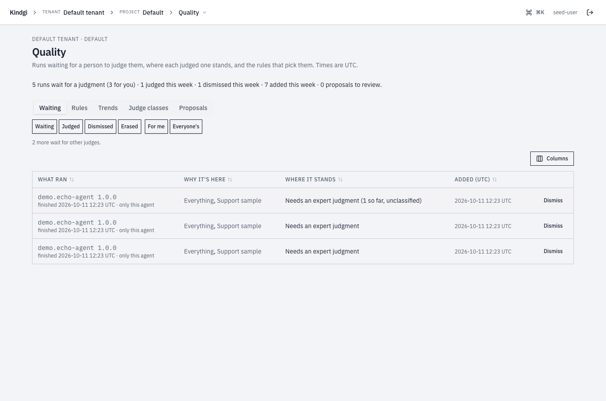
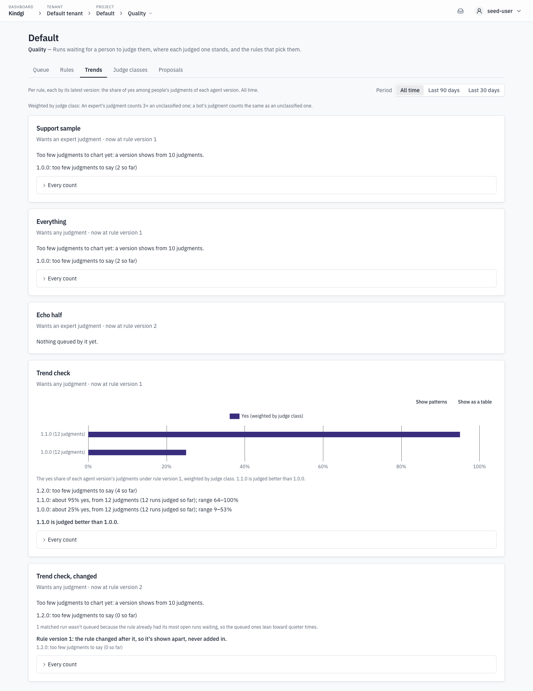
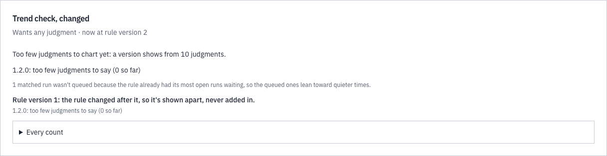

This page lists everything about correcting runs: what a correction holds,
how judge classes weigh it, what judging rules match, what the answers
waiting for a correction hold, how a rule's results count, and what the
console's Quality section shows. To correct a run, follow
[Correct a run's output](../judge-a-runs-output/).

## Corrections

- **`item.key`** is your stable id for the item: `answer` for the whole
  answer, or, for a list, the id of the element, such as a matched case's id.
- **`item.pointer`** (optional) is where the item is in the run's output, as
  a JSON Pointer such as `/matches/2`. Its value is kept with the correction.
- **`item.rank`** (optional) is its place in a ranked list, 0 first.
- **Who corrected it** comes from the token, as `assertedBy`. An app that
  records corrections for its own users adds `participantId`, its own opaque
  id for the user.
- **Correcting the same item again,** as the same caller and participant,
  under any class or none, replaces the earlier correction. The earlier one
  stays in the history. So each person has one verdict per item, and its
  class only says how much it counts.
- **A correction keeps copies** of the run's input and output, so it outlives
  the run's own retention.
- **Correcting a run takes write access** to its project, as cancelling it does.
- **What it should have done** (runtime 0.2.0 or later): a correction of
  an agent's run can say it, in `correction: { calls, notCalled }`. Each of
  `calls` is `{ tool, args }`, and each of `notCalled` is a tool id. Both
  lists are required, and one of them can be empty. It's about the whole
  run, so it's recorded under the item `kindgi:correction`, with `pointer`
  `""` or none. Its verdict says whether the run's decisions were right,
  `yes` or `no`, and its reason is optional, as for any correction.
- **How it's checked,** on a replay: only the tools it names are compared.
  Each tool in `calls` must be called as many times as it's listed, each
  call matching one listed call, in any order. A listed call's `args` match
  when each field given equals the call's top-level argument of that name,
  compared whole, and `{}` matches any arguments. A tool in `notCalled`
  must not be called. A call the replay refused still counts as called.
- **Its limits:** up to 50 `calls` and 50 `notCalled`, tool ids up to 200
  characters, and each `args` up to 100 fields and 4,000 characters of JSON.

Only a finished run can be corrected, and the pointer must find something:

```text
Run "fc26b436-611b-4962-9913-2f2669ade7e1" has no output to judge yet (status suspended).
Nothing at "/no/such" in run "bc6d1b53-3562-48c9-9f29-719779e3d110"'s output.
```

When what it should have done breaks a rule, the correction is refused with
`400 bad-input`, such as:

```text
correction needs at least one of calls or notCalled.
each correction call needs an args object ({} asks only that the tool was called).
"acme-store.refund" can't be in both correction.calls and correction.notCalled.
a correction is recorded under the item "kindgi:correction", not "answer".
the item "kindgi:correction" is reserved for corrections; judge an item of the output instead.
The judged version has no tool "acme-store.refunds".
```

## Judge classes

- **A class weighs its corrections:** `--weight=3` counts each three times.
  Without a class, a correction counts once.
- **A class applies** to the tenant, a project, or an agent in a project.
- **A restriction says who may correct as the class:**
  - `--min-reviewer-role`: `standard`, `senior` or `admin`, a reviewer of
    that role or above;
  - `--principal-kind`: `user` for people, or `service` for service tokens;
  - `--principal-id`: named users or tokens, by id.

  The last two repeat. A caller must meet each one you set. In the API and
  the clients, it's `assertableBy`.
- **Whom a class names is for the admins of its scope.** Anyone else who
  reads the class gets how many it names, as `principalCount`, not their
  ids.
- **A correction made under a restriction carries `"restricted": true`,**
  in `kindgi judgments list` too. It's decided when the correction is made:
  corrections recorded before the restriction don't count as restricted.
- **Lifting a restriction,** with
  `kindgi judge-classes set <judge-class-id> --unrestricted`, keeps the
  earlier corrections restricted. New ones aren't.
- **`kindgi judge-classes set` with restriction flags replaces the whole
  restriction.**

Test cases count restricted corrections apart, and a run on the test cases
can count only them, as
[Try a version on the test cases](../compare-an-agent-version/#count-only-experts-corrections)
shows.

## Judging rules

What a rule matches, in `when`, each field narrowing it:

- **`agentIds`** or **`flowIds`**: runs of these agents or flows, one or the
  other, not both. A rule naming an agent matches the agent's own runs, not
  its turns as a step of a flow.
- **`versions`**: these versions exactly, or `live`: runs that ran the
  agent's live version rather than one the caller named. So the rule follows
  each release.
- **`status`**: how the run ended. Only `completed`, since only a completed
  run can be corrected. It's also the default.
- **`includeDryRuns`**: dry runs are left out unless this is `true`. The
  runs that a run on the test cases makes are never queued.

How much of it to queue:

- **`sample`**: the share of matching runs, `0.05` for 5%. The same run and
  rule always give the same answer, across the rule's versions too. So
  raising it later keeps the runs it took before, and adds more.
- **`maxOpen`**: the rule adds nothing while this many of its runs wait, and
  starts again as they're corrected.
- **`judgeClassId`**: whose correction the rule wants, a
  [judge class](#judge-classes). Without it, any correction does.

A rule applies to runs that end after it's made. To try one before you make
it, `judgingRules.preview` takes the same fields. It answers how many of the
project's last 100 runs it would have queued, with its `sample` but not its
`maxOpen`. `last` sets how many runs, up to 500. Give an existing rule's
`ruleId` to sample as it does. Without one, the count is an estimate. A run
that doesn't record how its version was chosen never matches `live`.

To catch a rule up on runs that ended before it was made,
`judgingRules.queueRecent` queues its matches among the project's recent
runs: the `last` of them (up to 1,000, newest first), those completed at or
after `since`, or, with both, the `last` of those completed at or after
`since`. It samples as the rule samples, so it picks the runs the rule
itself would have. It doesn't apply `maxOpen`: a catch-up can leave more
than `maxOpen` of the rule's runs waiting, and the rule then adds nothing at
run end until fewer wait. The answer counts the matches three ways, which
together are all of them:

- **`queued`**: queued for the rule by this call, as a new item or added to one that's already waiting for another rule.
- **`alreadyQueued`**: the rule had queued them already, and they're still waiting.
- **`alreadyReviewed`**: their run was already corrected or dismissed, so
  they're left as they are.

An erased run isn't a match, so it's in none of the three.

A rule only lists runs: it never runs a model or spends anything.

### Change a rule

- **`judgingRules.update`** writes a new version of the rule. Runs queued
  from then on count toward the new version. `null` removes `maxOpen` or
  `judgeClassId`.
- **`judgingRules.versions`** lists every version, newest first, with who
  wrote each and when.
- **`judgingRules.unregister`** stops a rule. It queues nothing more. Its
  versions and the runs it queued stay.

## Answers waiting for a correction

`judgingQueue.list` gives the queue of answers waiting for a correction,
oldest first.

- **Each item** is a run: its agent or flow and version, how it ended, the
  rules that queued it, each at the version that did, the judge classes they
  want, and the corrections on it so far, by class. It carries none of the
  run's content: open the run to correct it.
- **`forMe: true`** keeps the items you can close: those that want a class
  you may correct as, or any correction.
- **An item closes** as `judged` once each rule that queued it has the
  correction it wants: one of its class, or any correction for a rule
  without a class.
- **`judgingQueue.dismiss`,** with an optional reason, takes a run not worth
  correcting out of the queue. `judgingQueue.reopen` puts it back. Each item's
  `can` says whether you may.
- **Counts:** `limit: 0` answers only the `total`. With `state`,
  `addedAfter` and `closedAfter`, it counts, for example, how many are
  waiting and how many were corrected this week.
- **When a run's content is gone,** erased or purged by
  [retention](../../../deploy/retention/), its waiting item closes as
  `erased` and shows nothing of the run.

Reading the rules and the queue takes read access to the project. Changing a
rule, queueing its recent matches, and dismissing or reopening an item, take
write access, as correcting a run does.

## A rule's results

`judgingRules.results` gives a group for each version of the rule and each
agent version:

- **The runs it queued:** `added`, and of them `open`, `judged`,
  `dismissed` and `erased`.
- **The corrections on them,** with their weighted share marked right, and
  the corrections by class.
- **The share marked right is per correction:** one person's verdict on one
  item of a run's output.
- **`runsWithJudgments`** counts the runs those corrections come from: the
  queued runs with at least one live correction, whatever their item's state
  now. That's still open, closed as `judged`, or dismissed after someone
  corrected it. `judgments` counts verdicts, so several people correcting one
  run make several corrections but one run here. To see how much a share
  rests on, count runs, not corrections.
- **`skippedByCap`** counts the runs the rule matched and sampled but didn't
  queue because `maxOpen` were waiting, even when another rule queued them.
  So `added` + `skippedByCap` is every run it matched and sampled. When it
  isn't 0, the queued runs lean toward quiet times.
- **Never pooled:** each version of each rule is a sample of its own `when`,
  so its results are never added to another's.

Here a rule that wants an expert's correction queued four runs. An expert,
with weight 3, and a peer corrected the first. A peer marked the second
`no`, and it's still open. A peer corrected the third, which was then
dismissed. The fourth was never corrected. So `judgments` is 4,
`runsWithJudgments` 3, and `yesShare` 0.83: 5 of 6 weighted verdicts.

```json
{
  "ruleId": "fd7a1785-717b-404e-bcdc-3b819806d784",
  "groups": [
    {
      "ruleVersion": 1,
      "agentVersion": "1.0.0",
      "added": 4,
      "open": 2,
      "judged": 1,
      "dismissed": 1,
      "erased": 0,
      "skippedByCap": 0,
      "judgments": 4,
      "runsWithJudgments": 3,
      "yesShare": 0.8333333333333334,
      "byClass": [
        {
          "judgeClassId": "2da17046-eb37-4157-b175-3381a926545a",
          "judgments": 3,
          "yes": 2
        },
        {
          "judgeClassId": "787b6f6f-30cf-4bac-bf27-ac5ef32cb6d3",
          "judgments": 1,
          "yes": 1
        }
      ]
    }
  ]
}
```

## In the console

A project's **Quality** section is the answers waiting for a correction and
the judging rules in the console. Its header says what it holds: "Answers
waiting for a correction, where each corrected one stands, and the judging
rules that pick them." The section has five tabs: **To correct**, **Rules**, **Trends**,
**Judge classes** and **Suggested changes**. Their tables sort by a
column's header, and **Columns** chooses which columns each shows. The tab,
the filters and each table's view go in the page's address, such as
`?tab=rules`, so a link opens the same view.

### To correct



Each row is a run in the queue:

- **What ran:** the agent or flow and its version, and when it finished. It
  links the run's **Corrections** tab, where you correct it, as
  [Correct an item](../judge-a-runs-output/#correct-an-item) shows.
- **Why it's here:** the rules that queued it.
- **Where it stands:** what it still needs, such as "Needs an expert
  correction (1 so far, unclassified)", or how a closed one ended.

Filter it by state, **Waiting**, **Corrected**, **Dismissed** or **Erased**. Or
by **For me** or **Everyone's** ("2 more wait for other judges."), by rule
and by agent. **Dismiss** takes a run out of the queue with a reason, and
**Reopen** puts a dismissed one back.


### Rules


Each rule is in words:

- **Which runs:** "Completed runs of Dev-Echo Agent", and how many it takes:
  "Takes every matching run", or "Takes 1 in 10".
- **What it wants:** "An expert correction", "Any correction" or "A bot
  correction".
- **Its cap:** "No cap", or no new items while that many are open.
- **What it has open now:** for example "3 open", linking **To correct**, filtered to the rule.

A rule matches an agent's or a flow's own runs, not an agent's turns as a
flow's step. Replays never match.

Project editors see **New rule**, and **Change** on each rule. The editor
shows what the rule would have queued from the recent runs, and saving makes
a new version of the rule. **History** lists what each version changed, who
changed it and when. **Remove** stops a rule, and the runs it queued stay
in the queue.


### Trends



**Trends** shows, per rule and by its latest version, the share marked
right among people's corrections of each agent version, over all time or the
last 90 or 30 days. These are [a rule's results](#a-rules-results):

- **A version shows from 10 corrections.** With fewer, it says so: "1.0.0:
  too few corrections to say (2 so far)".
- **Each line names its corrections and its range:** "1.1.0: about 95%
  marked right, from 12 corrections (12 runs corrected so far); range
  64–100%".
- **A comparison only when the ranges are apart:** "1.1.0 is marked right
  more often than 1.0.0."
- **The weights, in words:** "Weighted by judge class: An expert's
  correction counts 3× an unclassified one; a bot's correction counts the
  same as an unclassified one."
- **What the numbers leave out:** an earlier version of the rule is "shown
  apart, never added in". Runs the cap kept out are counted: "1 matched run
  wasn't queued because the rule already had its most open runs waiting, so
  the queued ones lean toward quieter times."

**Every count** opens the counts behind a rule's trend.



### Judge classes


Each [judge class](#judge-classes) that applies to the project's runs, in
words:

- how much it counts, such as "Counts 3× an unclassified one";
- where it applies, such as "This project";
- who may give it, such as "Only people" or "Only services". Who may give a
  restricted class is counted here, never listed;
- the rules that want it.

Below the list, the tab says what makes an expert: "Corrections in a
restricted class are the experts' corrections: "Count only experts" counts
only those."

Project admins add, change and remove a project's classes, and tenant admins
a tenant's. Removing a class names the rules that want it.


### Suggested changes


The project's agents' [suggested changes](../improve-an-agent/), grouped by
what they wait for: **To review**, **Waiting for a reviewer**, **Being
evaluated**, **Need a look** and **Closed**. Each says where it stands, such
as "Not better on the test cases", with the share marked right it was
evaluated on. Each links its page: "Each suggested change's page holds its
actions: evaluate, ask to make it live, roll back, withdraw."
