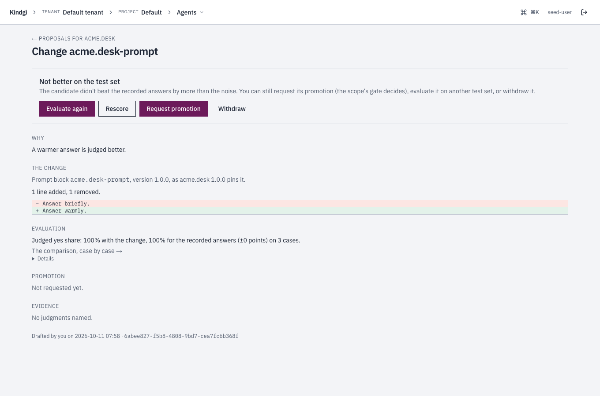

A **proposal** is new content for one data block an agent version pins (new
settings values, or a new prompt template), for one live scope. You draft
it; Kindgi publishes the block version, makes the agent version that runs
it, compares it on a test set, and promotes it through the scope's gate when
you ask. Nothing serves any scope until then, and a promoted proposal can be
rolled back.

Before you start, you need:

- **an agent that keeps its prompt or settings as data blocks**
  ([Change a prompt or a setting without a deploy](../change-a-prompt-or-setting/));
- **a judged test set** for it ([Build a test set from judgments](../build-a-test-set/));
- **a live version of the agent for the whole tenant**
  (`kindgi agents promote <agent-id> <version> --tenant`,
  [Make a version live](../release-an-agent-version/#make-a-version-live)).
  Without one, the version a proposal makes would serve every scope nothing
  is pinned for, so evaluating is refused with `409 proposal-needs-pin`;
- **a deployed runtime.** Under `kindgi dev`, the pack is the source of
  agents, so evaluating is refused with `registry-read-only`.

## Draft one

```sh
kindgi proposals draft --agent=acme.rank.scorer --from-version=1.0.0 --tenant \
  --block=acme.rank.weights --values='{"recency":0.2,"fit":0.8}' \
  --hypothesis="Fit matters more than recency for acme rankings."
```

It prints the proposal, with its `id` and the status `draft`:

```json
{
  "id": "3bca94f1-61a4-48b5-a3d7-f3664e466613",
  "agentId": "acme.rank.scorer",
  "fromVersion": "1.0.0",
  "scope": {
    "kind": "tenant"
  },
  "tier": "settings-block",
  "change": {
    "blockId": "acme.rank.weights",
    "content": {
      "values": {
        "fit": 0.8,
        "recency": 0.2
      }
    },
    "fromVersion": "1.0.0"
  },
  "hypothesis": "Fit matters more than recency for acme rankings.",
  "drafter": {
    "by": "user:62e1ffe2-30f4-4dff-948e-ae774107a7db",
    "kind": "person"
  },
  "status": "draft",
  "createdAt": "2026-10-09T13:24:23.787Z",
  "updatedAt": "2026-10-09T13:24:23.787Z"
}
```

- **What it changes:** `--block` names a block the version pins. `--values`
  gives a settings block's new values; `--template` gives a prompt block's new
  template. Either takes a file as `@<file>`.
- **For which scope:** `--tenant`, `--org=<org-id>`, or
  `--project=<project-id>` with `--segment=<key:value>`s for a segment.
- **Why:** `--hypothesis` says what the change should improve. Each
  `--judgment=<judgment-id>` (repeat it) keeps a judgment behind the change as
  evidence.
- **Checked now:** the content is checked as publishing that block version
  would be, and content equal to what the version pins is refused. The same
  change from the same version for the same scope returns the proposal
  drafted before.

Drafting needs `publish` on the agent.

## Evaluate it

```sh
kindgi proposals evaluate <proposal-id> --test-set=acme.rank-prompt-52080 --wait
```

The first evaluation publishes the block version and derives the agent
version that pins it (its `derivedFrom` names the proposal). Neither serves
any scope. The comparison replays the candidate on each case of the test set,
as [Compare a version on a test set](../compare-an-agent-version/) does, and
takes the same options: `--objective`, `--reads`, `--repetitions`, `--k` and
`--class-weights`.

The proposal is `evaluating`, then:

- `evaluated`: the candidate beat the recorded outputs on the objective, by
  more than the noise;
- `not-better`: it didn't;
- `evaluation-failed`: the comparison failed or was cancelled.

`--wait` waits until then (at most 30 minutes) and prints the proposal.
Here the candidate scored the same as the recorded outputs on the test set's
20 cases (`delta` 0), so it's `not-better`:

```json
{
  "id": "3bca94f1-61a4-48b5-a3d7-f3664e466613",
  …
  "status": "not-better",
  "candidate": {
    "pinsDigest": "sha256:3425842179e45dc5a491306e59ba29f7c634a9f8cdf43e6b9af6809f153b3fa7",
    "agentVersion": "1.0.2",
    "blockVersion": "1.0.2"
  },
  "evaluation": {
    "suiteId": "acme.rank-prompt-52080",
    "evalRunId": "aefcafd1-53df-480e-b01d-05ae55724507",
    "objective": "weightedYesShare",
    "startedAt": "2026-10-09T13:24:24.401Z",
    "runStatus": "completed",
    "baseline": 0.3333333333333333,
    "candidate": 0.3333333333333333,
    "delta": 0,
    "cases": 20,
    "better": false
  },
  …
}
```

### Judge the new answers, then rescore

A comparison counts what people have judged. When a change rewrites an
agent's answers, each new answer is an item no one has judged, so nothing on
the candidate's side is counted and the proposal can't be better. Here a
prompt change ("Answer briefly." to "Answer warmly.") rewrote the answer in
each of a test set's three cases. The comparison, the proposal's
`evaluation.evalRunId`, lists them case by case:

```sh
kindgi eval-runs show <eval-run-id>
```

```json
{
  "runId": "941582fc-9e32-41bb-b148-767712664c6b",
  …
  "suiteId": "acme.desk-checks",
  "suiteVersion": "1.0.0",
  "kind": "judged",
  …
  "status": "completed",
  …
  "result": {
    "perCase": [
      {
        …
        "caseId": "46b82ad4-1c2a-45f8-a593-a9c912964fd3",
        "runIds": ["c839338c-cfc1-4bf3-b4e3-c7f24e38a473"],
        "changes": {
          "new": [{ "key": "answer", "pointer": "/appended/1/content" }],
          "kept": [],
          "dropped": [{ "key": "answer" }]
        },
        …
      },
      …
    ],
    "summary": {
      …
      "metrics": {
        "judgedCoverage": { "n": 3, "delta": -1, "weight": 0, "baseline": 1, "baselineN": 3, "candidate": 0, "direction": "higher", "baselineWeight": 3 },
        "weightedYesShare": { "n": 0, "delta": null, "weight": 0, "baseline": 1, "baselineN": 3, "candidate": null, "direction": "higher", "baselineWeight": 3 },
        …
      },
      …
    }
  },
  …
}
```

`runIds` are the comparison's replay runs. Judge each new answer on its
replay run, at the `pointer` the comparison names. A replay's answer is at
`/appended/1/content`, not at a turn's `/response/content`; a pointer
that isn't in the run's output is refused (`400 item-not-found`):

```sh
kindgi judgments add --run=c839338c-cfc1-4bf3-b4e3-c7f24e38a473 --item=answer --pointer=/appended/1/content --yes
```

Then rescore the proposal:

```sh
kindgi proposals evaluate <proposal-id> --rescore --wait
```

A rescore is a new comparison, with the same test set version and settings,
that replays nothing: it scores the same replay runs again, with the
judgments made since, and becomes the proposal's evaluation. Here the three
new answers were judged good, as the old ones were, so the candidate scores
the same as the recorded outputs, and the proposal stays `not-better`.
Equal isn't better: a rescore that finds the candidate better makes it
`evaluated`.

```json
{
  "id": "9c8efe90-f4ac-4ce8-bb6f-5cd5ae7a043c",
  "agentId": "acme.desk",
  "fromVersion": "1.0.0",
  …
  "status": "not-better",
  "candidate": {
    "pinsDigest": "sha256:9ba29a87d32957a58fd798077b733c2a61e455a220e1c28ba4b1a97f10a49926",
    "agentVersion": "1.0.1",
    "blockVersion": "1.0.1"
  },
  "evaluation": {
    "suiteId": "acme.desk-checks",
    "evalRunId": "e6d9ec9a-0341-4d18-a3f3-d8e1289f5dc0",
    "objective": "weightedYesShare",
    "startedAt": "2026-10-11T08:09:47.089Z",
    "runStatus": "completed",
    "baseline": 1,
    "candidate": 1,
    "delta": 0,
    "cases": 3,
    "better": false
  },
  …
}
```

The new comparison says what it rescored, and how much of what it counts
was judged since. `comparison.rescoreOf` names the comparison rescored. Each
metric's `freshWeight` is the weight of those judgments, and per case,
`candidate[].fresh` and `changes.new[].judged`:

```json
"comparison": { "k": 10, "reads": "recorded", "baseline": "recorded", "rescoreOf": "941582fc-9e32-41bb-b148-767712664c6b", "repetitions": 1 },
…
"weightedYesShare": { "n": 3, "delta": 0, "weight": 3, "baseline": 1, "baselineN": 3, "candidate": 1, "direction": "higher", "freshWeight": 3, "baselineWeight": 3 }
```

- **The comparison rescored stays as it was.** A case whose replay run is
  gone since (deleted with its retention, say) keeps the scores it had, with
  `rescored: false`.
- **Rescoring needs `publish` on the agent,** from `evaluated`, `not-better`,
  `refused`, `superseded` or `expired`.
- **A comparison you started yourself,** not through a proposal, rescores
  with `kindgi eval-runs rescore <eval-run-id> --wait`.
- **In the clients:** `proposals.rescore(proposalId)` and
  `evalRuns.rescore(runId)` (`eval_runs.rescore(run_id)` in Python).

#### In the console

The comparison's page says what it couldn't count: "3 new answers this
comparison couldn't count", and "Judge each one below, then rescore: a new
comparison scores the same replays again, counting your judgments. Nothing
runs again, and this comparison stays as it is." Each new answer has its own
card, "New, so no judgment in the test set covers it: judge it here, then
rescore.", with **Yes** and **No**. **Rescore** beside the note counts what you
judged ("3 judged so far.").


The proposal's page, while nothing could be scored, says "None of the
candidate's answers could be scored: they changed, and nobody has judged the
new ones yet. Judge them on the comparison, then rescore.", with a link to the
comparison. Its **Rescore** asks first: "After people judge the comparison's
new answers, a rescore counts them: it scores the same answers on
acme.desk-checks again. Nothing runs again, and the earlier comparison stays as
it is. The proposal's status follows the rescore." After it, the evaluation
reads "Judged yes share: 100% with the change, 100% for the recorded answers
(±0 points) on 3 cases.", and the proposal stays **Not better on the test
set**.



## Request it

```sh
kindgi proposals request <proposal-id> --reason="Live check: promote by hand."
```

This promotes the candidate for the proposal's scope, through the scope's
gate, with the evaluation as its comparison
([Gate a release](../release-an-agent-version/#gate-a-release)). The proposal
is then:

- `promoted`: the candidate is live for the scope;
- `in-review`: the gate passed and a reviewer decides
  (`kindgi approvals complete`); then `promoted`, `rejected`, or `expired`
  if nobody decides in time, or `superseded` if the scope's live version or
  its policy changed meanwhile;
- `refused`: the gate refused it, listing every check.

A request is allowed once the proposal was evaluated, `not-better` included:
the gate decides. The proposal above was `not-better`, and the tenant's gate
let it through:

```json
{
  "id": "3bca94f1-61a4-48b5-a3d7-f3664e466613",
  …
  "status": "promoted",
  …
  "promotion": {
    "id": "47319459-4131-4ef6-85c6-64afe0514900",
    "status": "promoted",
    "liveNow": true
  },
  …
}
```

A proposal a [pass](../improve-an-agent/) wrote, rather than
a person, always waits for a reviewer, even where the scope's policy asks for
no approval. Requesting needs `promote` on the agent.

## Roll it back, or withdraw it

```sh
kindgi proposals rollback <proposal-id> --reason="Live check: put it back."
```

```json
{
  "id": "3bca94f1-61a4-48b5-a3d7-f3664e466613",
  …
  "status": "rolled-back",
  …
  "rolledBack": {
    "at": "2026-10-09T13:24:29.234Z",
    "by": "user:62e1ffe2-30f4-4dff-948e-ae774107a7db",
    "reason": "Live check: put it back.",
    "promotionId": "d19efc3c-d08a-44f8-8daa-8e2bdaedc1d8"
  },
  …
}
```

```sh
kindgi proposals withdraw <proposal-id> --reason="Superseded by a better draft"
```

- **`rollback`** puts the scope back on the version that served it before
  (`rolled-back`). The proposal and its versions stay, as history. It needs
  `promote` on the agent.
- **`withdraw`** closes a proposal before review, or after its promotion was
  refused, superseded or expired (`withdrawn`). `--reason` is required. It
  needs `publish` on the agent.

## Find them

```sh
kindgi proposals list --agent=acme.rank.scorer --table
kindgi proposals get <proposal-id>
```

The table has each proposal's agent version, scope, block, status, and the
evaluation's delta. `--status`, `--tier=settings-block|prompt-block` and a
scope flag (for exactly that scope) narrow the list. `get` shows the change,
the candidate versions, the comparison and the promotion. Proposals are
authorized on their agent: `read` to see one.

| Status | What it means |
| --- | --- |
| `draft` | Not evaluated yet. |
| `evaluating` | Its comparison is queued or running. |
| `evaluated` | The candidate beat the recorded outputs. |
| `not-better` | It didn't. |
| `evaluation-failed` | The comparison failed or was cancelled. |
| `in-review` | Requested; the gate passed and an approval is open. |
| `promoted` | Live for its scope. |
| `refused` | Requested; the gate refused it. |
| `rejected` | The reviewer rejected it. |
| `expired` | The approval expired undecided. |
| `superseded` | Approved after the scope's live version or policy changed. |
| `rolled-back` | Rolled back through the proposal. |
| `withdrawn` | Withdrawn. |

From your app, the clients have the same calls: `proposals.create`, `list`,
`get`, `evaluate`, `rescore`, `request`, `rollback` and `withdraw`.
