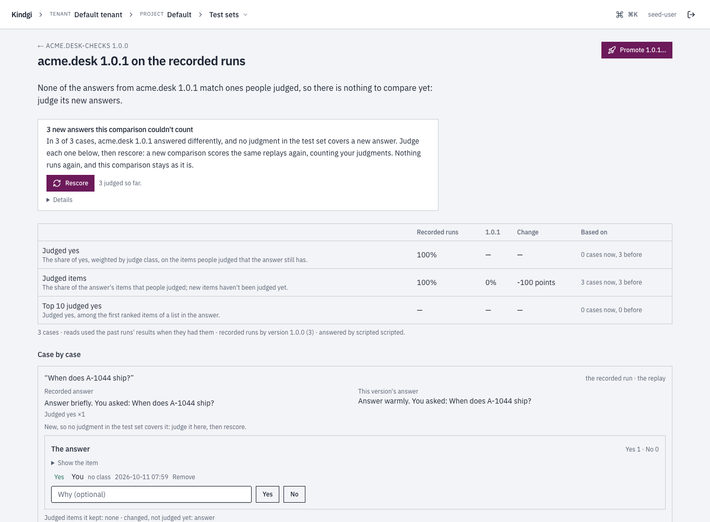

This guide drafts new settings or new instructions for an agent version,
tests it on the test cases, and sends it through the scope's release gate
policy, with a way back.

A **suggested change** is new content for one data block an agent version
pins, for one live scope: new settings values, or new instructions. You draft
it. Kindgi publishes the block version, makes the agent version that runs it,
tries it on the test cases, and makes it live through the scope's release gate
policy when you ask. Nothing serves any scope until then, and a suggested
change made live is a pin like any other, which `kindgi agents rollback` puts back.

## Before you start

- **An agent that keeps its instructions or settings as data blocks,** as
  [Change a prompt or a setting without a deploy](../change-a-prompt-or-setting/)
  shows.
- **Test cases built from corrections** for it, as
  [Build test cases from corrections](../build-a-test-set/) shows.
- **A live version of the agent for the whole tenant,** as
  [Make a version live](../release-an-agent-version/#make-a-version-live)
  shows: `kindgi agents promote <agent-id> <version> --tenant`. Without one,
  the version a suggested change makes would serve every scope nothing is
  pinned for.
  So evaluating is refused with `409 suggested-change-needs-pin`.
- **A runtime: `kindgi dev`, or a deployed one,** with Kindgi 0.2's CLI.
  Under `kindgi dev`, making a suggested change live writes it into the pack's
  files,
  as [Under `kindgi dev`](#under-kindgi-dev) shows.
- **`publish` on the agent** to draft and evaluate, and **`promote`** to ask
  to make it live.

## Draft one

A draft says what to change, for which scope, and why:

```sh
pnpm exec kindgi suggested-changes draft --agent=acme.rank.scorer --from-version=1.0.0 --tenant \
  --block=acme.rank.weights --values='{"recency":0.2,"fit":0.8}' \
  --why="Fit matters more than recency for acme rankings."
```

- **What it changes:** `--agent` and `--from-version` are the agent version.
  `--block` names a block the version pins. `--values` gives a settings
  block's new values, and `--template` the agent's new instructions. Either
  takes a file as `@<file>`.
- **For which scope:** `--tenant`, `--org=<org-id>`, or
  `--project=<project-id>` with `--segment=<key:value>`s for a segment.
- **Why:** `--why` says what the change should improve. Each
  `--correction=<correction-id>` keeps a correction behind the change as evidence.
  Repeat it for several.

It prints the suggested change, with its `id` and the status `draft`:

```json
{
  "id": "3bca94f1-61a4-48b5-a3d7-f3664e466613",
  "agentId": "acme.rank.scorer",
  "fromVersion": "1.0.0",
  "scope": {
    "kind": "tenant"
  },
  "tier": "settings-block",
  "change": {
    "blockId": "acme.rank.weights",
    "content": {
      "values": {
        "fit": 0.8,
        "recency": 0.2
      }
    },
    "fromVersion": "1.0.0"
  },
  "why": "Fit matters more than recency for acme rankings.",
  "madeBy": {
    "by": "user:62e1ffe2-30f4-4dff-948e-ae774107a7db",
    "kind": "person"
  },
  "status": "draft",
  "createdAt": "2026-10-09T13:24:23.787Z",
  "updatedAt": "2026-10-09T13:24:23.787Z"
}
```

The content is checked as publishing that block version would be, and
content equal to what the version pins is refused. The same change from the
same version for the same scope returns the suggested change drafted before.

## Evaluate it

An evaluation tests the change on your test cases before anything serves it:

```sh
pnpm exec kindgi suggested-changes evaluate <suggested-change-id> --test-set=acme.rank-prompt-52080 --wait
```

- `<suggested-change-id>` is the suggested change's `id`.
- `--test-set` names the test cases to try it on, built from corrections.
- `--wait` waits for the result, at most 30 minutes, and prints the
  suggested change.

The first evaluation publishes the block version and derives the agent
version that pins it. Its `derivedFrom` names the suggested change. Neither
serves any scope. The run on the test cases replays the candidate on each
case, as [Try a version on the test cases](../compare-an-agent-version/) does,
and
takes the same options: `--objective`, `--reads`, `--repetitions`, `--k` and
`--group-weights`.

The suggested change is `evaluating`, then:

- `evaluated`: the candidate beat the recorded outputs on the objective by
  more than the spread between the run's repetitions, when `--repetitions` is
  above 1. Or, kept as `cheaper` (its `evaluation.rule`), it was
  no worse than the current version on the same cases and cost less
  ([Let it try a cheaper model or another temperature](../improve-an-agent/#let-it-try-a-cheaper-model-or-another-temperature));
- `not-better`: it didn't;
- `evaluation-failed`: the run on the test cases failed or was cancelled.

Here the candidate scored the same as the recorded outputs on the 20 test
cases, with a `delta` of 0, so it's `not-better`:

```json
{
  "id": "3bca94f1-61a4-48b5-a3d7-f3664e466613",
  …
  "status": "not-better",
  "candidate": {
    "pinsDigest": "sha256:3425842179e45dc5a491306e59ba29f7c634a9f8cdf43e6b9af6809f153b3fa7",
    "agentVersion": "1.0.2",
    "blockVersion": "1.0.2"
  },
  "evaluation": {
    "testSetId": "acme.rank-prompt-52080",
    "testRunId": "aefcafd1-53df-480e-b01d-05ae55724507",
    "objective": "weightedYesShare",
    "startedAt": "2026-10-09T13:24:24.401Z",
    "runStatus": "completed",
    "baseline": 0.3333333333333333,
    "candidate": 0.3333333333333333,
    "delta": 0,
    "cases": 20,
    "better": false
  },
  …
}
```

### Correct the new answers, then rescore

A run on the test cases counts what people have corrected. When a change
rewrites an agent's answers, each new answer is an item no one has corrected.
So nothing on the candidate's side is counted, and the suggested change can't
be better. Here a change to the agent's instructions from "Answer briefly." to
"Answer warmly." rewrote the answer in each of three test cases. The run lists
them case by case:

```sh
pnpm exec kindgi test-runs show <test-run-id>
```

`<test-run-id>` is the suggested change's `evaluation.testRunId`. It prints
the run on the test cases:

```json
{
  "runId": "941582fc-9e32-41bb-b148-767712664c6b",
  …
  "testSetId": "acme.desk-checks",
  "testSetVersion": "1.0.0",
  "kind": "corrections",
  …
  "status": "completed",
  …
  "result": {
    "perCase": [
      {
        …
        "caseId": "46b82ad4-1c2a-45f8-a593-a9c912964fd3",
        "runIds": ["c839338c-cfc1-4bf3-b4e3-c7f24e38a473"],
        "changes": {
          "new": [{ "key": "answer", "pointer": "/appended/1/content" }],
          "kept": [],
          "dropped": [{ "key": "answer" }]
        },
        …
      },
      …
    ],
    "summary": {
      …
      "metrics": {
        "judgedCoverage": { "n": 3, "delta": -1, "weight": 0, "baseline": 1, "baselineN": 3, "candidate": 0, "direction": "higher", "baselineWeight": 3 },
        "weightedYesShare": { "n": 0, "delta": null, "weight": 0, "baseline": 1, "baselineN": 3, "candidate": null, "direction": "higher", "baselineWeight": 3 },
        …
      },
      …
    }
  },
  …
}
```

`runIds` are its replay runs. Correct each new answer as its replay run's
answer. The correction takes no pointer: the answer is wherever the run's
output has it, which for a replay is `/appended/1/content`, the `pointer`
named above, not a turn's `/response/content`:

```sh
pnpm exec kindgi corrections add --run=c839338c-cfc1-4bf3-b4e3-c7f24e38a473 --item=answer --yes
```

It prints the correction as JSON.

Then rescore the suggested change:

```sh
pnpm exec kindgi suggested-changes evaluate <suggested-change-id> --rescore --wait
```

A rescore is a new run on the test cases, with the same version of the test
cases and the same settings, that replays nothing: it scores the same replay
runs again, with the corrections made since, and becomes the suggested
change's evaluation. Here the three new answers were marked right, as the old
ones were, so the candidate scores the same as the recorded outputs, and the
suggested change stays `not-better`.
Equal isn't better: a rescore that finds the candidate better makes it
`evaluated`.

```json
{
  "id": "9c8efe90-f4ac-4ce8-bb6f-5cd5ae7a043c",
  "agentId": "acme.desk",
  "fromVersion": "1.0.0",
  …
  "status": "not-better",
  "candidate": {
    "pinsDigest": "sha256:9ba29a87d32957a58fd798077b733c2a61e455a220e1c28ba4b1a97f10a49926",
    "agentVersion": "1.0.1",
    "blockVersion": "1.0.1"
  },
  "evaluation": {
    "testSetId": "acme.desk-checks",
    "testRunId": "e6d9ec9a-0341-4d18-a3f3-d8e1289f5dc0",
    "objective": "weightedYesShare",
    "startedAt": "2026-10-11T08:09:47.089Z",
    "runStatus": "completed",
    "baseline": 1,
    "candidate": 1,
    "delta": 0,
    "cases": 3,
    "better": false
  },
  …
}
```

The new run says what it rescored, and how much of what it counts was
corrected since. `comparison.rescoreOf` names the run rescored. Each metric's
`freshWeight` is the weight of those corrections, and per case,
`candidate[].fresh` and `changes.new[].corrected`:

```json
"comparison": { "k": 10, "reads": "recorded", "baseline": "recorded", "rescoreOf": "941582fc-9e32-41bb-b148-767712664c6b", "repetitions": 1 },
…
"weightedYesShare": { "n": 3, "delta": 0, "weight": 3, "baseline": 1, "baselineN": 3, "candidate": 1, "direction": "higher", "freshWeight": 3, "baselineWeight": 3 }
```

- **The run rescored stays as it was.** A case whose replay run is
  gone since, such as one deleted with its retention, keeps the scores it
  had, with `rescored: false`.
- **Rescoring needs `publish` on the agent,** from `evaluated`, `not-better`,
  `refused`, `superseded` or `expired`.
- **A run on the test cases you started yourself,** not through a suggested
  change, rescores
  with `kindgi test-runs rescore <test-run-id> --wait`.
- **In the clients:** `suggestedChanges.rescore(suggestedChangeId)` and
  `testRuns.rescore(runId)`, or `test_runs.rescore(run_id)` in Python.

#### In the console

The run's page says what it couldn't count: "3 new answers this run couldn't
count", and "Correct each one below, then rescore: a new run on the test cases
scores the same replays again, counting your corrections. Nothing runs again,
and this run stays as it is." Each new answer has its own card, "New, so no
correction in the test cases covers it: correct it here, then rescore.", with
**Yes** and **No**. **Rescore** beside the note counts what you corrected ("3
corrected so far.").



The suggested change's page, while nothing could be scored, says "None of the
candidate's answers could be scored: they changed, and nobody has corrected the
new ones yet. Correct them on the run, then rescore.", with a link to the run.
Its **Rescore** asks first: "After people correct the run's new answers, a
rescore counts them: it scores the same answers on the acme desk checks test
cases again. Nothing runs again, and the earlier run stays as it is. The
suggested change's status follows the rescore." After it, the evaluation reads
"Share marked right: 100% with the change, 100% for the recorded answers (±0
points) on 3 cases.", and the suggested change stays **Not better on the test
cases**.


## Ask to make it live

A request makes the candidate live for the suggested change's scope, through
the scope's release gate policy, with the evaluation as its run on the test
cases:

```sh
pnpm exec kindgi suggested-changes request <suggested-change-id> --reason="Live check: promote by hand."
```

`--reason` is kept with the request to make it live.
[Gate a release](../release-an-agent-version/#gate-a-release) describes the
release gate policy. The suggested change is then:

- `pinned`: the candidate is live for the scope;
- `in-review`: the release gate policy passed and a reviewer decides, with
  `kindgi approvals complete`. Then it's `pinned` or `rejected`, `expired`
  if nobody decides in time, or `superseded` if the scope's live version or
  its policy changed meanwhile;
- `refused`: the release gate policy refused it, listing every check.

A request is allowed once the suggested change was evaluated, `not-better`
included: the release gate policy decides. This guide's suggested change
stayed `not-better` after its
[rescore](#correct-the-new-answers-then-rescore), and the tenant's release
gate policy let it through:

```json
{
  "id": "3bca94f1-61a4-48b5-a3d7-f3664e466613",
  …
  "status": "pinned",
  …
  "promotion": {
    "id": "47319459-4131-4ef6-85c6-64afe0514900",
    "status": "promoted",
    "liveNow": true
  },
  …
}
```

A suggested change an [Improve run](../improve-an-agent/) wrote, rather than
a person, always waits for a reviewer, even where the scope's policy asks for
no approval. While another active reviewer could approve it, someone other
than whoever asked to make it live must, even where the policy's `approvals`
sets `"separateApprover": false`. Asking to make it live needs `promote` on the
agent.

## Withdraw it

A withdrawal closes a suggested change before review, or after its request
to make it live was refused, superseded or expired:

```sh
pnpm exec kindgi suggested-changes withdraw <suggested-change-id> --reason="Superseded by a better draft"
```

It prints the suggested change, now `withdrawn`. `--reason` is required, and
withdrawing needs `publish` on the agent.

## Under `kindgi dev`

Under `kindgi dev`, the pack's files are what runs, so a suggested change
ends in them:

- **An Improve run, a draft and an evaluation** work as on a deployed runtime,
  for the whole tenant (`--tenant`). The version a suggested change makes is
  kept for its evaluation only: runs go on using the pack's version.
- **Making it live writes it into the pack.** A request, or the approval it
  waits for, writes each data block in the suggested change into the block's
  own file: its new version and content, and the agent's new instructions into
  the block's template file. `kindgi dev` reloads, the next run uses it, and
  the log says so:

  ```text
  ✎ acme.rank.weights 1.0.1 made live: written into blocks/weights.json (was 1.0.0)
  ```

  Commit the change to keep it. A deploy then publishes the block's new
  version, as [Keep them in the pack](../change-a-prompt-or-setting/#keep-them-in-the-pack)
  shows.
- **For the whole tenant only,** since the pack's files serve every scope. An
  Improve run, a draft, an evaluation or a request for a project or a segment is
  refused with `409 registry-read-only`, before anything is made.
- **The suggested change is `pinned`, with `liveNow` false:** nothing is
  pinned.
  The console says it was written into the pack's files.
- **If the block's file changed since the suggested change was made,** so it
  holds another version than the one the suggested change changed (another
  suggested change made live, or your edit at a new version), or the block
  left the pack, the request is refused with `409 promotion-superseded`, naming the file, and an
  approval settles it `superseded`. Draft again from what the pack holds now.
  An edit that kept the file's version is written over, so give a block you
  edit by hand a new version.
- **Rolling back is refused,** and so is unpinning. Undo the change in the
  pack's files, with git:
  `Error [registry-read-only]: Under kindgi dev, a version made live was written into the pack's files: undo it there, with git, and kindgi dev reloads it.`

## Find them

```sh
pnpm exec kindgi suggested-changes list --agent=acme.rank.scorer --table
pnpm exec kindgi suggested-changes get <suggested-change-id>
```

- `--agent` lists one agent's suggested changes, and `--table` prints a
  table: each suggested change's agent version, scope, block, status, and the
  evaluation's delta.
- `--status`, `--tier=settings-block|prompt-block` and a scope flag narrow
  the list. A scope flag keeps exactly that scope.
- `get` shows the change, the candidate versions, the run on the test cases
  and the request to make it live.

Suggested changes are authorized on their agent: `read` to see one.

| Status | What it means |
| --- | --- |
| `draft` | Not evaluated yet. |
| `evaluating` | Its run on the test cases is queued or running. |
| `evaluated` | The candidate beat the recorded outputs. Or, kept as `cheaper`, it was no worse than the current version and cost less. |
| `not-better` | It didn't. |
| `evaluation-failed` | The run on the test cases failed or was cancelled. |
| `in-review` | Asked to make it live; the release gate policy passed and an approval is open. |
| `pinned` | Live for its scope. |
| `refused` | Asked to make it live; the release gate policy refused it. |
| `rejected` | The reviewer rejected it. |
| `expired` | The approval expired undecided. |
| `superseded` | Approved after the scope's live version or policy changed. |
| `rolled-back` | Only on an older suggested change rolled back by its own `rollback`, which is removed. A rollback today goes through the agent's live routes and leaves it `pinned`. |
| `withdrawn` | Withdrawn. |

From your app, the clients have the same calls: `suggestedChanges.create`, `list`,
`get`, `evaluate`, `rescore`, `pin` and `withdraw`.

## Next

- [Improve an agent](../improve-an-agent/)
- [Release an agent version](../release-an-agent-version/)
- [Decide an approval](../../approvals/decide-an-approval/)
