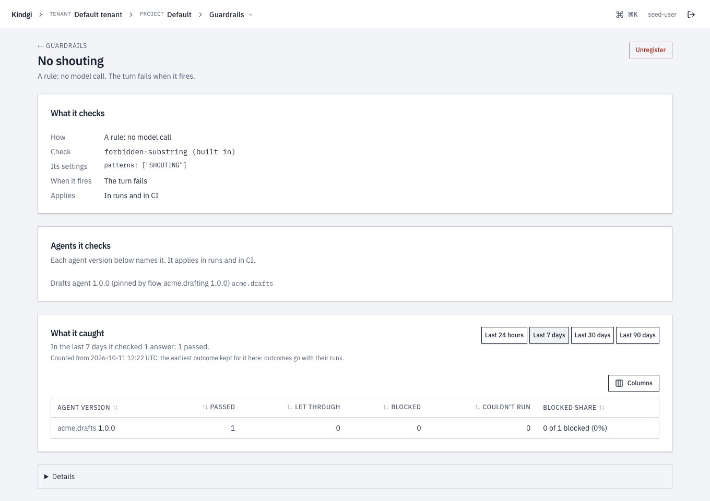
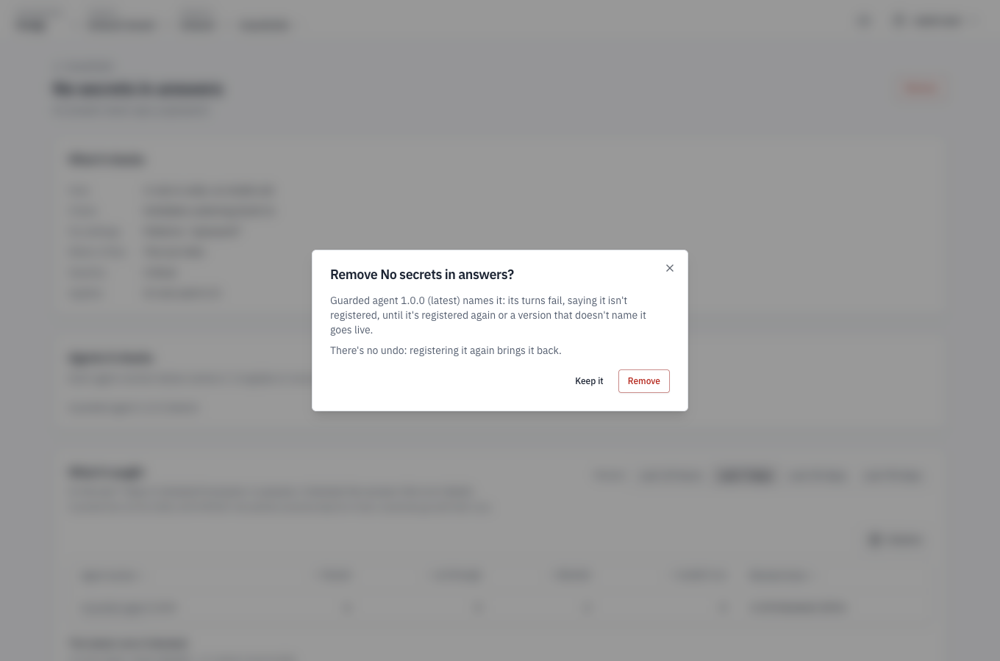

import { Tabs, TabItem } from '@astrojs/starlight/components';

This guide writes a guardrail that keeps an agent's answers short, puts it
on an agent, and tests its check.

## Before you start

- **A pack with an agent,** on a runtime such as `kindgi dev`, with Kindgi
  0.1's CLI. This guide uses the quickstart's pack, `my-pack`, and its
  `my-pack.echo-agent`, from the
  [TypeScript](../../../start/quickstart-typescript/),
  [Python](../../../start/quickstart-python/),
  [Java](../../../start/quickstart-java/) or
  [Scala](../../../start/quickstart-scala/) quickstart.

## The guardrail

The guardrail fails a turn whose answer is longer than a limit. It's one
file in the pack's `guardrails` folder. Ask your coding agent: "I want a
guardrail that keeps my agent's answers short." Kindgi's skills in your pack
tell it how ([How it knows Kindgi](../../../start/coding-agents/)). For
reference, the guardrail looks like this. This guide calls it
`my-pack.answer-length`:

<Tabs syncKey="lang">
<TabItem label="TypeScript">

```ts
// guardrails/answer-length/index.ts
import { defineCheck } from '@kindgi/sdk/define';
import { z } from 'zod';

export const check = defineCheck({
  id: 'my-pack.checks.answer-length',
  kind: 'zero-llm',
  configSchema: z.object({ maxChars: z.number().int().positive().default(500) }),
  evaluate: async (config, trace) => {
    const length = trace.output?.length ?? 0;
    if (length > config.maxChars) {
      return {
        passed: false,
        reason: `The answer is ${length} characters; the limit is ${config.maxChars}.`,
      };
    }
    return { passed: true };
  },
});

export default {
  id: 'my-pack.answer-length',
  name: 'Answer is short',
  kind: 'zero-llm',
  check,
  config: { maxChars: 60 },
  action: { 'on-violation': 'halt' },
  severity: 'error',
};
```

The file has two parts:

- **The check**, from `defineCheck`, exported as `check`. Its `evaluate`
  gets the guardrail's config and the turn's trace, and returns
  `{ passed, reason? }`.
- **The declaration**, the default export: the guardrail's id, the check it
  runs, the check's `config`, and the `action` on a failure.

</TabItem>
<TabItem label="Python">

```python
# guardrails/answer_length.py
from pydantic import BaseModel, Field

from kindgi import CheckResult, RunTrace, guardrail


class Config(BaseModel):
    max_chars: int = Field(500, alias="maxChars", gt=0)


@guardrail(
    id="my-pack.answer-length",
    name="Answer is short",
    on_violation="halt",
    severity="error",
    config={"maxChars": 60},
)
def answer_length(config: Config, trace: RunTrace) -> CheckResult:
    length = len(trace.output or "")
    if length > config.max_chars:
        return CheckResult(
            passed=False,
            reason=f"The answer is {length} characters; the limit is {config.max_chars}.",
        )
    return CheckResult(passed=True)
```

`@guardrail` declares both parts:

- **The check** is the function. It takes `(config, trace)`, and can be a
  `def` or an `async def`.
- **The declaration** is the decorator's arguments.

The first parameter's type is the config's schema.

</TabItem>
<TabItem label="Java">

```java
// src/main/java/mypack/guardrails/AnswerLength.java
package mypack.guardrails;

import com.fasterxml.jackson.annotation.JsonProperty;
import com.kindgi.pack.CheckResult;
import com.kindgi.pack.Guardrail;
import jakarta.validation.constraints.Positive;
import java.util.Map;

public final class AnswerLength {
  public record Config(@JsonProperty(defaultValue = "500") @Positive int maxChars) {}

  public static final Guardrail<Config> GUARDRAIL = Guardrail.define("my-pack.answer-length")
      .name("Answer is short")
      .checkId("my-pack.checks.answer-length")
      .onViolation("halt")
      .severity("error")
      .config(Config.class)
      .set("config", Map.of("maxChars", 60))
      .check((config, trace) -> {
        int length = trace.output() == null ? 0 : trace.output().length();
        if (length > config.maxChars()) {
          return CheckResult.fail(
              "The answer is " + length + " characters; the limit is " + config.maxChars() + ".");
        }
        return CheckResult.pass();
      });

  private AnswerLength() {}
}
```

The class has both parts:

- **The check** is the lambda in `check(...)`. It gets the guardrail's
  config, as a `Config`, and the turn's trace, and returns
  `CheckResult.pass()` or `CheckResult.fail(reason)`.
- **The declaration** is the builder: the guardrail's id, its check's id
  (`checkId`), the config's type (`config(Config.class)`), the config's
  values (`set("config", …)`, keyed as on the wire) and the action on a
  failure.

</TabItem>
<TabItem label="Scala">

```scala
// src/main/scala/mypack/guardrails/AnswerLength.scala
package mypack.guardrails

import com.kindgi.pack.scaladsl._
import jakarta.validation.constraints.Positive

object AnswerLength {
  final case class Config(@Positive maxChars: Int = 500)

  val guardrail: Guardrail[Config] = Guardrail[Config]("my-pack.answer-length")
    .name("Answer is short")
    .checkId("my-pack.checks.answer-length")
    .onViolation("halt")
    .severity("error")
    .set("config", Map("maxChars" -> 60))
    .check { (config, trace) =>
      val length = Option(trace.output).map(_.length).getOrElse(0)
      if (length > config.maxChars)
        CheckResult.fail(s"The answer is $length characters; the limit is ${config.maxChars}.")
      else CheckResult.pass
    }
}
```

`Guardrail[Config]` declares both parts: the function in `check` is the
check, `(config, trace)`, and the builder is the declaration. `Config`, a
case class, is the config's schema, and `set("config", …)` gives its values.

</TabItem>
</Tabs>

- **The id** is `<pack-id>.<name>`. Name the rule as what should hold:
  `answer-length`, `response-not-empty`.
- **`kind: 'zero-llm'`**: the check is your code, a function of the trace. It
  can't call a model. To have a model judge the answer, see
  [Have a model judge](#have-a-model-judge).
- **The reason** is what the violation reports. Say what was wrong. It
  shows wherever the failure does, such as the run's error and its page in
  the console. So describe what you blocked, never quote it: "it contains a
  card number", not the number.
- **The trace** is the turn. `RunTrace` in the
  [Python reference](../../../reference/python/authoring/#runtrace) lists
  its fields. Its names are camelCase in TypeScript and snake_case in
  Python:
  - `output`: the answer it judges: the turn's final answer. When the turn
    has a `retry` guardrail at the final answer, a `halt` or `retry`
    guardrail there judges each answer the model writes;
  - `toolCalls`, or `tool_calls`: its tool calls, each with the tool's name
    and arguments. At the final answer, that's every call the model asked
    for. A TypeScript check can also run at a tool call or a model reply,
    where the trace holds other fields:
    [Check a tool call or a reply](#check-a-tool-call-or-a-reply);
  - the tools' results, its model calls, the user's input and its cost;
  - `projectId`, or `project_id`: the run's project;
  - `orgId`, or `org_id`: the project's org, when it has one.

  The runtime sets the project and org, never the input.

## Put it on an agent

A guardrail checks only the agents that list it. Ask your coding agent: "Put
the answer length guardrail on my agent." For reference, it adds it to the
agent's guardrails:

<Tabs syncKey="lang">
<TabItem label="TypeScript">

```ts excerpt
// in agents/echo-agent/index.ts
guardrails: ['my-pack.response-not-empty' as GuardrailId, 'my-pack.answer-length' as GuardrailId],
```

The agent names the guardrail's id, not the check's.

</TabItem>
<TabItem label="Python">

```python excerpt
# in agents/echo_agent.py
from ..guardrails.answer_length import answer_length
from ..guardrails.response_not_empty import response_not_empty

# …
    guardrails=[response_not_empty, answer_length],
```

</TabItem>
<TabItem label="Java">

```java excerpt
// in src/main/java/mypack/agents/EchoAgent.java
import mypack.guardrails.AnswerLength;

// …
      .guardrail(ResponseNotEmpty.GUARDRAIL)
      .guardrail(AnswerLength.GUARDRAIL)
```

</TabItem>
<TabItem label="Scala">

```scala excerpt
// in src/main/scala/mypack/agents/EchoAgent.scala
import mypack.guardrails.{AnswerLength, ResponseNotEmpty}

// …
    .guardrail(ResponseNotEmpty.guardrail)
    .guardrail(AnswerLength.guardrail)
```

</TabItem>
</Tabs>

Once it's saved, `kindgi dev` registers the guardrail with the rest of the
pack. An agent that names a guardrail that isn't registered doesn't run. Its
turn fails with:

```text
Error [unresolved-guardrail]: Agent "my-pack.gated" references guardrails not in the registry: my-pack.no-such-guardrail
```

## Run it

Start a turn to see the guardrail stop it. `dev-echo`'s answer, its "isn't
a real model" line and the tool's result, is longer than 60 characters, so
the turn stops. `--agent` is the agent, and `--input` its input:

<Tabs syncKey="lang">
<TabItem label="TypeScript">

```sh
pnpm exec kindgi runs start --agent=my-pack.echo-agent --input='{"userMessage":"hi"}'
```

```text
Error [guardrail-violation]: Turn blocked by guardrail 'my-pack.answer-length': The answer is 243 characters; the limit is 60.
```

</TabItem>
<TabItem label="Python">

```sh
uv run kindgi runs start --agent=my-pack.echo-agent --input='{"userMessage":"Ada"}'
```

```text
Error [guardrail-violation]: Turn blocked by guardrail 'my-pack.answer-length': The answer is 252 characters; the limit is 60.
```

</TabItem>
<TabItem label="Java">

```sh
./kindgiw runs start --agent=my-pack.echo-agent --input='{"userMessage":"hi"}'
```

```text
Error [guardrail-violation]: Turn blocked by guardrail 'my-pack.answer-length': The answer is 246 characters; the limit is 60.
```

</TabItem>
<TabItem label="Scala">

```sh
./kindgiw runs start --agent=my-pack.echo-agent --input='{"userMessage":"hi"}'
```

```text
Error [guardrail-violation]: Turn blocked by guardrail 'my-pack.answer-length': The answer is 246 characters; the limit is 60.
```

</TabItem>
</Tabs>

The command exits with status 1. The run's status is `failed`, and it has
no answer.
[Stop a turn or record a violation](../halt-or-record/) shows what the run
records, and how to let the turn finish instead.

A check that throws can't run, and its action decides what happens next:
with `halt`, the turn fails
([When the check can't run](../halt-or-record/#when-the-check-cant-run)).
The error carries the exception's message:
`handler-throw: Check "…" evaluate() threw: …`.
Return `passed: false` for a rule that isn't met. Throw only when the check
itself can't run.

## Check a tool call or a reply

A check can judge a step of the turn before it takes effect, instead of the
final answer: a tool call before it runs, a call's result before the model
sees it, or a model reply before its calls run. The check names the points
it can run at, and each guardrail that runs it picks one of them with `at`
([Where in the turn it runs](../configure-a-guardrail/#where-in-the-turn-it-runs)).

<Tabs syncKey="lang">
<TabItem label="TypeScript">

`defineCheck({ points })` names the points: `'before-tool'`, `'after-tool'`,
`'model-step'` and `'final-answer'`. A check without `points` runs at the
final answer only. This check refuses a refund over a limit, before the
refund tool runs:

```ts
// guardrails/refund-limit/index.ts
import { defineCheck } from '@kindgi/sdk/define';
import { z } from 'zod';

export const check = defineCheck({
  id: 'my-pack.checks.refund-limit',
  kind: 'zero-llm',
  points: ['before-tool'],
  configSchema: z.object({ maxAmount: z.number().positive().default(100) }),
  evaluate: async (config, trace) => {
    const amount = trace.call?.arguments.amount;
    if (typeof amount === 'number' && amount > config.maxAmount) {
      return {
        passed: false,
        reason: `The refund is ${amount}; the limit is ${config.maxAmount}.`,
      };
    }
    return { passed: true };
  },
});

export default {
  id: 'my-pack.refund-limit',
  name: 'Refunds stay under a limit',
  kind: 'zero-llm',
  check,
  config: { maxAmount: 100 },
  at: 'before-tool',
  scope: { tools: ['acme.orders.refund'] },
  action: { 'on-violation': 'halt' },
  severity: 'error',
};
```

At each point, the trace holds what the check judges:

- `trace.at`: the point it runs at. Absent at the final answer.
- `trace.call`, at `'before-tool'` and `'after-tool'`: the call, with its
  `callId`, `toolId`, `toolName`, `toolVersion` and `arguments`.
- `trace.result`, at `'after-tool'`: what the call came to. `{ output }`
  when it returned, or `{ error: { code?, message } }` when it threw.
- `trace.step`, at `'model-step'`: the reply, with its `text` and the
  `toolCalls` it asks for. `text` is empty when the reply only asks for
  calls.

Away from the final answer, the trace has no `output`. Its `toolCalls` and
`toolResults` hold only the calls that ran, never the one the check judges.

`defineCheck` throws `invalid-check-definition` when `points` is empty,
names a point that doesn't exist, or names one twice.

With `halt`, a refund over the limit stops the turn before the call runs:

```text
Error [guardrail-violation]: Turn blocked by guardrail 'my-pack.refund-limit' before calling acme.orders.refund: The refund is 250; the limit is 100.
```

With `retry`, the call doesn't run, and the model gets the reason as its
result, so it can go on without the refund or ask for a smaller one.
[At a tool call or a model reply](../halt-or-record/#at-a-tool-call-or-a-model-reply)
describes each action at each point.

</TabItem>
<TabItem label="Python">

A Python check runs at the final answer only. `@guardrail` has no field for
the points a check runs at, or for a guardrail's `at`, and `RunTrace` has no
`call`, `result` or `step`.

</TabItem>
<TabItem label="Java">

A Java check runs at the final answer only. `Guardrail.define` has no
method for the points a check runs at, or for a guardrail's `at`, and
`RunTrace` has no typed accessor for `call`, `result` or `step`.

</TabItem>
<TabItem label="Scala">

A Scala check runs at the final answer only. `Guardrail[Config](…)` has no
method for the points a check runs at, or for a guardrail's `at`, and
`RunTrace` has no typed accessor for `call`, `result` or `step`.

</TabItem>
</Tabs>

## Test the check

The check is a function of the config and the trace, so a unit test calls it
directly, without a run. Ask your coding agent: "Write tests for my answer
length guardrail." For reference, the tests look like this, with the command
that runs the pack's tests:

<Tabs syncKey="lang">
<TabItem label="TypeScript">

```ts
// guardrails/answer-length/index.test.ts
import type { RunId, TenantId } from '@kindgi/sdk/types';
import { expect, test } from 'vitest';

import { check } from './index.js';

const trace = (output: string) => ({
  runId: 'run-1' as RunId,
  tenantId: 'test-tenant' as TenantId,
  output,
  toolCalls: [],
  toolResults: [],
  modelCalls: [],
  mode: 'runtime' as const,
});

test('passes a short answer', async () => {
  expect(await check.evaluate({ maxChars: 60 }, trace('Shipped.'), {})).toEqual({ passed: true });
});

test('fails a long answer, with a reason', async () => {
  const result = await check.evaluate({ maxChars: 5 }, trace('Shipped yesterday.'), {});
  expect(result.passed).toBe(false);
  expect(result.reason).toBe('The answer is 18 characters; the limit is 5.');
});
```

```sh
pnpm exec kindgi test
```

```text
 ✓ guardrails/answer-length/index.test.ts (2 tests) 2ms
…
      Tests  7 passed (7)
```

</TabItem>
<TabItem label="Python">

```python
# tests/test_answer_length.py
from kindgi import RunTrace
from guardrails.answer_length import Config, answer_length


def test_a_short_answer_passes():
    trace = RunTrace(run_id="r", tenant_id="t", output="Shipped.")
    assert answer_length(Config(maxChars=60), trace).passed


def test_a_long_answer_fails_with_a_reason():
    trace = RunTrace(run_id="r", tenant_id="t", output="Shipped yesterday.")
    result = answer_length(Config(maxChars=5), trace)
    assert not result.passed
    assert result.reason == "The answer is 18 characters; the limit is 5."
```

```sh
uv run pytest
```

```text
........                                                                 [100%]
8 passed in 0.19s
```

</TabItem>
<TabItem label="Java">

```java
// src/test/java/mypack/guardrails/AnswerLengthTest.java
package mypack.guardrails;

import static org.junit.jupiter.api.Assertions.assertEquals;
import static org.junit.jupiter.api.Assertions.assertFalse;
import static org.junit.jupiter.api.Assertions.assertTrue;

import com.kindgi.pack.CheckResult;
import com.kindgi.pack.RunTrace;
import java.util.Map;
import org.junit.jupiter.api.Test;

class AnswerLengthTest {
  private static RunTrace trace(String output) {
    return new RunTrace(Map.of("runId", "run-1", "tenantId", "test-tenant", "output", output));
  }

  @Test
  void passesAShortAnswer() throws Exception {
    assertTrue(AnswerLength.GUARDRAIL.evaluate(new AnswerLength.Config(60), trace("Shipped.")).passed());
  }

  @Test
  void failsALongAnswerWithAReason() throws Exception {
    CheckResult result = AnswerLength.GUARDRAIL.evaluate(new AnswerLength.Config(5), trace("Shipped yesterday."));
    assertFalse(result.passed());
    assertEquals("The answer is 18 characters; the limit is 5.", result.reason());
  }
}
```

```sh
./mvnw test
```

```text
[INFO] Running mypack.guardrails.AnswerLengthTest
[INFO] Tests run: 2, Failures: 0, Errors: 0, Skipped: 0, Time elapsed: 0.444 s -- in mypack.guardrails.AnswerLengthTest
…
[INFO] Tests run: 5, Failures: 0, Errors: 0, Skipped: 0
[INFO]
[INFO] ------------------------------------------------------------------------
[INFO] BUILD SUCCESS
```

</TabItem>
<TabItem label="Scala">

```scala
// src/test/scala/mypack/guardrails/AnswerLengthSuite.scala
package mypack.guardrails

import com.kindgi.pack.RunTrace
import scala.jdk.CollectionConverters._

class AnswerLengthSuite extends munit.FunSuite {
  private def trace(output: String) =
    new RunTrace(Map[String, AnyRef]("runId" -> "run-1", "tenantId" -> "test-tenant", "output" -> output).asJava)

  test("passes a short answer") {
    assert(AnswerLength.guardrail.evaluate(AnswerLength.Config(60), trace("Shipped.")).passed)
  }

  test("fails a long answer, with a reason") {
    val result = AnswerLength.guardrail.evaluate(AnswerLength.Config(5), trace("Shipped yesterday."))
    assert(!result.passed)
    assertEquals(result.reason, "The answer is 18 characters; the limit is 5.")
  }
}
```

```sh
sbt test
```

```text
…
Test run mypack.guardrails.AnswerLengthSuite finished: 0 failed, 0 ignored, 2 total 0.525s
…
[info] Passed: Total 5, Failed 0, Errors 0, Passed 5
```

</TabItem>
</Tabs>

## Have a model judge

A guardrail of kind `llm-judge` has a model judge each answer against a
rubric, in place of a check you write. Use it for a rule that code can't
check, such as tone. Each answer it judges costs a model call. Ask your
coding agent: "I want a guardrail that has a model check my agent's answers
are professional." For reference, it looks like this. This guide calls it
`my-pack.professional-tone`:

<Tabs syncKey="lang">
<TabItem label="TypeScript">

```ts
// guardrails/professional-tone/index.ts
// The runtime judges an llm-judge guardrail with a model; it never calls this check.
export const check = {
  id: 'my-pack.checks.professional-tone',
  evaluate: async () => ({ passed: true }),
};

export default {
  id: 'my-pack.professional-tone',
  name: 'Professional tone',
  kind: 'llm-judge',
  check,
  config: {
    rubric: 'The answer is professional in tone and has no slang.',
    responseFormat: 'pass-fail',
  },
  judgeCapabilities: { needs: [{ feature: 'structured-output' }] },
  action: { 'on-violation': 'log-only' },
  severity: 'warn',
};
```

</TabItem>
<TabItem label="Python">

```python
# guardrails/professional_tone.py
from typing import Any

from kindgi import RunTrace, guardrail


# The runtime judges an llm-judge guardrail with a model; it never calls this check.
@guardrail(
    id="my-pack.professional-tone",
    name="Professional tone",
    check_id="my-pack.checks.professional-tone",
    kind="llm-judge",
    on_violation="log-only",
    severity="warn",
    config={
        "rubric": "The answer is professional in tone and has no slang.",
        "responseFormat": "pass-fail",
    },
    judge_capabilities={"needs": [{"feature": "structured-output"}]},
)
def professional_tone(config: dict[str, Any], trace: RunTrace) -> bool:
    return True
```

</TabItem>
<TabItem label="Java">

```java
// src/main/java/mypack/guardrails/ProfessionalTone.java
package mypack.guardrails;

import com.kindgi.pack.CheckResult;
import com.kindgi.pack.Guardrail;
import java.util.List;
import java.util.Map;

public final class ProfessionalTone {
  // The runtime judges an llm-judge guardrail with a model; it never calls this check.
  public static final Guardrail<Map<String, Object>> GUARDRAIL =
      Guardrail.define("my-pack.professional-tone")
          .name("Professional tone")
          .checkId("my-pack.checks.professional-tone")
          .kind("llm-judge")
          .set("config", Map.of(
              "rubric", "The answer is professional in tone and has no slang.",
              "responseFormat", "pass-fail"))
          .judgeCapabilities(Map.of("needs", List.of(Map.of("feature", "structured-output"))))
          .onViolation("log-only")
          .severity("warn")
          .check((config, trace) -> CheckResult.pass());

  private ProfessionalTone() {}
}
```

</TabItem>
<TabItem label="Scala">

```scala
// src/main/scala/mypack/guardrails/ProfessionalTone.scala
package mypack.guardrails

import com.kindgi.pack.scaladsl._

object ProfessionalTone {
  // The runtime judges an llm-judge guardrail with a model; it never calls this check.
  val guardrail: Guardrail[Map[String, Any]] = Guardrail.json("my-pack.professional-tone")
    .name("Professional tone")
    .checkId("my-pack.checks.professional-tone")
    .kind("llm-judge")
    .set("config", Map(
      "rubric" -> "The answer is professional in tone and has no slang.",
      "responseFormat" -> "pass-fail"))
    .judgeCapabilities(Map("needs" -> List(Map("feature" -> "structured-output"))))
    .onViolation("log-only")
    .severity("warn")
    .check((_, _) => CheckResult.pass)
}
```

</TabItem>
</Tabs>

- **What the judge sees:** the rubric, the turn's final answer, and its
  tool calls with their arguments. It doesn't see the user's message or the
  tools' results, so write a rubric that the answer and the calls are enough
  to judge.
- **`config`** is what it judges by:
  - `rubric`: what should hold.
  - `responseFormat`: `pass-fail`, the default, has the judge answer PASS
    or FAIL, then its reason. `score` has it answer a score from 0 to 1,
    which passes at `threshold` or above: 0.5 unless you set one.
  - `temperature`: the judge's temperature, when you set one.
- **The verdict:** a FAIL, or a score below the threshold, fails the check.
  A reply that starts with neither PASS nor FAIL, or, for a score, whose
  first line doesn't start with a number, fails it too. The action handles
  a failure as it handles any check's
  ([Choose the action](../halt-or-record/#choose-the-action)). The judge's
  reason is the violation's reason, and shows wherever the failure does, so
  the rubric can ask for a reason that doesn't quote the answer.
- **`judgeCapabilities`** (`judge_capabilities=` in Python) is what the
  judge's model must support, such as `structured-output`. The runtime
  picks the judge's model by it, deployed and under `kindgi dev`. When no
  model fits, the check can't run
  ([When the check can't run](../halt-or-record/#when-the-check-cant-run)).
  `kindgi build` and `kindgi dev` refuse an `llm-judge` guardrail without
  it, and name the guardrail:

  ```text
  guardrail my-pack.professional-tone is kind 'llm-judge' with no 'judgeCapabilities': name what its judge model is routed by (for example { needs: [{ feature: 'structured-output' }] })
  ```

  In Python, `@guardrail` refuses it first with a `DefinitionError`, and in
  Java and Scala, `check(...)` throws an `IllegalStateException`, each with
  the same advice.
- **The check** is still declared, because every guardrail names one, but
  the runtime never calls it. So it only passes, and there's nothing of
  yours to unit-test.
- **What it costs:** a model call for each answer it judges. When the turn
  has a `retry` guardrail at the final answer, a `halt` or `retry` guardrail
  there judges each answer the model writes, a call each.
  `budget.maxCostUsd` isn't enforced
  ([How long its check may take](../configure-a-guardrail/#how-long-its-check-may-take)).

## In the console

A project's **Guardrails** page lists its guardrails: "Checks on agents'
answers: what each checks, what happens when an answer breaks it, and the
agents it checks. A run checks an agent only with the guardrails its
version names." Each row has:
- **Guardrail:** its name, with its description under it.
- **Check:** its check, such as "Forbidden substring", over how it checks:
  "A rule in code", "A model judges it, a call per answer" or "Another
  system checks it".
- **If an answer breaks it:** "The turn fails" ("Its answer isn't kept"),
  or "Recorded only" ("The answer goes out"). One that asks for a retry, a
  reviewer or a compensation is recorded only too, and says that part
  doesn't run yet.
- **Agents it checks:** the agents whose versions name it, such as "Guarded
  agent" or "Drafts agent, Guarded agent and 2 more", or "None yet". Under
  them, where it's narrowed: "Not in runs: in CI only", "Only for …" or
  "Only in flows …".

The list has a search box, sorts by a column's header, and **Columns**
chooses which columns it shows.


A guardrail's page has its name and description, and **Remove** for
guardrail admins. Then:
- **What it checks:** **How**, such as "A rule in code, no model call";
  **Check**, such as "forbidden substring (built in)", or "(from a pack)"
  for a pack's own; **Its settings**; **If an answer breaks it**;
  **Severity**; and **Applies**: "In every run", "In every run, not in CI"
  or "Not in runs: in CI only".
- **Agents it checks:** "Each agent version below names it. It applies in
  every run.", then each agent version that names it and can run here,
  marked "(latest)", "(pinned)" or "(pinned and latest)". With none, it
  says "No agent version that can run here names it (each agent’s latest,
  every pinned one, and every one a flow version in use pins), so it checks
  nothing here yet."
- **What it caught:** its outcomes by agent version, as
  [Stop a turn or record a violation](../halt-or-record/#in-the-console)
  shows.
- **Details:** its definition, as the runtime sent it.


A flow step runs the agent version its flow version pins, so that version is
checked too: "Drafts agent 1.0.0 (pinned by flow acme.drafting 1.0.0)".



**Remove** asks first, naming the agent versions whose turns then fail, and
how they come back:

```text
Remove No secrets in answers?
Guarded agent 1.0.0 (latest) names it: its turns fail, saying it isn't registered, until it's registered again or a version that doesn't name it takes over.
There's no undo: registering it again brings it back.
```

- **When several versions name it,** it counts them and lists each: "2 agent
  versions name it: their turns fail, saying it isn't registered, until
  it's registered again or versions that don't name it take over."
- **When a flow pins one of those versions,** it adds: "The flow version
  that pins it fails at that step too: …".
- **When the project's agents or flows can't be read,** it says so: "The
  project's agents or flows couldn't be read, so which versions name it
  isn't known. Any that do fail their turns, and the flow steps that run
  them, until it's registered again."
- **Keep it** closes the dialog with nothing changed.
- **Once it's removed,** the dialog says "Removed. Its definition, to
  register it again:", with the definition, and **Done**.
- **Past 100 agents or flows,** the page and the dialog say which weren't
  checked: "Only the first 100 agents were checked." They say the same of
  the first 100 flows' steps. The list says "Only the first 100 agents were
  checked for which versions name each."
- **Under `kindgi dev`,** Remove is off: "the pack's files are its
  guardrails. Take it out of the pack, and kindgi dev reloads it."



## Next

- [Configure a guardrail](../configure-a-guardrail/)
- [Stop a turn or record a violation](../halt-or-record/)
- [Use a built-in check](../use-a-built-in-check/)
