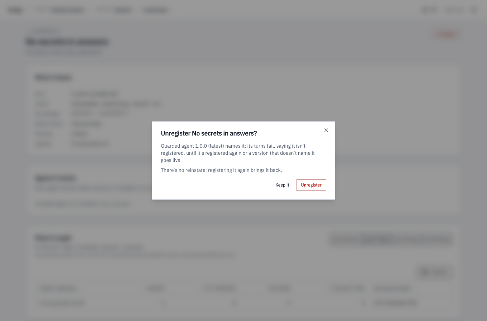

import { Tabs, TabItem } from '@astrojs/starlight/components';

This guide writes a guardrail that keeps an agent's answers short, puts it
on an agent, and tests its check.

## Before you start

- **A pack with an agent,** on a runtime such as `kindgi dev`, with Kindgi
  0.1's CLI. This guide uses the quickstart's pack, `my-pack`, and its
  `my-pack.echo-agent`, from the
  [TypeScript](../../../start/quickstart-typescript/),
  [Python](../../../start/quickstart-python/),
  [Java](../../../start/quickstart-java/) or
  [Scala](../../../start/quickstart-scala/) quickstart.

## The guardrail

The guardrail fails a turn whose answer is longer than a limit. It's one
file in the pack's `guardrails` folder. Ask your coding agent: "I want a
guardrail that keeps my agent's answers short." Kindgi's skills in your pack
tell it how ([How it knows Kindgi](../../../start/coding-agents/)). For
reference, the guardrail looks like this. This guide calls it
`my-pack.answer-length`:

<Tabs syncKey="lang">
<TabItem label="TypeScript">

```ts
// guardrails/answer-length/index.ts
import { defineCheck } from '@kindgi/sdk/define';
import { z } from 'zod';

export const check = defineCheck({
  id: 'my-pack.checks.answer-length',
  kind: 'zero-llm',
  configSchema: z.object({ maxChars: z.number().int().positive().default(500) }),
  evaluate: async (config, trace) => {
    const length = trace.output?.length ?? 0;
    if (length > config.maxChars) {
      return {
        passed: false,
        reason: `The answer is ${length} characters; the limit is ${config.maxChars}.`,
      };
    }
    return { passed: true };
  },
});

export default {
  id: 'my-pack.answer-length',
  name: 'Answer is short',
  kind: 'zero-llm',
  check,
  config: { maxChars: 60 },
  action: { 'on-violation': 'halt' },
  severity: 'error',
};
```

The file has two parts:

- **The check**, from `defineCheck`, exported as `check`. Its `evaluate`
  gets the guardrail's config and the turn's trace, and returns
  `{ passed, reason? }`.
- **The declaration**, the default export: the guardrail's id, the check it
  runs, the check's `config`, and the `action` on a failure.

</TabItem>
<TabItem label="Python">

```python
# guardrails/answer_length.py
from pydantic import BaseModel, Field

from kindgi import CheckResult, RunTrace, guardrail


class Config(BaseModel):
    max_chars: int = Field(500, alias="maxChars", gt=0)


@guardrail(
    id="my-pack.answer-length",
    name="Answer is short",
    on_violation="halt",
    severity="error",
    config={"maxChars": 60},
)
def answer_length(config: Config, trace: RunTrace) -> CheckResult:
    length = len(trace.output or "")
    if length > config.max_chars:
        return CheckResult(
            passed=False,
            reason=f"The answer is {length} characters; the limit is {config.max_chars}.",
        )
    return CheckResult(passed=True)
```

`@guardrail` declares both parts:

- **The check** is the function. It takes `(config, trace)`, and can be a
  `def` or an `async def`.
- **The declaration** is the decorator's arguments.

The first parameter's type is the config's schema.

</TabItem>
<TabItem label="Java">

```java
// src/main/java/mypack/guardrails/AnswerLength.java
package mypack.guardrails;

import com.fasterxml.jackson.annotation.JsonProperty;
import com.kindgi.pack.CheckResult;
import com.kindgi.pack.Guardrail;
import jakarta.validation.constraints.Positive;
import java.util.Map;

public final class AnswerLength {
  public record Config(@JsonProperty(defaultValue = "500") @Positive int maxChars) {}

  public static final Guardrail<Config> GUARDRAIL = Guardrail.define("my-pack.answer-length")
      .name("Answer is short")
      .checkId("my-pack.checks.answer-length")
      .onViolation("halt")
      .severity("error")
      .config(Config.class)
      .set("config", Map.of("maxChars", 60))
      .check((config, trace) -> {
        int length = trace.output() == null ? 0 : trace.output().length();
        if (length > config.maxChars()) {
          return CheckResult.fail(
              "The answer is " + length + " characters; the limit is " + config.maxChars() + ".");
        }
        return CheckResult.pass();
      });

  private AnswerLength() {}
}
```

The class has both parts:

- **The check** is the lambda in `check(...)`. It gets the guardrail's
  config, as a `Config`, and the turn's trace, and returns
  `CheckResult.pass()` or `CheckResult.fail(reason)`.
- **The declaration** is the builder: the guardrail's id, its check's id
  (`checkId`), the config's type (`config(Config.class)`), the config's
  values (`set("config", …)`, keyed as on the wire) and the action on a
  failure.

</TabItem>
<TabItem label="Scala">

```scala
// src/main/scala/mypack/guardrails/AnswerLength.scala
package mypack.guardrails

import com.kindgi.pack.scaladsl._
import jakarta.validation.constraints.Positive

object AnswerLength {
  final case class Config(@Positive maxChars: Int = 500)

  val guardrail: Guardrail[Config] = Guardrail[Config]("my-pack.answer-length")
    .name("Answer is short")
    .checkId("my-pack.checks.answer-length")
    .onViolation("halt")
    .severity("error")
    .set("config", Map("maxChars" -> 60))
    .check { (config, trace) =>
      val length = Option(trace.output).map(_.length).getOrElse(0)
      if (length > config.maxChars)
        CheckResult.fail(s"The answer is $length characters; the limit is ${config.maxChars}.")
      else CheckResult.pass
    }
}
```

`Guardrail[Config]` declares both parts: the function in `check` is the
check, `(config, trace)`, and the builder is the declaration. `Config`, a
case class, is the config's schema, and `set("config", …)` gives its values.

</TabItem>
</Tabs>

- **The id** is `<pack-id>.<name>`. Name the rule as what should hold:
  `answer-length`, `response-not-empty`.
- **`kind: 'zero-llm'`**: the check is your code, a function of the trace. It
  can't call a model.
- **The reason** is what the violation reports. Say what was wrong. It
  shows wherever the failure does, such as the run's error and its page in
  the console. So describe what you blocked, never quote it: "it contains a
  card number", not the number.
- **The trace** is the turn. `RunTrace` in the
  [Python reference](../../../reference/python/authoring/#runtrace) lists
  its fields. Its names are camelCase in TypeScript and snake_case in
  Python:
  - `output`: the turn's final answer;
  - `toolCalls`, or `tool_calls`: its tool calls, each with the tool's name
    and arguments;
  - the tools' results, its model calls, the user's input and its cost;
  - `projectId`, or `project_id`: the run's project;
  - `orgId`, or `org_id`: the project's org, when it has one.

  The runtime sets the project and org, never the input.

## Put it on an agent

A guardrail checks only the agents that list it. Ask your coding agent: "Put
the answer length guardrail on my agent." For reference, it adds it to the
agent's guardrails:

<Tabs syncKey="lang">
<TabItem label="TypeScript">

```ts excerpt
// in agents/echo-agent/index.ts
guardrails: ['my-pack.response-not-empty' as GuardrailId, 'my-pack.answer-length' as GuardrailId],
```

The agent names the guardrail's id, not the check's.

</TabItem>
<TabItem label="Python">

```python excerpt
# in agents/echo_agent.py
from ..guardrails.answer_length import answer_length
from ..guardrails.response_not_empty import response_not_empty

# …
    guardrails=[response_not_empty, answer_length],
```

</TabItem>
<TabItem label="Java">

```java excerpt
// in src/main/java/mypack/agents/EchoAgent.java
import mypack.guardrails.AnswerLength;

// …
      .guardrail(ResponseNotEmpty.GUARDRAIL)
      .guardrail(AnswerLength.GUARDRAIL)
```

</TabItem>
<TabItem label="Scala">

```scala excerpt
// in src/main/scala/mypack/agents/EchoAgent.scala
import mypack.guardrails.{AnswerLength, ResponseNotEmpty}

// …
    .guardrail(ResponseNotEmpty.guardrail)
    .guardrail(AnswerLength.guardrail)
```

</TabItem>
</Tabs>

Once it's saved, `kindgi dev` registers the guardrail with the rest of the
pack. An agent that names a guardrail that isn't registered doesn't run. Its
turn fails with:

```text
Error [unresolved-guardrail]: Agent "my-pack.gated" references guardrails not in the registry: my-pack.no-such-guardrail
```

## Run it

Start a turn to see the guardrail stop it. `dev-echo`'s answer, its "isn't
a real model" line and the tool's result, is longer than 60 characters, so
the turn stops. `--agent` is the agent, and `--input` its input:

<Tabs syncKey="lang">
<TabItem label="TypeScript">

```sh
pnpm exec kindgi runs start --agent=my-pack.echo-agent --input='{"userMessage":"hi"}'
```

```text
Error [guardrail-violation]: Turn blocked by guardrail 'my-pack.answer-length': The answer is 243 characters; the limit is 60.
```

</TabItem>
<TabItem label="Python">

```sh
uv run kindgi runs start --agent=my-pack.echo-agent --input='{"userMessage":"Ada"}'
```

```text
Error [guardrail-violation]: Turn blocked by guardrail 'my-pack.answer-length': The answer is 252 characters; the limit is 60.
```

</TabItem>
<TabItem label="Java">

```sh
./kindgiw runs start --agent=my-pack.echo-agent --input='{"userMessage":"hi"}'
```

```text
Error [guardrail-violation]: Turn blocked by guardrail 'my-pack.answer-length': The answer is 246 characters; the limit is 60.
```

</TabItem>
<TabItem label="Scala">

```sh
./kindgiw runs start --agent=my-pack.echo-agent --input='{"userMessage":"hi"}'
```

```text
Error [guardrail-violation]: Turn blocked by guardrail 'my-pack.answer-length': The answer is 246 characters; the limit is 60.
```

</TabItem>
</Tabs>

The command exits with status 1. The run's status is `failed`, and it has
no answer.
[Stop a turn or record a violation](../halt-or-record/) shows what the run
records, and how to let the turn finish instead.

A check that throws fails the turn whatever its action. The error carries
the exception's message: `handler-throw: Check "…" evaluate() threw: …`.
Return `passed: false` for a rule that isn't met. Throw only when the check
itself can't run.

## Test the check

The check is a function of the config and the trace, so a unit test calls it
directly, without a run. Ask your coding agent: "Write tests for my answer
length guardrail." For reference, the tests look like this, with the command
that runs the pack's tests:

<Tabs syncKey="lang">
<TabItem label="TypeScript">

```ts
// guardrails/answer-length/index.test.ts
import type { RunId, TenantId } from '@kindgi/sdk/types';
import { expect, test } from 'vitest';

import { check } from './index.js';

const trace = (output: string) => ({
  runId: 'run-1' as RunId,
  tenantId: 'test-tenant' as TenantId,
  output,
  toolCalls: [],
  toolResults: [],
  modelCalls: [],
  mode: 'runtime' as const,
});

test('passes a short answer', async () => {
  expect(await check.evaluate({ maxChars: 60 }, trace('Shipped.'), {})).toEqual({ passed: true });
});

test('fails a long answer, with a reason', async () => {
  const result = await check.evaluate({ maxChars: 5 }, trace('Shipped yesterday.'), {});
  expect(result.passed).toBe(false);
  expect(result.reason).toBe('The answer is 18 characters; the limit is 5.');
});
```

```sh
pnpm exec kindgi test
```

```text
 ✓ guardrails/answer-length/index.test.ts (2 tests) 2ms
…
      Tests  7 passed (7)
```

</TabItem>
<TabItem label="Python">

```python
# tests/test_answer_length.py
from kindgi import RunTrace
from guardrails.answer_length import Config, answer_length


def test_a_short_answer_passes():
    trace = RunTrace(run_id="r", tenant_id="t", output="Shipped.")
    assert answer_length(Config(maxChars=60), trace).passed


def test_a_long_answer_fails_with_a_reason():
    trace = RunTrace(run_id="r", tenant_id="t", output="Shipped yesterday.")
    result = answer_length(Config(maxChars=5), trace)
    assert not result.passed
    assert result.reason == "The answer is 18 characters; the limit is 5."
```

```sh
uv run pytest
```

```text
........                                                                 [100%]
8 passed in 0.19s
```

</TabItem>
<TabItem label="Java">

```java
// src/test/java/mypack/guardrails/AnswerLengthTest.java
package mypack.guardrails;

import static org.junit.jupiter.api.Assertions.assertEquals;
import static org.junit.jupiter.api.Assertions.assertFalse;
import static org.junit.jupiter.api.Assertions.assertTrue;

import com.kindgi.pack.CheckResult;
import com.kindgi.pack.RunTrace;
import java.util.Map;
import org.junit.jupiter.api.Test;

class AnswerLengthTest {
  private static RunTrace trace(String output) {
    return new RunTrace(Map.of("runId", "run-1", "tenantId", "test-tenant", "output", output));
  }

  @Test
  void passesAShortAnswer() throws Exception {
    assertTrue(AnswerLength.GUARDRAIL.evaluate(new AnswerLength.Config(60), trace("Shipped.")).passed());
  }

  @Test
  void failsALongAnswerWithAReason() throws Exception {
    CheckResult result = AnswerLength.GUARDRAIL.evaluate(new AnswerLength.Config(5), trace("Shipped yesterday."));
    assertFalse(result.passed());
    assertEquals("The answer is 18 characters; the limit is 5.", result.reason());
  }
}
```

```sh
./mvnw test
```

```text
[INFO] Running mypack.guardrails.AnswerLengthTest
[INFO] Tests run: 2, Failures: 0, Errors: 0, Skipped: 0, Time elapsed: 0.444 s -- in mypack.guardrails.AnswerLengthTest
…
[INFO] Tests run: 5, Failures: 0, Errors: 0, Skipped: 0
[INFO]
[INFO] ------------------------------------------------------------------------
[INFO] BUILD SUCCESS
```

</TabItem>
<TabItem label="Scala">

```scala
// src/test/scala/mypack/guardrails/AnswerLengthSuite.scala
package mypack.guardrails

import com.kindgi.pack.RunTrace
import scala.jdk.CollectionConverters._

class AnswerLengthSuite extends munit.FunSuite {
  private def trace(output: String) =
    new RunTrace(Map[String, AnyRef]("runId" -> "run-1", "tenantId" -> "test-tenant", "output" -> output).asJava)

  test("passes a short answer") {
    assert(AnswerLength.guardrail.evaluate(AnswerLength.Config(60), trace("Shipped.")).passed)
  }

  test("fails a long answer, with a reason") {
    val result = AnswerLength.guardrail.evaluate(AnswerLength.Config(5), trace("Shipped yesterday."))
    assert(!result.passed)
    assertEquals(result.reason, "The answer is 18 characters; the limit is 5.")
  }
}
```

```sh
sbt test
```

```text
…
Test run mypack.guardrails.AnswerLengthSuite finished: 0 failed, 0 ignored, 2 total 0.525s
…
[info] Passed: Total 5, Failed 0, Errors 0, Passed 5
```

</TabItem>
</Tabs>

## In the console

A project's **Guardrails** page lists its guardrails, with a headline such
as "5 guardrails; 1 isn't named by any agent here." Each row says:
- **how it checks:** "A rule: no model call", with the check;
- **what happens when it fires:** "The turn fails", or "It is recorded;
  nothing stops";
- **when it applies:** "In runs and in CI", or "In runs only, not in CI";
- **how many agents name it:** "1 agent", or "No agent".

The list has a search box, sorts by a column's header, and **Columns**
chooses which columns it shows.


A guardrail's page has:
- **What it checks:** how, the check, its settings, when it fires, its
  severity and where it applies.
- **Agents it checks:** each agent version that names it and can run here,
  marked "(latest)" or "(live)".
- **What it caught:** its outcomes by agent version, as
  [Stop a turn or record a violation](../halt-or-record/#in-the-console)
  shows.

![No secrets in answers' page: a rule, forbidden-substring (built in), patterns ["password"], the turn fails, critical, in runs and in CI; the agent version that names it, Guarded agent 1.0.0 (latest); and What it caught.](../../../../assets/guardrails/guardrail-page.png)

A flow step runs the agent version its flow version pins, so that version is
checked too: "Drafts agent 1.0.0 (pinned by flow acme.drafting 1.0.0)".


Guardrail admins also see **Unregister**. Its dialog names the agent
versions whose turns then fail, and how they come back:

```text
Unregister No secrets in answers?
Guarded agent 1.0.0 (latest) names it: its turns fail, saying it isn't registered, until it's registered again or a version that doesn't name it goes live.
There's no reinstate: registering it again brings it back.
```

- **When a flow pins one of those versions,** it adds: "The flow version
  that pins it fails at that step too: …".
- **Once it's done,** the dialog shows the guardrail's definition, to
  register it again.
- **Past 100 agents or flows,** the page and the dialog say which weren't
  checked: "Only the first 100 agents were checked." They say the same of
  the first 100 flows' steps.



## Next

- [Configure a guardrail](../configure-a-guardrail/)
- [Stop a turn or record a violation](../halt-or-record/)
- [Use a built-in check](../use-a-built-in-check/)
