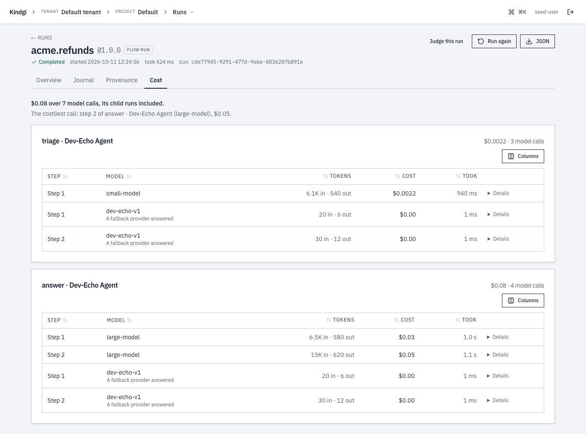
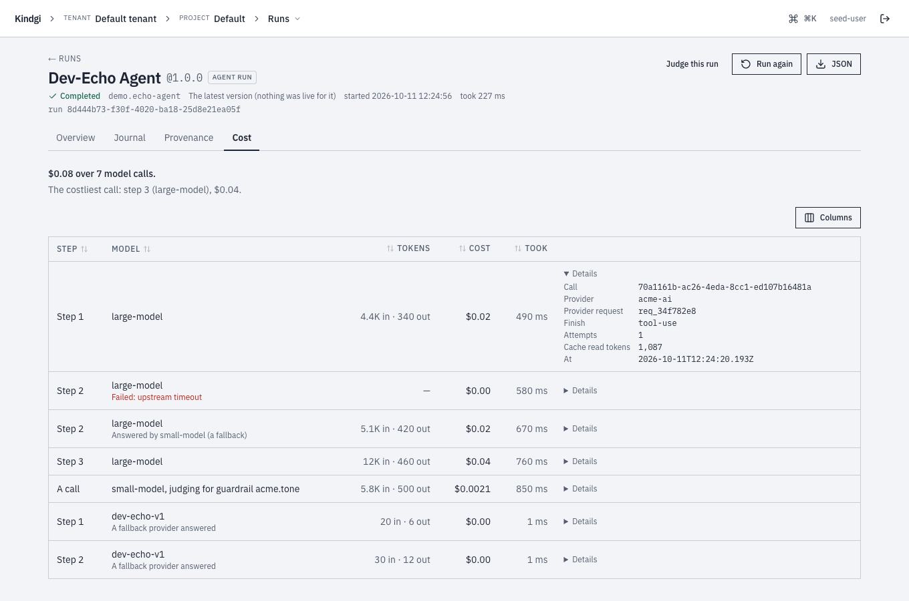
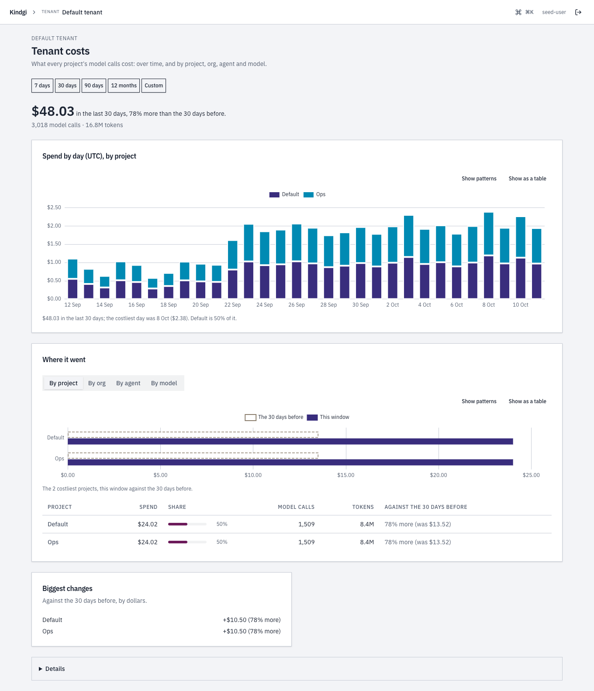

import { Tabs, TabItem } from '@astrojs/starlight/components';

This guide reads what a run's model calls cost, sums one customer's month,
and gets each run's total when it finishes.

Kindgi records every model call a run makes: the model, the tokens, and what
the call cost at the prices its provider was registered with, as
[Models](../../models/) describes. These costs are Kindgi's estimates from
the vendors' published prices. Your provider's invoice is what you pay.

## Before you start

- **A runtime,** such as `kindgi dev`, with Kindgi 0.2's client: Node 22.12
  or later, Python 3.11 or later, or Java 17 or later.
- **`KINDGI_API_URL` and `KINDGI_API_TOKEN`** set, or a running
  `kindgi dev`, which the client finds.
- **A run's id,** to read its calls. `kindgi runs list` shows it.

## A run's calls

Read the records of one run. Ask your coding agent: "I want to see what each
model call in a run cost." For reference, the code looks like this. Each
script takes the run's id as its first argument:

<Tabs syncKey="lang">
<TabItem label="TypeScript">

```ts
// run-cost.ts
import { createClient } from '@kindgi/sdk/client';
import type { RunId } from '@kindgi/sdk/types';

const kindgi = createClient(); // KINDGI_API_URL, KINDGI_API_TOKEN, or the running kindgi dev

const calls = await kindgi.cost.usage.query({ runId: process.argv[2] as RunId });
for (const call of calls.data) {
  console.log(call.step, call.model, call.status, call.usage?.promptTokens, call.usage?.completionTokens, call.costUsd);
}
```

</TabItem>
<TabItem label="Python">

```python
# run_cost.py
import sys

from kindgi.client import Kindgi

kindgi = Kindgi()  # KINDGI_API_URL, KINDGI_API_TOKEN, or the running kindgi dev

calls = kindgi.cost.records.list(run_id=sys.argv[1])
for call in calls.data:
    usage = call.usage
    print(call.step, call.model, call.status, usage and usage.prompt_tokens, usage and usage.completion_tokens, call.cost_usd)
```

</TabItem>
<TabItem label="Java">

```java
// src/main/java/com/acme/app/RunCost.java
package com.acme.app;

import com.kindgi.client.Kindgi;
import com.kindgi.client.models.CostRecord;
import com.kindgi.client.models.CostRecordCollectionPage;
import com.kindgi.client.resources.CostRecordsListParams;
import java.util.UUID;

public final class RunCost {
  public static void main(String[] args) {
    Kindgi kindgi = Kindgi.create(); // KINDGI_API_URL, KINDGI_API_TOKEN, or the running kindgi dev

    CostRecordCollectionPage calls = kindgi.cost().records().list(
        CostRecordsListParams.builder().runId(UUID.fromString(args[0])).build());
    for (CostRecord call : calls.data()) {
      System.out.println(call.step() + " " + call.model() + " " + call.status() + " "
          + (call.usage() == null ? null : call.usage().promptTokens()) + " "
          + (call.usage() == null ? null : call.usage().completionTokens()) + " " + call.costUsd());
    }
  }
}
```

</TabItem>
<TabItem label="Scala">

```scala
// src/main/scala/acme/app/RunCost.scala
package acme.app

import com.kindgi.client.Kindgi
import com.kindgi.client.resources.CostRecordsListParams
import java.util.UUID
import scala.jdk.CollectionConverters._

object RunCost {
  def main(args: Array[String]): Unit = {
    val kindgi = Kindgi.create() // KINDGI_API_URL, KINDGI_API_TOKEN, or the running kindgi dev

    val calls = kindgi.cost().records().list(CostRecordsListParams.builder().runId(UUID.fromString(args(0))).build())
    for (call <- calls.data.asScala) {
      val usage = Option(call.usage)
      println(s"${call.step} ${call.model} ${call.status} ${usage.map(_.promptTokens).orNull} " +
        s"${usage.map(_.completionTokens).orNull} ${call.costUsd}")
    }
  }
}
```

</TabItem>
</Tabs>

For an agent turn that called a tool once, each prints two model calls, the
newest first:

```text
2 claude-sonnet-5-5 ok 606 152 0.002732
1 claude-sonnet-5-5 ok 513 57 0.0015960000000000002
```

Each record is one model call:

```json
{
  "id": "bfe7ccd4-ca6c-411c-918f-e605b4943bdd",
  "tenantId": "c963c8d8-5afc-403f-8c4b-8617327c424e",
  "category": "llm.inference",
  "providerId": "anthropic",
  "runId": "f3835200-e4c6-4579-a3fc-4b70f7444333",
  "agentId": "acme.order-desk",
  "conversationId": "936af311-f1c8-4260-a1ed-973876b4ac71",
  "quantity": 570,
  "unit": "tokens",
  "costUsd": 0.0015960000000000002,
  "occurredAt": "2026-10-08T15:13:23.128Z",
  "callId": "00a26a40-58c5-41ce-af41-a5c583a577a6",
  "projectId": "18af3731-67e6-4720-aa50-0972ff4b5eca",
  "rootRunId": "f3835200-e4c6-4579-a3fc-4b70f7444333",
  "agentVersion": "0.1.0",
  "nodeId": "model-call",
  "step": 1,
  "model": "claude-sonnet-5-5",
  "servedModel": "claude-sonnet-5-5",
  "status": "ok",
  "usage": { "promptTokens": 513, "completionTokens": 57, "cacheReadTokens": 0, "cacheWriteTokens": 0 },
  "durationMs": 1438,
  "finishReason": "tool-use",
  "providerRequestId": "req_011CfpzCE92VRAVmBURYMRFu",
  "attempts": 1
}
```

| Field | What it is |
| --- | --- |
| `model`, `servedModel` | The model the agent asked for, and the exact version the provider answered with. |
| `usage` | The tokens: `promptTokens`, `completionTokens`, and the cache and reasoning counts. A count the provider reports is there, 0 included; one it doesn't report is absent. |
| `costUsd` | The call's cost in US dollars. |
| `status` | `ok`, or `failed` (see [A failed call](#a-failed-call)). |
| `step` | The model call's number in the turn. |
| `runId`, `rootRunId` | The run that made the call, and the run at the top of its tree. |
| `flowId` | For an agent step in a flow, the flow. An agent run on its own has none. |
| `projectId`, `agentId`, `agentVersion`, `conversationId` | Where the call belongs. |
| `providerRequestId` | The provider's id for the request, to quote to its support. Not every provider sends one. |
| `callId` | The call's id. The model call's node in the turn's [provenance](../trace-an-answer/) has the same `callId`. |
| `thinking` | How much the call asked its model to think. `asked` is the level it asked for: the agent's model settings, or a guardrail judge's `lowest`. `level` is the level sent, and `sent` the vendor's own fields as they went out. Absent when the call neither asked nor sent one. |

A call to a model that thinks carries what it sent. Here, an agent asked for
`max` of Gemini 3.8 Flash, whose highest level is `high`:

```json excerpt
"thinking": { "asked": "max", "level": "high", "sent": { "thinkingLevel": "HIGH" } }
```

- **`asked` and `level` differ:** the level was rounded to one the model
  takes, and the turn carried a `thinking-level-adjusted` warning, as
  [Temperature and thinking](../../models/#temperature-and-thinking)
  describes.
- **`asked` without `level`:** nothing was sent, since the model doesn't
  think or its adapter didn't send the level.
- **`level` without `asked`:** the call asked none, and got the model's
  registered `thinking.default`.

To see the usage exactly as the provider sent it, add `includeRawUsage: true`,
or `include="rawUsage"` in Python. Each record then has `rawUsage`:

```json excerpt
"rawUsage": {
  "provider": "anthropic",
  "model": "claude-sonnet-5-5",
  "usage": { "input_tokens": 513, "output_tokens": 57, "cache_read_input_tokens": 0, "cache_creation_input_tokens": 0, … }
}
```

## A flow's whole run

Each agent step of a flow runs as a run of its own, under the flow's run. The
flow's run makes no model calls itself, so ask for its whole tree with
`rootRunId`. Ask your coding agent: "I want the cost of a flow's whole run."
For reference, the call looks like this, where `flowRunId` is the flow run's
id:

<Tabs syncKey="lang">
<TabItem label="TypeScript">

```ts excerpt
const calls = await kindgi.cost.usage.query({ rootRunId: flowRunId });
```

</TabItem>
<TabItem label="Python">

```python excerpt
calls = kindgi.cost.records.list(root_run_id=flow_run_id)
```

</TabItem>
<TabItem label="Java">

```java excerpt
CostRecordCollectionPage calls =
    kindgi.cost().records().list(CostRecordsListParams.builder().rootRunId(flowRunId).build());
```

</TabItem>
<TabItem label="Scala">

```scala excerpt
val calls = kindgi.cost().records().list(CostRecordsListParams.builder().rootRunId(flowRunId).build())
```

</TabItem>
</Tabs>

Each record's `runId` is the agent step's run, and its `rootRunId` is the
flow's run.

To see what each step cost, read the flow run's provenance record. Once the
run has finished, `GET /v1/provenance/{runId}` with the flow run's id returns
`stepUsage` beside the record's graph. It has each step's calls, their cost
in USD and their tokens, keyed by the step's node id in the record
(`step:classify`), and it sums every run
the step started and the runs under those:

```json excerpt
  "stepUsage": {
    "step:classify": {"calls": 1, "costUsd": 0, "tokens": {"prompt": 20, "completion": 6, "cacheRead": 0, "cacheWrite": 0, "reasoning": 0}}
  }
```

A step that made no model calls has no entry. A step the record has no node
for has no entry either, such as one cut from a record over its size limit,
so the entries can sum to less than the whole tree. In a loop, each
iteration's step has its own entry, and a long loop's folded iterations
share their `#folded` node's entry.
[A flow's answers](../trace-an-answer/#a-flows-answers) reads the record.

## One customer's month

Give each of your customers an org, and run their work in a project of that
org, as
[Organize work by org and project](../../projects/organize-by-org-and-project/)
shows. One call then sums a customer's spend, here by month and model. Ask
your coding agent: "I want to see what one customer spent this month, by
model." For reference, the script looks like this:

<Tabs syncKey="lang">
<TabItem label="TypeScript">

```ts
// customer-cost.ts
import { createClient } from '@kindgi/sdk/client';
import type { Timestamp } from '@kindgi/sdk/types';

const kindgi = createClient(); // KINDGI_API_URL, KINDGI_API_TOKEN, or the running kindgi dev

// Once per customer: an org, and a project in it.
const org = await kindgi.orgs.create({ slug: 'acme-customer-one', name: 'Customer one' });
const project = await kindgi.projects.create({ orgId: org.id, slug: 'support', name: 'Support' });

// Each run for that customer names the project.
await kindgi.runs.start({
  agent: 'acme-ops.echo-agent',
  input: { userMessage: 'Echo hello.' },
  projectId: project.id,
});

// The customer's month so far, by model.
const now = new Date();
const monthStart = new Date(Date.UTC(now.getUTCFullYear(), now.getUTCMonth(), 1));
const month = await kindgi.cost.usage.summary({
  scope: { kind: 'org', orgId: org.id },
  from: monthStart.toISOString() as Timestamp,
  to: now.toISOString() as Timestamp,
  groupBy: ['month', 'model'],
});
console.log(JSON.stringify(month, null, 2));
```

</TabItem>
<TabItem label="Python">

```python
# customer_cost.py
import json
from datetime import datetime, timezone

from kindgi.client import Kindgi

kindgi = Kindgi()  # KINDGI_API_URL, KINDGI_API_TOKEN, or the running kindgi dev

# Once per customer: an org, and a project in it.
org = kindgi.orgs.create(slug="acme-customer-one", name="Customer one")
project = kindgi.projects.create(org_id=str(org.id), slug="support", name="Support")

# Each run for that customer names the project.
kindgi.runs.start(
    agent="acme-ops.echo-agent",
    input={"userMessage": "Echo hello."},
    project_id=project.id,
)

# The customer's month so far, by model.
now = datetime.now(timezone.utc)
month = kindgi.cost.aggregate(
    group_by="month,model",
    scope_kind="org",
    scope_id=str(org.id),
    from_=now.replace(day=1, hour=0, minute=0, second=0, microsecond=0).isoformat(),
    to=now.isoformat(),
)
print(json.dumps(month.model_dump(mode="json", by_alias=True, exclude_none=True), indent=2))
```

</TabItem>
<TabItem label="Java">

```java
// src/main/java/com/acme/app/CustomerCost.java
package com.acme.app;

import com.kindgi.client.Kindgi;
import com.kindgi.client.KindgiJson;
import com.kindgi.client.models.CostAggregateResult;
import com.kindgi.client.models.CreateResourceResult;
import com.kindgi.client.models.OrgSpec;
import com.kindgi.client.models.ProjectSpec;
import com.kindgi.client.models.ScopeKind;
import com.kindgi.client.models.StartRunBody;
import com.kindgi.client.resources.CostAggregateParams;
import java.time.OffsetDateTime;
import java.time.ZoneOffset;
import java.util.Map;
import java.util.UUID;

public final class CustomerCost {
  public static void main(String[] args) {
    Kindgi kindgi = Kindgi.create(); // KINDGI_API_URL, KINDGI_API_TOKEN, or the running kindgi dev

    // Once per customer: an org, and a project in it.
    CreateResourceResult org = kindgi.orgs().create(
        OrgSpec.builder().slug("acme-customer-one").name("Customer one").build());
    CreateResourceResult project = kindgi.projects().create(
        ProjectSpec.builder().orgId(org.id()).slug("support").name("Support").build());

    // Each run for that customer names the project.
    kindgi.runs().start(StartRunBody.WithAgent.builder()
        .agent("acme-ops.echo-agent")
        .input(Map.of("userMessage", "Echo hello."))
        .projectId(UUID.fromString(project.id()))
        .build());

    // The customer's month so far, by model.
    OffsetDateTime now = OffsetDateTime.now(ZoneOffset.UTC);
    CostAggregateResult month = kindgi.cost().aggregate(CostAggregateParams.builder()
        .scopeKind(ScopeKind.ORG)
        .scopeId(org.id())
        .from(now.withDayOfMonth(1).toLocalDate().atStartOfDay().atOffset(ZoneOffset.UTC))
        .to(now)
        .groupBy("month,model")
        .build());
    System.out.println(KindgiJson.write(month));
  }
}
```

`groupBy` takes the dimensions comma-separated, as the API does.
`KindgiJson.write` prints the answer as JSON on one line; the answer below
is indented to read.

</TabItem>
<TabItem label="Scala">

```scala
// src/main/scala/acme/app/CustomerCost.scala
package acme.app

import com.kindgi.client.{Kindgi, KindgiJson}
import com.kindgi.client.models.{OrgSpec, ProjectSpec, ScopeKind, StartRunBody}
import com.kindgi.client.resources.CostAggregateParams
import java.time.{OffsetDateTime, ZoneOffset}
import java.util.UUID
import scala.jdk.CollectionConverters._

object CustomerCost {
  def main(args: Array[String]): Unit = {
    val kindgi = Kindgi.create() // KINDGI_API_URL, KINDGI_API_TOKEN, or the running kindgi dev

    // Once per customer: an org, and a project in it.
    val org = kindgi.orgs().create(OrgSpec.builder().slug("acme-customer-one").name("Customer one").build())
    val project = kindgi.projects().create(
      ProjectSpec.builder().orgId(org.id).slug("support").name("Support").build())

    // Each run for that customer names the project.
    kindgi.runs().start(StartRunBody.WithAgent.builder()
      .agent("acme-ops.echo-agent")
      .input(Map("userMessage" -> "Echo hello.").asJava)
      .projectId(UUID.fromString(project.id))
      .build())

    // The customer's month so far, by model.
    val now = OffsetDateTime.now(ZoneOffset.UTC)
    val month = kindgi.cost().aggregate(CostAggregateParams.builder()
      .scopeKind(ScopeKind.ORG)
      .scopeId(org.id)
      .from(now.withDayOfMonth(1).toLocalDate.atStartOfDay.atOffset(ZoneOffset.UTC))
      .to(now)
      .groupBy("month,model")
      .build())
    println(KindgiJson.write(month))
  }
}
```

`groupBy` takes the dimensions comma-separated, as the API does.
`KindgiJson.write` prints the answer as JSON on one line; the answer below
is indented to read.

</TabItem>
</Tabs>

The sum covers only that customer's runs:

```json
{
  "groups": [
    {
      "key": {"month": "2026-10", "model": "claude-sonnet-5-5"},
      "count": 2,
      "totalUsd": 0.00449,
      "tokens": {"prompt": 1385, "completion": 172, "cacheRead": 0, "cacheWrite": 0, "reasoning": 0}
    }
  ],
  "totalGroups": 1,
  "truncated": false,
  "totalUsd": 0.00449,
  "totalRecords": 2,
  "tokens": {"prompt": 1385, "completion": 172, "cacheRead": 0, "cacheWrite": 0, "reasoning": 0},
  "timeRange": {"from": "2026-10-01T00:00:00.000Z", "to": "2026-10-08T15:13:28.571Z"},
  "groupBy": ["month", "model"]
}
```

- **`scope`** narrows the sum to an org, `{ kind: 'org', orgId }`, or a
  project, `{ kind: 'project', projectId }`. In Python, it's `scope_kind`
  and `scope_id`.
- **Who sees what:** the sum needs `read` on its scope. Across projects,
  with no scope or an org, it counts only the projects the caller may read,
  and records with no project. A tenant admin's sum counts every project.
  Where the deployment's cost store can't apply the limit, anyone but a
  tenant admin is refused with `403`.
- **`from` and `to`**: the time window. `to` is exclusive.
- **The groups** come most expensive first, at most 1000 of them. `?limit=`
  on the API, or `limit=` in Python, sets another cap, up to 10000.
  `truncated` says whether some were left out, and `totalGroups` how many
  there were. The totals always cover every record. To read every record
  instead, page through [`cost.usage.query`](#a-runs-calls).
- **`groupBy`** splits the sum. Besides `month` and `model`: `day`, `orgId`,
  `projectId`, `agentId`, `flowId`, `runId`, `rootRunId`, `conversationId`,
  `providerId`, `servedModel`, `category` and `tenant`. With no `groupBy`,
  you get the totals only.
- **Filters** narrow what's summed, as they narrow `cost.usage.query`.
  `flowId` keeps one flow's spend: every record of the run trees whose root
  is a run of that flow, whatever its version. With `groupBy` `day`, that's
  the flow's spend by day. In Python, it's `flow_id`. It needs runtime
  0.1.9 or later: an earlier one ignores it and sums every flow.

A tool can check that a run belongs to the right customer, as
[Check the run's org](../../tools/write-a-tool/#check-the-runs-org) shows.

## When a run finishes

The [`run.finished` webhook](../../webhooks/receive-run-finished/) carries the
run's total under `data.run.usage`:

```json
{
  "id": "8004eba4-0d7a-4b81-9cd2-9c1884295f9c",
  "type": "run.finished",
  "createdAt": "2026-10-05T07:08:42.227Z",
  "data": {
    "run": {
      "id": "695492e1-0569-48cf-bf5b-e92170ebcd38",
      "projectId": "cb742f19-68f2-4594-9cd6-b555617dc851",
      "flowId": "acme-ops.echo-flow",
      "flowVersion": "0.1.0",
      "status": "completed",
      "dryRun": false,
      "failureMessage": null,
      "createdAt": "2026-10-05T07:08:39.834Z",
      "completedAt": "2026-10-05T07:08:42.227Z",
      "usage": {
        "calls": 2,
        "costUsd": 0.001994,
        "tokens": { "prompt": 1669, "completion": 65, "cacheRead": 0, "cacheWrite": 0, "reasoning": 0 }
      }
    }
  }
}
```

Only the run at the top of a tree sends `run.finished`, and its `usage` covers
the whole tree: this flow's two calls were made by its agent step.

## A failed call

A model call that fails is recorded too, at no cost. A turn whose provider key
was wrong:

```json
{
  "runId": "28a40635-eb0b-44db-9b8f-3748c2f8165e",
  "model": "claude-sonnet-5-5",
  "status": "failed",
  "costUsd": 0,
  "durationMs": 252,
  "attempts": 1,
  "error": { "message": "401 {\"type\":\"error\",\"error\":{\"type\":\"authentication_error\",\"message\":\"invalid x-api-key\"},\"request_id\":null}" },
  …
}
```

It has no `usage`, and it counts in `run.finished`'s `calls`.

## Cost in the console

The console shows the same numbers on three pages: a project's **Cost**, a
run's **Cost** tab, and the tenant's **Tenant costs**. Days are in UTC, and a
failed call costs $0.

### A project's cost

Anyone who can read the project sees its **Cost** page: what its model calls
cost over a range, against the range before. The range is **7 days**,
**30 days**, **90 days**, **12 months** or **Custom**.


- **The headline:** "$24.17 in the last 30 days, 77% more than the 30 days
  before." and "1,508 model calls · 8.4M tokens".
- **Spend by day (UTC), by agent:** a stacked chart, with a sentence under
  it ("the costliest day was 8 Oct ($1.19). Support agent is 62% of it.").
  **Show as a table** gives the numbers. Over 12 months it's by month.
- **Where it went:** **By agent**, **By model**, **By flow** or **By kind**,
  the costliest against the range before ("33% more (was $11.28)", "new").
  An agent's or a model's row filters the page to it. So does a flow's,
  and a flow's page opens this page filtered to that flow with **Cost**
  (both runtime 0.1.9 or later). The table sorts by a column's header, and
  **Columns** chooses which columns it shows.
- **Biggest changes:** against the range before, by dollars ("Research
  agent new: $8.57", "Legacy summarizer −$1.81 (none now)").
- **Per-turn caps:** each agent with a budget for one turn, and how close its
  turns came ("Costliest turn $0.14 of $0.12; 36 turns used over 80% of it, 4
  turns went over.").
- **Details:** the token split, and the exact
  [`GET /v1/cost/aggregate`](#one-customers-month) queries the page made.

The range, the filters and the breakdown are in the page's address, so a
link opens the same view.

### A run's cost

Every run's page has a **Cost** tab: the [run's calls](#a-runs-calls), as
`cost.usage.query` returns them.



- **The total,** with a [flow's child runs](#a-flows-whole-run) included:
  "$0.08 over 7 model calls, its child runs included."
- **The costliest call:** "The costliest call: step 2 of answer · Dev-Echo
  Agent (large-model), $0.05."
- **Each model call,** grouped by the run that made it: its step, model,
  tokens in and out, cost and how long it took. A failed call says why
  ("Failed: upstream timeout") and costs $0.00. When a fallback answered,
  the call says so ("A fallback provider answered").
- **Details,** for one call: the call's id, the provider and its request
  id, how it finished, its attempts, cache-read tokens and when it was made.



A flow run's **Overview** tab gives the same total: "Cost: $0.08 over 7
model calls, its child runs included. Each call →".

### The tenant's costs

Tenant admins see **Tenant costs**: every project's spend, laid out like a
project's Cost page.



- **The headline,** and **Spend by day (UTC), by project.**
- **Where it went:** **By project**, **By org**, **By agent** or **By
  model**. A project's row opens that project's Cost page at the same range,
  and an agent's or a model's row filters this page.
- **Biggest changes** and **Details,** as on a project's page.

Anyone else who opens it is pointed to each project's Cost page instead. As
with the API in [One customer's month](#one-customers-month), a person's
numbers count only the projects they may read.

## Next

- [Trace an answer and its cost](../trace-an-answer/)
- [Set an agent's budget](../../agents/budgets/)
- [Organize work by org and project](../../projects/organize-by-org-and-project/)
