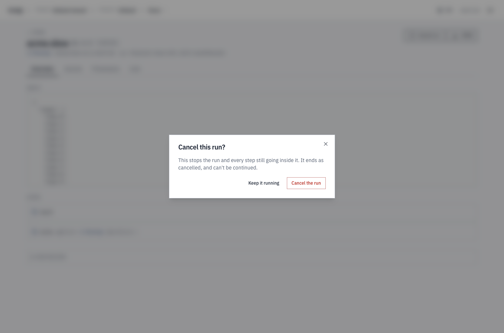

import { Tabs, TabItem } from '@astrojs/starlight/components';

```sh
kindgi runs cancel <run-id>
```

```json
{
  "ok": true,
  "runId": "265627c7-1ac7-4d18-a926-6da9fcc18577"
}
```

The run's status becomes `cancelled`, and the journal ends with
`run.cancelled`:

```json
{"sequence": 6, "kind": "wait.suspended", "nodeId": "hold", "payload": {"nodeId": "hold", "tokenId": "child:d8c2c7dc-7ceb-4e4b-8986-ee75e7c9bcc2:25"}, …}
{"sequence": 7, "kind": "run.cancelled", "payload": {}, …}
```

That run was waiting for an approval. A run can be cancelled while it runs
too, and cancelling a flow's run cancels the agent turns inside it: see
[what a cancel stops](#what-a-cancel-stops).

A run that already ended can't be cancelled:

```text
Error [conflict]: Cannot cancel run: already cancelled
```

## What a cancel stops

A cancel takes effect at once, wherever the run is:

- **No step starts after it.** A flow between two steps, or in the middle of
  a loop, starts nothing more, and its journal records no start after
  `run.cancelled`.
- **A step running when it lands stops.** An agent turn stops waiting for its
  model and ends `cancelled`. A start that was waiting for the turn
  (`wait: true`) answers within seconds with `422 agent-turn-aborted`,
  "Agent turn cancelled".
- **A step that ends as it lands keeps its end.** Its `step.completed` comes
  after `run.cancelled` in the journal: it did finish.

Here a flow running a loop over 2,000 orders, each answered by an agent,
was cancelled twice. The first time, the turn for order A-1012 was running:
the cancel stopped it, and the journal ends at the cancel:

```json
{"sequence": 77, "kind": "step.started", "nodeId": "answer", "payload": {"input": "A-1012", …}, …}
{"sequence": 78, "kind": "run.cancelled", "payload": {}, …}
```

The second time, the turn for A-1030 finished as the cancel landed. Its end
follows `run.cancelled`, and nothing starts after it:

```json
{"sequence": 185, "kind": "step.started", "nodeId": "answer", "payload": {"input": "A-1030", …}, …}
{"sequence": 186, "kind": "run.cancelled", "payload": {}, …}
{"sequence": 187, "kind": "step.completed", "nodeId": "answer", "payload": {"output": {"text": "You said: \"A-1030\"", …}, …}, …}
{"sequence": 188, "kind": "edge.evaluated", "payload": {"to": "$end", "from": "answer", "edgeId": "b1", "decision": true, …}, …}
{"sequence": 189, "kind": "iteration.completed", "nodeId": "each", "payload": {…, "iteration": 30, …}, …}
```

A step that was running when the run was cancelled, such as the loop itself
or A-1012's step, has no end of its own: `run.cancelled` ends it, as it ends
a run waiting for an approval.

An agent turn started with `wait: true`, and cancelled while its model call
ran, answers the waiting start with:

```json
{
  "error": {
    "code": "agent-turn-aborted",
    "message": "Agent turn cancelled",
    "details": {
      "reason": "external",
      "runId": "8619fb26-6370-48df-b9bc-01bcd91602b6"
    },
    "requestId": "req-fb51fd31-fe44-4a44-ad97-88baa95a23e4"
  }
}
```

## From your app

<Tabs syncKey="lang">
<TabItem label="TypeScript">

```ts
const run = await kindgi.runs.start({
  flow: 'acme.reserve-order',
  input: { orderId: 'A-500' },
  options: { wait: false },
});
const cancelled = await kindgi.runs.cancel(run.id);
console.log(cancelled.status);
```

```text
cancelled
```

</TabItem>
<TabItem label="Python">

```python
run = kindgi.runs.start(
    flow="acme.reserve-order", input={"orderId": "A-500"}, options={"wait": False}
)
cancelled = kindgi.runs.cancel(run.id)
print(cancelled.status)
```

```text
cancelled
```

</TabItem>
</Tabs>

`cancel` returns the run. It answers with a conflict error when the run had
already ended.

## Approvals of a cancelled run

Cancelling a run withdraws the approvals it was waiting for, and those of the
runs inside it (a flow's agent steps), in the same step. They leave the
pending list as `withdrawn`, with `withdrawnBecause: "run-cancelled"`. A
reviewer who opens one can no longer decide it (`409 approval-terminal`).
An approval the run asked for without waiting on it (a project-wide memory
fact's review, a memory erasure's) stays pending, and can still be decided.

To see them before you cancel, list the run's approvals with the runs inside
it: `approvals.list({ runId, includeDescendants: true })` in TypeScript,
`approvals.list(run_id=…, include_descendants=True)` in Python.

[Decide an approval](../../approvals/decide-an-approval/) has more on
approvals.

## In the console

A run's page has **Cancel run** while it's going, for project editors and
up. Its dialog says what a cancel does before anything happens:

```text
Cancel this run?
This stops the run and every step still going inside it. It ends as cancelled, and can't be continued.
```

- **A run waiting for an approval** adds: "If it's waiting for an approval,
  that approval is withdrawn: it leaves the reviewers' list."
  ([Approvals of a cancelled run](#approvals-of-a-cancelled-run)).
- **Keep it running** closes the dialog. **Cancel the run** cancels it, and
  the dialog says "Cancelled.".
- **A run that finished meanwhile:** "It had already finished: there was
  nothing to stop."


