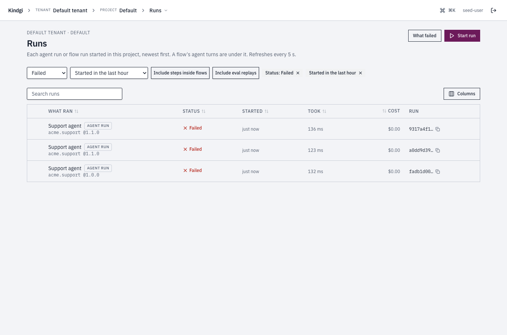
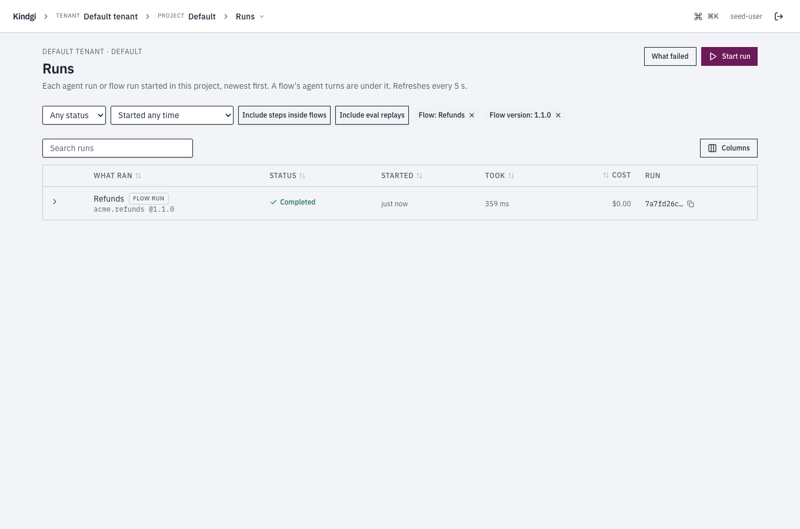

import { Tabs, TabItem } from '@astrojs/starlight/components';

This guide lists runs: the newest page by page, only the ones your app
started, the runs inside one run, or one agent's turns.

## Before you start

- **Runs to list,** on a runtime such as `kindgi dev`, with Kindgi 0.2's
  CLI.
- **For the app's half:** Node 22.12 or later, Python 3.11 or later, or
  Java 17 or later, with Kindgi 0.2's client, and `KINDGI_API_URL` and
  `KINDGI_API_TOKEN` set.

## From the CLI

The newest runs come first. List two:

<Tabs syncKey="lang">
<TabItem label="TypeScript">

```sh
pnpm exec kindgi runs list --limit=2
```

</TabItem>
<TabItem label="Python">

```sh
uv run kindgi runs list --limit=2
```

</TabItem>
<TabItem label="Java">

```sh
./kindgiw runs list --limit=2
```

</TabItem>
<TabItem label="Scala">

```sh
./kindgiw runs list --limit=2
```

</TabItem>
</Tabs>

`--limit=2` is the most runs on a page. It prints the page:

```json
{
  "data": [
    {
      "id": "657512f8-97b5-41bb-a0cc-396bffe158f6",
      …
      "flowId": "acme.reserve-order",
      "flowVersion": "0.1.0",
      "status": "cancelled",
      …
    },
    {
      "id": "365d7fd0-7801-43e5-a3c5-66f9479cf02d",
      …
    }
  ],
  "hasMore": true,
  "nextCursor": "eyJjcmVhdGVkQXQiOiIyMDI2LTEwLTAzVDIwOjE0OjE2Ljc0NFoiLCJpZCI6IjM2NWQ3ZmQwLTc4MDEtNDNlNS1hM2M1LTY2Zjk0NzljZjAyZCJ9"
}
```

- **`--limit`** is 25 by default, and at most 100.
- **`--cursor=<nextCursor>`** gets the next page, where `<nextCursor>` is the
  page's `nextCursor`.
- **The list leaves out each run's `output`.** `kindgi runs get <run-id>`
  has it.

The CLI lists every run, including the agent turns inside flows. Each of
those is a run of `agent.turn`, with a `parentRunId`. `--agent=<agent-id>`
lists one agent's turns, as [One agent's turns](#one-agents-turns) shows.
The clients also filter by status, creation time, flow and version, and
scope.

## From your app

Your app lists runs with `runs.list`. Ask your coding agent: "I want my app
to list the runs it started, newest first, a page at a time." For reference,
this code lists the newest runs your app started, then gets the next page:

<Tabs syncKey="lang">
<TabItem label="TypeScript">

```ts
// app/list-runs.ts
import { createClient } from '@kindgi/sdk/client';

const kindgi = createClient(); // KINDGI_API_URL, KINDGI_API_TOKEN

// The newest runs your app started, without the agent turns inside them
const page = await kindgi.runs.list({ topLevel: true, limit: 3 });
for (const run of page.data) console.log(run.id, run.flowId, run.status);

// The next page
if (page.nextCursor !== undefined) {
  const next = await kindgi.runs.list({ topLevel: true, limit: 3, cursor: page.nextCursor });
  console.log(next.data.length, next.hasMore);
}
```

```text
f703bffb-367c-4abb-a699-006575b7c21a acme.reserve-order cancelled
54e3258d-3cd3-444a-8175-c965ef6cf682 acme.reserve-order completed
42b7c0c8-3c47-4962-9b08-3319ff887ada acme.review-order completed
3 true
```

</TabItem>
<TabItem label="Python">

```python
# app/list_runs.py
from kindgi.client import Kindgi, paginate

kindgi = Kindgi()  # KINDGI_API_URL, KINDGI_API_TOKEN

# The newest runs your app started, without the agent turns inside them
page = kindgi.runs.list(top_level=True, limit=3)
for run in page.data:
    print(run.id, run.flow_id, run.status)

# Every one of them, page after page
print(sum(1 for _ in paginate(kindgi.runs.list, top_level=True)))
```

```text
969888a4-a1a8-43fc-8e83-63529ad580c2 acme.reserve-order cancelled
197046c4-e220-4b6d-abcb-1703d6c6efd5 acme.reserve-order completed
edaf7625-0585-40c3-805c-0c098f6846b8 acme.review-order failed
81
```

</TabItem>
<TabItem label="Java">

```java
// src/main/java/com/acme/app/ListRuns.java
package com.acme.app;

import com.kindgi.client.Kindgi;
import com.kindgi.client.models.RunCollectionPage;
import com.kindgi.client.resources.RunsListParams;

public final class ListRuns {
  public static void main(String[] args) {
    Kindgi kindgi = Kindgi.create(); // KINDGI_API_URL, KINDGI_API_TOKEN

    // The newest runs your app started, without the agent turns inside them
    RunsListParams params = RunsListParams.builder().topLevel(true).limit(3L).build();
    RunCollectionPage page = kindgi.runs().list(params);
    for (RunCollectionPage.DataItem run : page.data()) {
      System.out.println(run.id() + " " + run.flowId() + " " + run.status());
    }

    // The next page
    if (page.nextCursor() != null) {
      RunCollectionPage next = kindgi.runs().list(params.toBuilder().cursor(page.nextCursor()).build());
      System.out.println(next.data().size() + " " + next.hasMore());
    }
  }
}
```

```text
b6a0ff1e-a891-49c4-857a-aca3ba8dd75e acme.reserve-order cancelled
51a59895-3fad-4e49-8fef-f2e2be8881a9 acme.review-order completed
e3cf4013-a78d-48f8-b7f1-e729000fc994 acme.review-order completed
3 true
```

The params are a record with a builder; `toBuilder()` makes the next
page's from them.

</TabItem>
<TabItem label="Scala">

```scala
// src/main/scala/acme/app/ListRuns.scala
package acme.app

import com.kindgi.client.Kindgi
import com.kindgi.client.resources.RunsListParams
import scala.jdk.CollectionConverters._

object ListRuns {
  def main(args: Array[String]): Unit = {
    val kindgi = Kindgi.create() // KINDGI_API_URL, KINDGI_API_TOKEN

    // The newest runs your app started, without the agent turns inside them
    val params = RunsListParams.builder().topLevel(true).limit(3L).build()
    val page = kindgi.runs().list(params)
    for (run <- page.data.asScala) println(s"${run.id} ${run.flowId} ${run.status}")

    // The next page
    Option(page.nextCursor).foreach { cursor =>
      val next = kindgi.runs().list(params.toBuilder.cursor(cursor).build())
      println(s"${next.data.size} ${next.hasMore}")
    }
  }
}
```

```text
b6a0ff1e-a891-49c4-857a-aca3ba8dd75e acme.reserve-order cancelled
51a59895-3fad-4e49-8fef-f2e2be8881a9 acme.review-order completed
e3cf4013-a78d-48f8-b7f1-e729000fc994 acme.review-order completed
3 true
```

The params are a Java record with a builder; `toBuilder` makes the next
page's from them.

</TabItem>
</Tabs>

The page holds the runs, and its `nextCursor` leads to the next one.
`list` takes these filters, with their Python names in brackets:

- **`topLevel: true`** (`top_level=True`) leaves out runs started inside
  other runs, such as agent turns: the runs your app and the CLI started.
- **`includeOutput: true`** (`include="output"`) adds each run's `output`.
- **`scope`** (`scope_kind` / `scope_id`) lists one project's runs, or the runs
  of every project in an org: `{ kind: 'project', projectId }`
  (`scope_kind="project", scope_id=…`), or `{ kind: 'org', orgId }`.
- **`agentId`** (`agent_id`) lists one agent's turns, as
  [One agent's turns](#one-agents-turns) shows.
- **`status`** lists the runs in one status, or in any of several:
  `['failed', 'cancelled']` (a list in Python too).
- **`createdAfter`** / **`createdBefore`** (`created_after` /
  `created_before`) list the runs created strictly after, or before, a time.
- **`flowId`** (`flow_id`) lists one flow's runs, and **`flowVersion`**
  (`flow_version`) one version's. An agent's turns run the `agent.turn` flow:
  use `agentId` for an agent's.
- In Python, `paginate` follows `next_cursor` for you.

A status that doesn't exist, a time that isn't one, an empty value, or a
version without its id is refused with `400 bad-input`, naming it:

```json
{ "error": { "code": "bad-input", "message": "`agentVersion` needs `agentId`", … } }
```

The filters combine. Ask your coding agent, for example: "I want my app to
list the runs from the last day that failed or were cancelled." For
reference, this code lists them, leaving out the runs inside them:

<Tabs syncKey="lang">
<TabItem label="TypeScript">

```ts
// app/ended-runs.ts
import { createClient } from '@kindgi/sdk/client';

const kindgi = createClient(); // KINDGI_API_URL, KINDGI_API_TOKEN

const since = new Date(Date.now() - 24 * 3_600_000).toISOString();
const ended = await kindgi.runs.list({
  status: ['failed', 'cancelled'],
  createdAfter: since,
  topLevel: true,
});
for (const run of ended.data) console.log(run.id, run.status, run.agent?.version);
```

```text
c231451d-c304-4466-bb37-3b72145470ed cancelled 2.1.0
```

</TabItem>
<TabItem label="Python">

```python
# app/ended_runs.py
from datetime import datetime, timedelta, timezone

from kindgi.client import Kindgi

kindgi = Kindgi()  # KINDGI_API_URL, KINDGI_API_TOKEN

since = (datetime.now(timezone.utc) - timedelta(days=1)).isoformat()
ended = kindgi.runs.list(status=["failed", "cancelled"], created_after=since, top_level=True)
for run in ended.data:
    print(run.id, run.status, run.agent.version if run.agent else None)
```

```text
c231451d-c304-4466-bb37-3b72145470ed cancelled 2.1.0
```

</TabItem>
<TabItem label="Java">

```java
// src/main/java/com/acme/app/ListEnded.java
package com.acme.app;

import com.kindgi.client.Kindgi;
import com.kindgi.client.models.RunCollectionPage;
import com.kindgi.client.models.RunStatus;
import com.kindgi.client.resources.RunsListParams;
import java.time.OffsetDateTime;
import java.util.List;

public final class ListEnded {
  public static void main(String[] args) {
    Kindgi kindgi = Kindgi.create(); // KINDGI_API_URL, KINDGI_API_TOKEN

    RunCollectionPage ended = kindgi.runs().list(RunsListParams.builder()
        .status(List.of(RunStatus.FAILED, RunStatus.CANCELLED))
        .createdAfter(OffsetDateTime.now().minusHours(24))
        .topLevel(true)
        .build());
    for (RunCollectionPage.DataItem run : ended.data()) {
      System.out.println(run.id() + " " + run.status() + " " + (run.agent() == null ? null : run.agent().version()));
    }
  }
}
```

```text
b627328a-d5ac-4230-b305-4bac6b307213 cancelled null
4ff78455-4ff5-45e9-8d5b-7d3116a76e84 cancelled null
e7532a22-7401-4b8d-a7ac-f3dd20e628e2 cancelled null
b0896582-86d7-4e7d-8387-931550da93a3 failed null
667c2bc8-6930-457e-bc7d-2756b6f26ff8 failed null
```

</TabItem>
<TabItem label="Scala">

```scala
// src/main/scala/acme/app/ListEnded.scala
package acme.app

import com.kindgi.client.Kindgi
import com.kindgi.client.models.RunStatus
import com.kindgi.client.resources.RunsListParams
import java.time.OffsetDateTime
import scala.jdk.CollectionConverters._

object ListEnded {
  def main(args: Array[String]): Unit = {
    val kindgi = Kindgi.create() // KINDGI_API_URL, KINDGI_API_TOKEN

    val ended = kindgi.runs().list(RunsListParams.builder()
      .status(List(RunStatus.FAILED, RunStatus.CANCELLED).asJava)
      .createdAfter(OffsetDateTime.now().minusHours(24))
      .topLevel(true)
      .build())
    for (run <- ended.data.asScala) println(s"${run.id} ${run.status} ${Option(run.agent).map(_.version).orNull}")
  }
}
```

```text
b627328a-d5ac-4230-b305-4bac6b307213 cancelled null
4ff78455-4ff5-45e9-8d5b-7d3116a76e84 cancelled null
e7532a22-7401-4b8d-a7ac-f3dd20e628e2 cancelled null
b0896582-86d7-4e7d-8387-931550da93a3 failed null
667c2bc8-6930-457e-bc7d-2756b6f26ff8 failed null
```

</TabItem>
</Tabs>

## The runs inside a run

A flow's run starts a run for each agent step. `parentRunId`
(`parent_run_id`) lists the runs a run started, each with the step it belongs
to. Ask your coding agent: "I want my app to list the agent turns inside a
flow's run." For reference, this code starts a flow's run, then lists the
runs inside it:

<Tabs syncKey="lang">
<TabItem label="TypeScript">

```ts
// app/run-children.ts
import { createClient } from '@kindgi/sdk/client';

const kindgi = createClient(); // KINDGI_API_URL, KINDGI_API_TOKEN

const run = await kindgi.runs.start({ flow: 'acme.process-order', input: { orderId: 'A-100' } });
const children = await kindgi.runs.list({ parentRunId: run.id });
for (const child of children.data) console.log(child.id, child.flowId, child.parentNodeId);
```

```text
eb59636f-aaae-4cd2-84ec-66cbcbf55f83 agent.turn note
```

</TabItem>
<TabItem label="Python">

```python
# app/run_children.py
from kindgi.client import Kindgi

kindgi = Kindgi()  # KINDGI_API_URL, KINDGI_API_TOKEN

run = kindgi.runs.start(flow="acme.process-order", input={"orderId": "A-100"})
children = kindgi.runs.list(parent_run_id=run.id)
for child in children.data:
    print(child.id, child.flow_id, child.parent_node_id)
```

```text
13237b2f-6cdd-4592-a94d-f5e751258790 agent.turn note
```

</TabItem>
<TabItem label="Java">

```java
// src/main/java/com/acme/app/ListChildren.java
package com.acme.app;

import com.kindgi.client.Kindgi;
import com.kindgi.client.models.Run;
import com.kindgi.client.models.RunCollectionPage;
import com.kindgi.client.models.StartRunBody;
import com.kindgi.client.resources.RunsListParams;
import java.util.Map;

public final class ListChildren {
  public static void main(String[] args) {
    Kindgi kindgi = Kindgi.create(); // KINDGI_API_URL, KINDGI_API_TOKEN

    Run run = kindgi.runs().start(StartRunBody.WithFlow.builder()
        .flow("acme.process-order")
        .input(Map.of("orderId", "A-100"))
        .build());
    RunCollectionPage children = kindgi.runs().list(RunsListParams.builder().parentRunId(run.id()).build());
    for (RunCollectionPage.DataItem child : children.data()) {
      System.out.println(child.id() + " " + child.flowId() + " " + child.parentNodeId());
    }
  }
}
```

```text
84b4622d-b44d-40c7-b6f3-d4014539ab15 agent.turn note
```

</TabItem>
<TabItem label="Scala">

```scala
// src/main/scala/acme/app/ListChildren.scala
package acme.app

import com.kindgi.client.Kindgi
import com.kindgi.client.models.StartRunBody
import com.kindgi.client.resources.RunsListParams
import scala.jdk.CollectionConverters._

object ListChildren {
  def main(args: Array[String]): Unit = {
    val kindgi = Kindgi.create() // KINDGI_API_URL, KINDGI_API_TOKEN

    val run = kindgi.runs().start(StartRunBody.WithFlow.builder()
      .flow("acme.process-order")
      .input(Map("orderId" -> "A-100").asJava)
      .build())
    val children = kindgi.runs().list(RunsListParams.builder().parentRunId(run.id).build())
    for (child <- children.data.asScala) println(s"${child.id} ${child.flowId} ${child.parentNodeId}")
  }
}
```

```text
b3539355-2683-419f-bd84-26a718ccb66f agent.turn note
```

</TabItem>
</Tabs>

## One agent's turns

An agent's turn names its agent: `agent` carries the agent's id, the
version that ran and the conversation. That goes for an agent run and for
the turn a flow's agent step starts. List one agent's turns, at every
version:

<Tabs syncKey="lang">
<TabItem label="TypeScript">

```sh
pnpm exec kindgi runs list --agent=acme.chat-desk --table
```

</TabItem>
<TabItem label="Python">

```sh
uv run kindgi runs list --agent=acme.chat-desk --table
```

</TabItem>
<TabItem label="Java">

```sh
./kindgiw runs list --agent=acme.chat-desk --table
```

</TabItem>
<TabItem label="Scala">

```sh
./kindgiw runs list --agent=acme.chat-desk --table
```

</TabItem>
</Tabs>

`--agent` is the agent's id, and `--table` prints a table instead of JSON:

```text
ID                                    STATUS     FLOW / AGENT          CREATED
────────────────────────────────────  ─────────  ────────────────────  ────────────────────────
45d986f1-8a8d-4341-a786-5ddcf239bb93  completed  acme.chat-desk@0.1.0  2026-10-11T07:55:48.520Z
95674147-b935-4a63-a74c-cbffc0fb103a  completed  acme.chat-desk@0.1.0  2026-10-11T07:55:39.011Z
```

In the clients, it's `agentId`, or `agent_id` in Python. Ask your coding
agent: "I want my app to list one agent's turns." For reference, the code
looks like this:

<Tabs syncKey="lang">
<TabItem label="TypeScript">

```ts
// app/agent-turns.ts
import { createClient } from '@kindgi/sdk/client';

const kindgi = createClient(); // KINDGI_API_URL, KINDGI_API_TOKEN

const turns = await kindgi.runs.list({ agentId: 'acme.desk-agent' });
for (const run of turns.data) {
  console.log(run.id, run.agent?.version, run.agent?.conversationId, run.parentRunId ?? '-');
}
```

```text
51f736ba-bdde-4558-bf5f-32270622b822 1.1.0 d8d51075-ee70-44bd-b93d-f15e450798b7 259f5e11-6ebe-4347-a590-e3db5c71cf7f
f9745c06-9935-4641-bf41-77d11a7f1ffb 1.1.0 b3e40910-9a84-4fc5-a4f8-d2cced5dbb53 -
d0f3817d-1166-462d-a666-7a193bc48f08 1.0.0 60c9d486-ff3b-4ef9-8fbe-be19ab1d7313 -
```

</TabItem>
<TabItem label="Python">

```python
# app/agent_turns.py
from kindgi.client import Kindgi

kindgi = Kindgi()  # KINDGI_API_URL, KINDGI_API_TOKEN

turns = kindgi.runs.list(agent_id="acme.desk-agent")
for run in turns.data:
    if run.agent is not None:
        print(run.id, run.agent.version, run.agent.conversation_id, run.parent_run_id or "-")
```

```text
51f736ba-bdde-4558-bf5f-32270622b822 1.1.0 d8d51075-ee70-44bd-b93d-f15e450798b7 259f5e11-6ebe-4347-a590-e3db5c71cf7f
f9745c06-9935-4641-bf41-77d11a7f1ffb 1.1.0 b3e40910-9a84-4fc5-a4f8-d2cced5dbb53 -
d0f3817d-1166-462d-a666-7a193bc48f08 1.0.0 60c9d486-ff3b-4ef9-8fbe-be19ab1d7313 -
```

</TabItem>
<TabItem label="Java">

```java
// src/main/java/com/acme/app/ListTurns.java
package com.acme.app;

import com.kindgi.client.Kindgi;
import com.kindgi.client.models.RunCollectionPage;
import com.kindgi.client.resources.RunsListParams;
import java.util.Objects;

public final class ListTurns {
  public static void main(String[] args) {
    Kindgi kindgi = Kindgi.create(); // KINDGI_API_URL, KINDGI_API_TOKEN

    RunCollectionPage turns = kindgi.runs().list(RunsListParams.builder().agentId("acme.desk-agent").build());
    for (RunCollectionPage.DataItem run : turns.data()) {
      System.out.println(run.id() + " " + run.agent().version() + " " + run.agent().conversationId() + " "
          + Objects.toString(run.parentRunId(), "-"));
    }
  }
}
```

```text
1e6dcd0a-7a2c-4240-a55c-517415f38d2a 1.1.0 8cd0734d-e281-4325-b724-594eda004e54 -
a9dc9e8c-733c-4b4f-a520-3dfb760979ce 1.1.0 3e923800-371e-40c3-8e1d-1af2f1295eca -
```

</TabItem>
<TabItem label="Scala">

```scala
// src/main/scala/acme/app/ListTurns.scala
package acme.app

import com.kindgi.client.Kindgi
import com.kindgi.client.resources.RunsListParams
import scala.jdk.CollectionConverters._

object ListTurns {
  def main(args: Array[String]): Unit = {
    val kindgi = Kindgi.create() // KINDGI_API_URL, KINDGI_API_TOKEN

    val turns = kindgi.runs().list(RunsListParams.builder().agentId("acme.desk-agent").build())
    for (run <- turns.data.asScala) {
      println(s"${run.id} ${run.agent.version} ${run.agent.conversationId} ${Option(run.parentRunId).getOrElse("-")}")
    }
  }
}
```

```text
1e6dcd0a-7a2c-4240-a55c-517415f38d2a 1.1.0 8cd0734d-e281-4325-b724-594eda004e54 -
a9dc9e8c-733c-4b4f-a520-3dfb760979ce 1.1.0 3e923800-371e-40c3-8e1d-1af2f1295eca -
```

</TabItem>
</Tabs>

The first turn is a flow's agent step: it has a `parentRunId`. Add
`topLevel: true` to leave those out. It combines with `scope` too. A turn
stored by an older runtime may not name its agent. It then has no `agent`,
and `agentId` doesn't list it.

Add `agentVersion` (`agent_version`) for one version's turns, such as to see
how a new version is doing. It needs `agentId`.

To see what a turn did, [read its journal](../read-the-journal/).

## In the console

A project's **Runs** page lists each agent run or flow run started in the
project, newest first, with a flow's agent turns under it. It refreshes every
5 seconds. A flow run's row opens, by its arrow, to its agent turns, each
with the step it belongs to. Their cost is in the flow run's. The list has a
search box and sorts by a column's header. **Columns** chooses which columns
it shows.




Its filters:
- **Status:** Pending, Running, Waiting, Completed, Failed or Cancelled. A
  waiting run waits on something, such as an approval.
- **Started:** in the last hour, 24 hours, 7 days or 30 days.
- **An agent or a flow, and its version,** from a link that names them. A
  flow's page has **Runs** at the top, and **Runs →** on each version's row.
  A schedule's page links **Runs it started →**. **Its failed runs** on
  [What failed](#what-failed) names the agent or flow and its version. With
  an agent chosen, a **Version** choice appears: **Every version**, or one.
- **Include steps inside flows** and **Include eval replays.**

Each filter shows as a chip ("Status: Failed", "Started in the last hour",
"Flow: Refunds"). Removing an agent's or a flow's chip removes its version
too. The page's address keeps the filters, the sort and the search, so a
link opens the same list.



### What failed

**What failed**, from the Runs page, groups the project's failed runs by
cause and by version, so a bad deploy shows. Approvals people decided are
counted apart: they aren't errors.


- **The window:** the last 24 hours, 7, 30 or 90 days.
- **The headline:** "In the last 7 days, 7 runs failed: 7 errors (in 3
  groups)."
- **The errors by version:** bars of the runs that failed with an error, by
  agent or flow version, the most first. **Show as a table** shows the
  numbers.
- **One row per cause and version:** the cause in a run page's words, with
  its code ("A guardrail blocked the answer." `guardrail-violation`), what
  failed at which version, how many runs, when it was first and last seen,
  **The latest** run, and **Its failed runs** on the Runs page.

## Next

- [Read a run's journal](../read-the-journal/)
- [See why runs failed](../see-why-runs-failed/)
- [Show runs in your app](../show-runs-in-your-app/)
