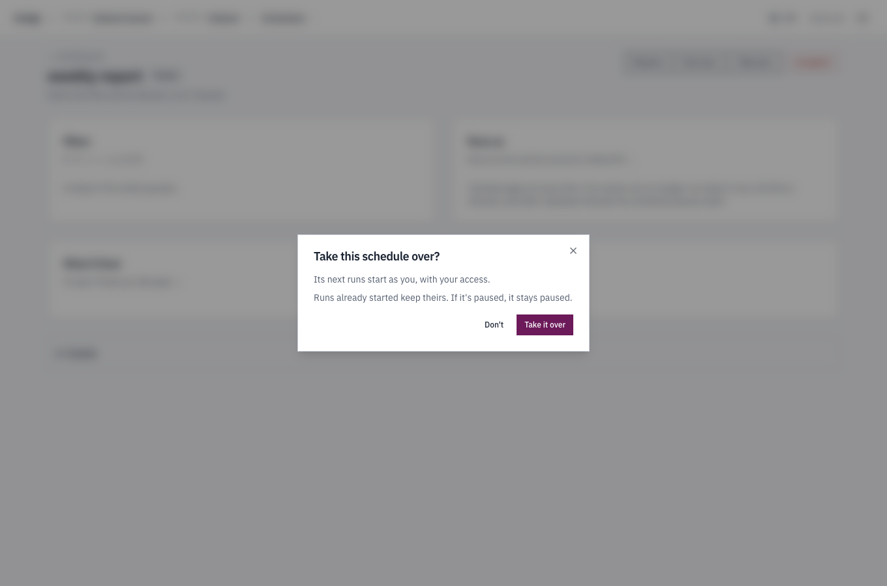
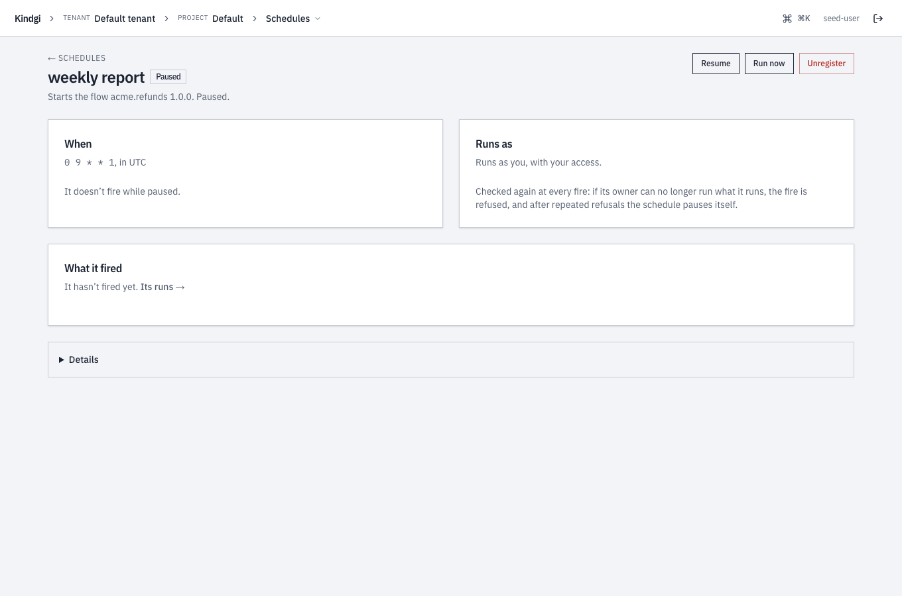
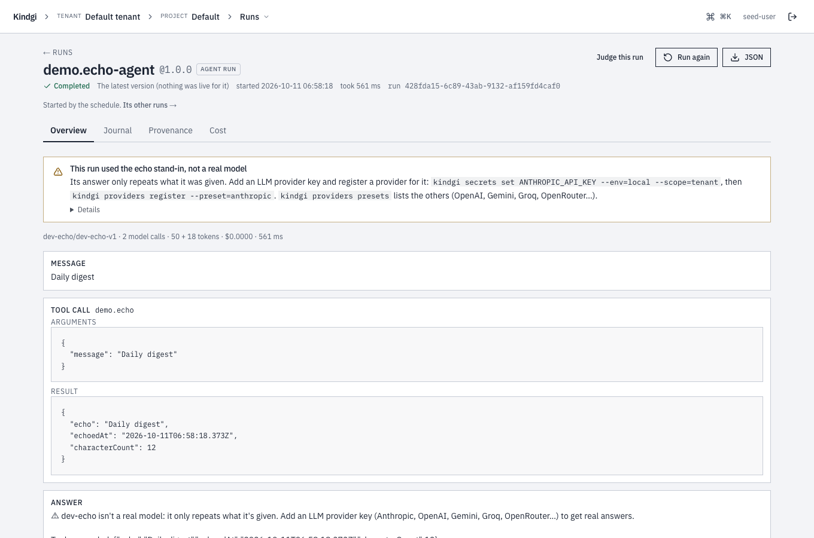

This guide runs an agent or a flow at set times, and shows each time it ran,
or why it didn't.

A **schedule** starts a run of an agent or a flow at the times a cron
expression gives. Its runs act as whoever made the schedule, checked again
at every run. They land in the schedule's project, and each names the
schedule that started it.

To start a run when something happens outside instead, such as an order in
your WooCommerce store, use a [webhook trigger](../../webhooks/start-runs-from-webhooks/).
Or have the other system [start a run](../start-a-run/) with `POST /v1/runs`.

## Before you start

- **An agent or a flow to run,** registered on your runtime, such as
  `kindgi dev`. This guide runs the agent `acme.order-desk`.
- **Kindgi 0.2's CLI**, in your pack's directory.
- **`write` on the schedule's project and `execute` on the agent or flow,**
  when authorization is on: its runs act as you, unless you name a service
  account for them ([Run as a service account](#run-as-a-service-account)).

## Create one

The schedule says what to run, with what input, and when:

```sh
pnpm exec kindgi schedules create --agent=acme.order-desk --cron="0 7 * * 1-5" --timezone=America/Toronto \
  --input='{"userMessage":"List the orders still open from yesterday."}' --label="weekday digest"
```

- **What it runs:** `--agent` runs the agent's live version, or else its
  latest. `--agent-version` pins one. `--flow` runs a flow, and needs
  `--flow-version`.
- **Its input:** an agent's is `{"userMessage": "…"}`, the message each run
  sends. A schedule for an agent without one is refused when you create it.
  A flow takes its own input, `{}` if you give none. `--input=@digest.json`
  reads a file.
- **When:** `--cron` takes a cron expression or a shorthand such as `@daily`.
  `0 7 * * 1-5` is 07:00 on weekdays. The times are in `--timezone`, an IANA
  name, UTC by default. The shortest interval is a minute, except under
  `kindgi dev`.
- **Where:** `--project=<project-id>` is its project. Without it, it's the
  tenant's Default project.
- **`--label`** names it, for lists and the console.
- **`--allow-unattended=<tool-id>`** names a tool whose calls in its runs
  needn't wait for a person's yes, though no person started them, once for
  each tool. It takes `admin` on the project
  ([Tools allowed unattended](../../approvals/ask-before-a-tool-runs/#tools-allowed-unattended)).

It prints the schedule, with its `id`. To see the next three times it runs,
where `<schedule-id>` is that `id`:

```sh
pnpm exec kindgi schedules get <schedule-id> --upcoming=3
```

From your app, the clients have the same calls on `schedules`: `register`,
`list`, `get`, `update`, `pause`, `resume`, `runNow`, `fires`,
`takeOwnership` and `unregister` (`run_now` and `take_ownership` in
Python).

## Run as a service account

A schedule's runs act as its **owner**: whoever created it, or last changed
what it runs ([Who owns it after a change](#who-owns-it-after-a-change)).
To have them act as a service account instead, with the account's grants
rather than yours, and keep running after you leave, name it with
`--run-as`:

```sh
pnpm exec kindgi schedules create --agent=acme.order-desk --cron="0 7 * * 1-5" --timezone=America/Toronto \
  --input='{"userMessage":"List the orders still open from yesterday."}' --run-as=<service-account-id>
```

- **Naming an account needs `act_as` on it,** which tenant admins hold, as
  well as what creating the schedule needs. Anyone else is answered `403
  permission-denied`, "You can't name that service account as the trigger's
  owner.", whether or not the account exists. A tenant admin is told when
  no service account in the tenant has that id (`404
  service-account-not-found`) or it was unregistered (`409
  service-account-unregistered`).
- **The account must be able to run it,** as any owner must: a fire it may
  no longer run is `refused`. So is every fire after the account is
  unregistered (runtime 0.1.9 or later): take the schedule over, or
  delete it.
- **To hand an existing schedule to an account:** `kindgi schedules
  take-ownership <schedule-id> --run-as=<service-account-id>`. It needs
  what taking it over yourself needs, `admin` on the project and `execute`
  on the agent or flow, and `act_as` on the account. Its next fire acts as
  the account. The schedule keeps its tools allowed unattended.
- **From your app:** `runAsServiceAccountId` on `schedules.register` and
  `schedules.takeOwnership` (`run_as_service_account_id` in Python).
- **Each change of owner is recorded** as evidence, `trigger-owner-set`: a
  schedule created to run as an account, every take-over, and every change
  that moves it.

### Who owns it after a change

When someone who isn't its owner changes what the schedule runs, they
become its owner (runtime 0.2.0 or later), and its next fires act as
them. So your own access only serves what you set it to run.

- **These move it:** a new target or version, a new input, or a new list
  of tools allowed unattended.
- **These don't:** its label, its cron line or timezone, its catch-up,
  overlap and deadline policies, and the same value sent again.
- **A schedule a service account owns keeps its owner,** whoever changes
  it. A service account that changes a person's schedule becomes its
  owner.

The answer to the change shows the owner after it.

## Each time it fires

Once it's created, the schedule fires at its times. Each time the schedule
comes due is a **fire**. A fire starts one run with
the schedule's input, and the run's `trigger` names the schedule, the fire
and the time it was for. With several runtime instances on one database,
each time still fires once.

- **The previous run is still going,** working or waiting for an approval.
  With `--overlap=skip`, the default, the fire is `skipped-overlap`.
  `--overlap=allow` starts another run.
- **The runtime was down** when one or more times came due. With
  `--catch-up=latest`, the default, it fires once when it's back, for the
  latest of them. It says how many it stood in for, as `missedCount`.
  `--catch-up=skip` fires none of them. A time is missed when the fire would
  start more than `--starting-deadline` seconds late, 600 by default.
- **Its owner may no longer run it,** such as when they lost their role on
  the project, or were removed from the tenant, or it's a service account
  that was unregistered (runtime 0.1.9 or later).
  The fire is `refused`, with why. Whoever holds `admin` on the project can
  make themselves its owner: `kindgi schedules take-ownership <schedule-id>`,
  or hand it to a service account
  ([Run as a service account](#run-as-a-service-account)).
- **The person a run would act for is being erased:** the fire is
  `skipped-erasure`, and no run starts for them until the erasure completes.

After 5 fires in a row that were refused or failed, the schedule pauses
itself, with the reason in its `statusReason`. Skipped fires don't count.
Nor does a fire refused for a limit, its note starting `rate-limited:`,
or one the database was too busy to start (runtime 0.1.9 or later), its
note starting `database-busy:`. Neither starts the count over.
`kindgi schedules resume <schedule-id>` clears the pause.

## See what it did

The schedule's history says what each fire did:

```sh
pnpm exec kindgi schedules fires <schedule-id> --table
```

`--table` prints a table. Without it, the same fires come as JSON. The
history is newest first, kept for 30 days. Each row has:

- **`FIRED`:** when the fire happened.
- **`FOR`:** the time it was for, or `run-now` for one you started by hand.
- **`OUTCOME`:** `started`, `skipped-overlap`, `skipped-erasure`, `skipped`,
  `refused`, `failed`, or `pending` while a fire is starting. A fire is
  `skipped` when an improve schedule's threshold isn't met or its monthly cap
  is reached, when its project is suspended, or when its tenant is suspended
  or starts closing before its run or pass has started. `NOTE` says which.
- **`STARTED`:** a run's id, or `pass <id>` for an
  [improve schedule](#improve-on-a-schedule).
- **`NOTE`:** why it was skipped, refused or failed, or how many missed times
  it stood in for.

[Improve on a schedule](#improve-on-a-schedule) shows a history.
`kindgi runs list --trigger=<schedule-id>` lists the runs it started. Each
fire also logs one `[schedules]` record, with its outcome and run, as
[Logs](../../../deploy/self-hosted/logs/) describes.

## Find your schedules

```sh
pnpm exec kindgi schedules list --status=active
pnpm exec kindgi schedules list --project=<project-id>
```

- `--status=active` lists the active ones.
- `--project=<project-id>`, `?projectId=` in the API, lists one project's
  schedules.

Each schedule's `owner` has the owner's name now, `displayName`: the
person's, or the service account's. When it can't be read, only its `id` is
there.

With [authorization](../../../deploy/authorization/) on, the list holds the
schedules in projects you may read, or all of them for a tenant admin. A
page can then hold fewer than `--limit` and still have more after it. Keep
going with `--cursor`, set to the previous page's `nextCursor`, until there's
none.

## Run it now, pause it, change it

- `kindgi schedules run-now <schedule-id>` runs it once now, outside its
  schedule. Its next time doesn't move, and a run still going doesn't stop it.
- `kindgi schedules pause <schedule-id>` stops it. `resume` starts it again
  from its next time, without running the ones it missed while paused.
- `kindgi schedules update <schedule-id>` changes when it runs, what it runs,
  its input or its policies, with the same flags as `create`. A change to
  what it runs can make you its owner
  ([Who owns it after a change](#who-owns-it-after-a-change)).
  `--allow-unattended` replaces its tools allowed unattended, and a new
  `--agent` or `--flow` must name them again, or `none`.
- `kindgi schedules unregister <schedule-id>` removes it.

## In the console

A project's **Schedules** page lists its schedules, with a headline such as
"2 schedules, 1 paused; the next fires in 14 h.". Each row says:

- what it runs, such as "the agent demo.echo-agent (its live version)" or
  "the flow acme.refunds 1.0.0";
- its cron;
- when it next fires, such as "Next in 14 h (2026-10-12 02:00 UTC)", or that
  it's paused;
- its last scheduled fire, and **Its runs →**.

Times are UTC. The list has a search box and sorts by a column's header.
**Columns** chooses which columns it shows.


A schedule's page has:
- **When:** its cron in UTC and its next five times. A paused one says
  "It doesn’t fire while paused." instead.
- **Runs as:** whose access its runs have, checked again at every fire, such
  as "Runs as you, with your access."
- **Tools allowed unattended:** the tools its runs call without waiting
  for a person's yes, or "None"
  ([Tools allowed unattended](../../approvals/ask-before-a-tool-runs/#tools-allowed-unattended)).
- **What it fired:** a summary, such as "Of its 2 fires, 2 started a run.",
  and a table of its fires, newest first. Each fire has when it fired, the
  time it was for, what happened or why the fire was refused, and the run it
  started. A fire started by hand is for "run now", and what happened reads
  "Started a run (run now)". The table sorts by a column's header, and
  **Columns** chooses which columns it shows.


Project editors and up have, on the list and on the page:
- **Pause** and **Resume**;
- **Run now:** "It starts a run now, as its owner, with its usual input. Its
  next scheduled fire doesn't change.";
- **Unregister:** "It stops firing. The runs it started stay, with their
  record of what started them." It can't be brought back from the console:
  register it again.

On a schedule that runs as someone else, project admins also get **Take
over**: "Its next runs start as you, with your access. Runs already started
keep theirs. If it's paused, it stays paused." On a schedule with tools
allowed unattended, the dialog adds that its runs still call them, with
the new owner's access.



After it, the page says "Runs as you, with your access.", and a paused
schedule stays paused:



A tenant admin gets **Change owner…** instead (runtime 0.1.9 or later),
whenever the tenant has a registered service account the schedule doesn't
already run as. Its **Runs
as** list has "You — with your access", the take-over above, and each
registered service account, such as "nightly-bot — a service account, with
its own access". The account it runs as now isn't listed, and on a schedule
that runs as you the list starts at "Pick a service account". Under the
list, the dialog says what changes before anything does, such as "Its next
runs act as nightly-bot, with its access, not yours: it needs its own access
to what this schedule starts." After **Change owner**, the page reads:
"Runs as the service account nightly-bot." Naming an account needs what
[`--run-as`](#run-as-a-service-account) needs, and a refusal shows in the
runtime's words.

A run a schedule started says so at the top of its page: "Started by the
schedule “nightly digest” (0 2 * * *).", with **Its other runs →**, the runs
list filtered to that schedule.



## Improve on a schedule

A schedule can start [improvement passes](../../evals/improve-an-agent/)
instead of runs, when enough new judgments have come in on an agent's runs,
counted the way the pass will count them:

```sh
pnpm exec kindgi schedules create --cron="0 3 * * *" --improve=acme.rank.scorer --project=<project-id> --segment=company:acme \
  --input='{"tiers": ["settings"], "threshold": {"judgments": 5, "runs": 3, "judges": 2}, "monthlyCapUsd": 20}' --label="acme improve"
```

- `--improve=acme.rank.scorer` is the agent to improve.
- `--segment=company:acme` narrows its scope to a segment of the project.

It prints the schedule, with the defaults applied to its input:

```json
{
  "scheduleId": "fa6356f8-3f9f-4ab3-b713-636424a43120",
  "triggerId": "fa6356f8-3f9f-4ab3-b713-636424a43120",
  "improve": {
    "agentId": "acme.rank.scorer",
    "scope": {
      "kind": "segment",
      "projectId": "eea49512-700f-4c59-9f66-05ca3b820a3b",
      "path": [
        {
          "key": "company",
          "value": "acme"
        }
      ]
    }
  },
  …
  "input": {
    "tiers": [
      "settings"
    ],
    "budget": {
      "maxCostUsd": 5,
      "maxCandidates": 30
    },
    "objective": "weightedYesShare",
    "threshold": {
      "runs": 3,
      "judges": 2,
      "judgments": 5
    },
    "classWeights": "restricted-only",
    "monthlyCapUsd": 20
  },
  …
}
```

At each fire, it counts the "no" judgments on the agent's runs in its scope
since the agent's last pass there, the way the pass will count them:
everyone's until the tenant, the project, or the agent being improved has a
[restricted judge class](../../evals/judge-a-runs-output/#restrict-who-may-judge-as-a-class),
then only the ones recorded under one. With `classWeights` in the schedule's
input, it counts the way that value says. The last pass is one that didn't
fail or get cancelled, whoever started it. With enough of them, across enough
runs, from enough judges, it starts a pass on a fresh test set of those runs,
`improve.<pass-id>`. Otherwise the fire is `skipped`, and its note says which
count was short.

That schedule's first fire, started with `run-now`, was skipped: one judge
short. Then the threshold was lowered to one judge:

```sh
pnpm exec kindgi schedules update <schedule-id> --input='{"tiers": ["settings"], "threshold": {"judgments": 5, "runs": 3, "judges": 1}, "monthlyCapUsd": 20}'
```

It prints the schedule, with its new input. The next fire started a pass, and
the third came while that pass was still running. Its history, newest first:

```sh
pnpm exec kindgi schedules fires <schedule-id> --table
```

```text
FIRED                     FOR      OUTCOME          STARTED                                    NOTE
────────────────────────  ───────  ───────────────  ─────────────────────────────────────────  ──────────────────────────────────────────────────────────────────────────────────────────────────────
2026-10-09T13:25:40.917Z  run-now  skipped-overlap                                             Its previous pass 3599f4ab-8788-433f-af66-7990ddfa9f47 is still running.
2026-10-09T13:25:40.341Z  run-now  started          pass 3599f4ab-8788-433f-af66-7990ddfa9f47
2026-10-09T13:25:39.201Z  run-now  skipped                                                     Not enough new trusted judgments so far: 1 of 2 judges (trusted "no" judgments met: 10, runs met: 10).
```

This project has a restricted judge class, so the pass counts trusted
judgments and the skip note names them. Without one, it would count every
"no", and the note would drop "trusted".

- **Its scope** is the schedule's project, `--project`, or a segment of it,
  `--segment=<key:value>`, repeated for a path. It's never the tenant or an
  org: a pass learns from one project's runs, so its evidence must cover the
  scope it changes. Promote wider by hand after review.
- **Its input,** `--input`, takes the pass's options, `threshold` and
  `monthlyCapUsd`. It's kept with the defaults applied: the thresholds
  default to 5 judgments, 3 runs and 2 judges, and the cap to 20 US dollars a
  month.
- **A monthly cap:** once the schedule's passes this month, in UTC, have
  cost `monthlyCapUsd`, its fires are skipped until the next month. A pass's
  budget is never more than what's left of it. Its cost counts the
  comparisons that prove its best candidate, which its budget doesn't stop,
  so a month's passes can cost more than the cap.
- **One pass at a time:** while the schedule's previous pass still runs, a
  fire is `skipped-overlap`.
- **At most once an hour.** Registering needs `publish` on the agent.

A fire that started a pass names it, as `passId`. The pass names the
schedule and the fire, as `trigger`. When the pass proposes, it asks for the
review at once, so the proposal waits in reviewers' approvals.

## Next

- [List runs](../list-runs/)
- [Start runs from WooCommerce, Drupal or any signed webhook](../../webhooks/start-runs-from-webhooks/)
- [Let a pass look for something better](../../evals/improve-an-agent/)
