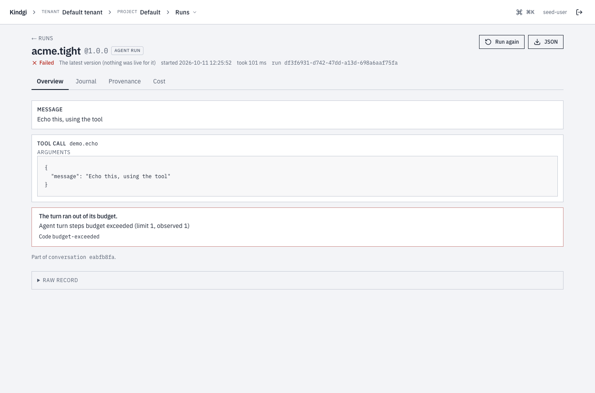
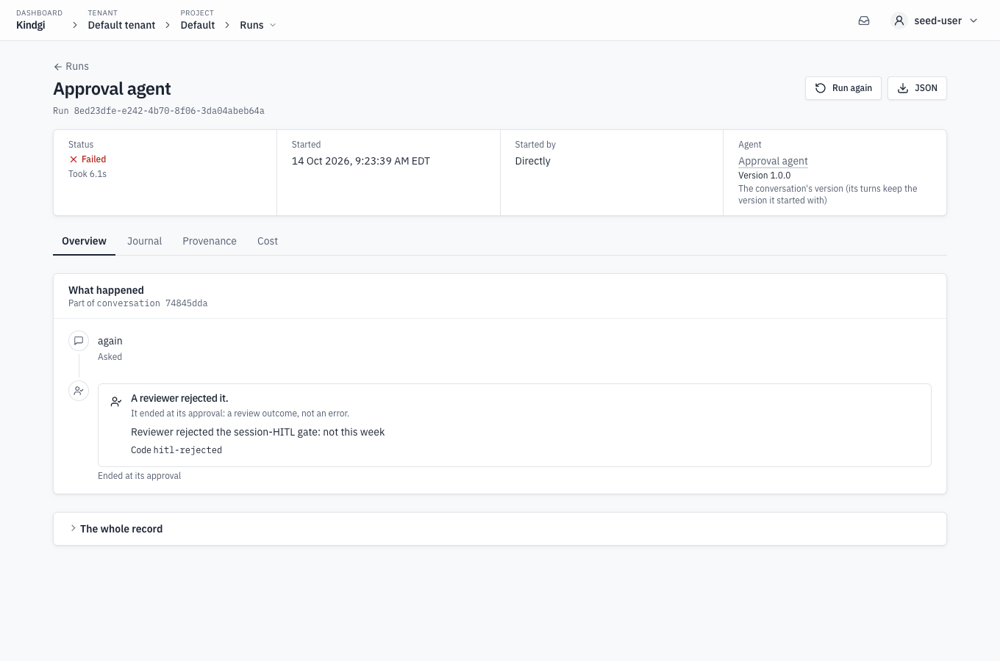
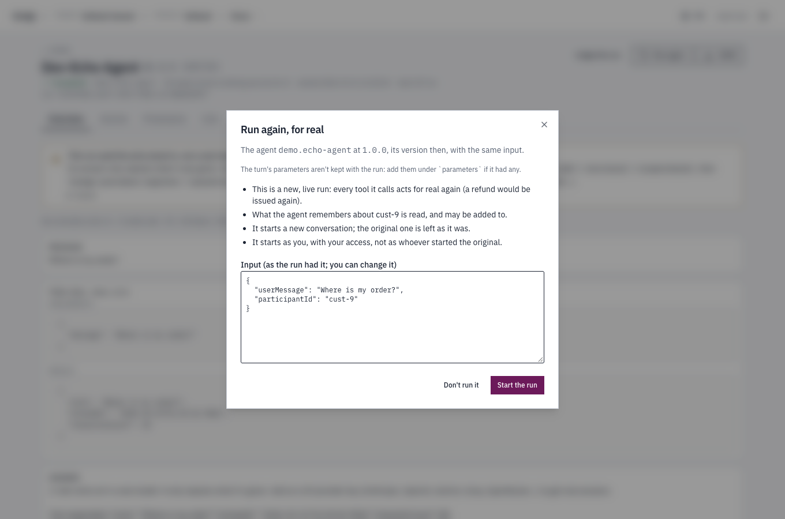

import { Tabs, TabItem } from '@astrojs/starlight/components';

## From the CLI

<Tabs syncKey="lang">
<TabItem label="TypeScript">

```sh
pnpm exec kindgi runs start --flow=acme.review-order --input='{"orderId":"A-200"}'
pnpm exec kindgi runs start --flow=acme.review-order --input=@order.json
```

</TabItem>
<TabItem label="Python">

```sh
uv run kindgi runs start --flow=acme.review-order --input='{"orderId":"A-200"}'
uv run kindgi runs start --flow=acme.review-order --input=@order.json
```

</TabItem>
<TabItem label="Java">

```sh
./kindgiw runs start --flow=acme.review-order --input='{"orderId":"A-200"}'
./kindgiw runs start --flow=acme.review-order --input=@order.json
```

</TabItem>
<TabItem label="Scala">

```sh
./kindgiw runs start --flow=acme.review-order --input='{"orderId":"A-200"}'
./kindgiw runs start --flow=acme.review-order --input=@order.json
```

</TabItem>
</Tabs>

`--input` is the run's input as JSON, or `@` and a file to read it from. The
command waits for the run to finish, however long it takes, and prints it.
Ctrl+C stops the waiting, not the run:

```text
Stopped waiting. Run f91ff793-b029-48e8-9ce4-f9fa70bd0c40 goes on: kindgi runs get f91ff793-b029-48e8-9ce4-f9fa70bd0c40
```

With `--no-wait`, it prints the run as soon as it exists:

<Tabs syncKey="lang">
<TabItem label="TypeScript">

```sh
pnpm exec kindgi runs start --flow=acme.reserve-order --input='{"orderId":"A-300"}' --no-wait
```

</TabItem>
<TabItem label="Python">

```sh
uv run kindgi runs start --flow=acme.reserve-order --input='{"orderId":"A-300"}' --no-wait
```

</TabItem>
<TabItem label="Java">

```sh
./kindgiw runs start --flow=acme.reserve-order --input='{"orderId":"A-300"}' --no-wait
```

</TabItem>
<TabItem label="Scala">

```sh
./kindgiw runs start --flow=acme.reserve-order --input='{"orderId":"A-300"}' --no-wait
```

</TabItem>
</Tabs>

```json
{
  "id": "1b1f6486-3faf-4ab7-8506-c09f50f989bc",
  …
  "flowId": "acme.reserve-order",
  "flowVersion": "0.1.0",
  "status": "pending",
  "dryRun": false,
  …
}
```

`kindgi runs get <run-id>` shows it again, with its output once it's done.

`--agent-version=<version>` (or `--flow-version`) runs that version instead of
the one in use there: the agent's pinned version, else its project's
[Latest](../../improve/pinned-versions-reference/#latest); or the flow's
[pinned version](../../flows/pin-a-flow-version/), else its latest. And
`--project=<project-id>` runs in that project instead of the
agent's or flow's own, which is the default project for what `kindgi deploy` registers
(`kindgi projects list` lists the projects with their ids). With
authorization on, naming a project needs `write` on it:

<Tabs syncKey="lang">
<TabItem label="TypeScript">

```sh
pnpm exec kindgi runs start --agent=acme.order-desk --agent-version=0.1.0 --project=<project-id> --input='{"userMessage":"Where is order A-1002?"}'
```

</TabItem>
<TabItem label="Python">

```sh
uv run kindgi runs start --agent=acme.order-desk --agent-version=0.1.0 --project=<project-id> --input='{"userMessage":"Where is order A-1002?"}'
```

</TabItem>
<TabItem label="Java">

```sh
./kindgiw runs start --agent=acme.order-desk --agent-version=0.1.0 --project=<project-id> --input='{"userMessage":"Where is order A-1002?"}'
```

</TabItem>
<TabItem label="Scala">

```sh
./kindgiw runs start --agent=acme.order-desk --agent-version=0.1.0 --project=<project-id> --input='{"userMessage":"Where is order A-1002?"}'
```

</TabItem>
</Tabs>

A `--project` that isn't a project in your workspace stops before anything runs,
with `No project with id "<project-id>" in this tenant` (the API answers 404
`project-not-found`). One that isn't an id at all, like `--project=support`,
gets `` `projectId` must be a project id (a UUID) ``.

## From your app

Create a client. With no arguments it reads the API's URL and a token from
`KINDGI_API_URL` and `KINDGI_API_TOKEN`, which you set in your env file
(`.env` / `.env.local`). In development, when they aren't set, it uses the
running `kindgi dev`, which writes both to `.kindgirc.json`, and warns once
that you should set them. In production (`NODE_ENV` or `KINDGI_ENV` set to
`production`) it never does, so set them there.

Ask your coding agent: "I want my app to start runs on Kindgi." For
reference, the client it creates looks like this:

<Tabs syncKey="lang">
<TabItem label="TypeScript">

```ts excerpt
import { createClient } from '@kindgi/sdk/client';

const kindgi = createClient(); // KINDGI_API_URL, KINDGI_API_TOKEN, or the running kindgi dev
```

</TabItem>
<TabItem label="Python">

```python excerpt
from kindgi.client import Kindgi

kindgi = Kindgi()  # KINDGI_API_URL, KINDGI_API_TOKEN, or the running kindgi dev
```

</TabItem>
<TabItem label="Java">

```java excerpt
import com.kindgi.client.Kindgi;

Kindgi kindgi = Kindgi.create(); // KINDGI_API_URL, KINDGI_API_TOKEN, or the running kindgi dev
```

The Java client is `com.kindgi:kindgi-client` on Maven Central
([Call Kindgi from a Java app](../../../start/java-app/#1-get-the-client)).

</TabItem>
<TabItem label="Scala">

```scala excerpt
import com.kindgi.client.Kindgi

val kindgi = Kindgi.create() // KINDGI_API_URL, KINDGI_API_TOKEN, or the running kindgi dev
```

A Scala app calls Kindgi with the Java client, `com.kindgi:kindgi-client`
(`libraryDependencies += "com.kindgi" % "kindgi-client" % "<version>"`). Its
methods take Java collections, so convert a Scala `Map` with `.asJava`.

</TabItem>
</Tabs>

Each example below is a whole file, with its imports.

### Wait for the result

Ask your coding agent: "I want my app to start a run and wait for its
result." For reference, the code looks like this:

<Tabs syncKey="lang">
<TabItem label="TypeScript">

```ts
// scripts/start-and-wait.ts
import { createClient } from '@kindgi/sdk/client';

const kindgi = createClient();

const run = await kindgi.runs.start({
  flow: 'acme.review-order',
  input: { orderId: 'A-200' },
});
console.log(run.status, run.output);
```

```text
completed { status: 'held', orderId: 'A-200' }
```

</TabItem>
<TabItem label="Python">

```python
# scripts/start_and_wait.py
from kindgi.client import Kindgi

kindgi = Kindgi()

run = kindgi.runs.start(flow="acme.review-order", input={"orderId": "A-200"})
print(run.status, run.output)
```

```text
completed {'status': 'held', 'orderId': 'A-200'}
```

</TabItem>
<TabItem label="Java">

```java
// src/main/java/com/acme/app/StartAndWait.java
package com.acme.app;

import com.kindgi.client.Kindgi;
import com.kindgi.client.models.Run;
import com.kindgi.client.models.StartRunBody;
import java.util.Map;

public final class StartAndWait {
  public static void main(String[] args) {
    Kindgi kindgi = Kindgi.create();

    Run run = kindgi.runs().start(StartRunBody.WithFlow.builder()
        .flow("acme.review-order")
        .input(Map.of("orderId", "A-200"))
        .build());
    System.out.println(run.status() + " " + run.output());
  }
}
```

```text
completed {status=held, orderId=A-200}
```

</TabItem>
<TabItem label="Scala">

```scala
// src/main/scala/acme/app/StartAndWait.scala
package acme.app

import com.kindgi.client.Kindgi
import com.kindgi.client.models.StartRunBody
import scala.jdk.CollectionConverters._

object StartAndWait {
  def main(args: Array[String]): Unit = {
    val kindgi = Kindgi.create()

    val run = kindgi.runs().start(StartRunBody.WithFlow.builder()
      .flow("acme.review-order")
      .input(Map("orderId" -> "A-200").asJava)
      .build())
    println(s"${run.status} ${run.output}")
  }
}
```

```text
completed {status=held, orderId=A-200}
```

</TabItem>
</Tabs>

`start` returns when the run completes, fails or waits for something (a
person's approval, for example: `status` is then `suspended`). Use it when the
run is short and the caller needs the answer.

Each client waits for an answer up to its timeout: 30 seconds in TypeScript
(`timeoutMs`, on `createClient` or on one call to `start`), 60 seconds in
Python (`timeout=`, on `Kindgi(...)` or on one call), 60 seconds in Java and
Scala (`Kindgi.builder().timeout(…)`). A waited start whose run takes longer
fails on the client, and the run's id never arrives, though the run may still
be going:

<Tabs syncKey="lang">
<TabItem label="TypeScript">

```text
The run didn't end within 30 s, the client's timeout (timeoutMs). A waited start answers only when the run ends, so the run may still be going, and its id didn't arrive. Start a run that can take longer with `options: { wait: false }`: the answer carries its id at once. Then follow it with `runs.stream(runId)` or `runs.get(runId)`. Or raise `timeoutMs`.
```

</TabItem>
<TabItem label="Python">

A `NetworkError`, after 60 seconds:

```text
The run didn't end within 60 s, the client's timeout (timeout). A waited start answers only when the run ends, so the run may still be going, and its id didn't arrive. Start a run that can take longer with `options={"wait": False}`: the answer carries its id at once. Then follow it with `runs.stream(run_id)` or `runs.get(run_id)`. Or raise `timeout`.
```

</TabItem>
<TabItem label="Java">

A `ConflictException`, just after 60 seconds. The client sends a start again
after a timeout, with the same idempotency key, and the server answers that
the first one is still running:

```text
com.kindgi.client.ConflictException: A request with this Idempotency-Key is still running. Retry after it answers (Retry-After), and you'll get its answer.
```

</TabItem>
<TabItem label="Scala">

The Java client's `ConflictException`, just after 60 seconds. The client sends
a start again after a timeout, with the same idempotency key, and the server
answers that the first one is still running:

```text
com.kindgi.client.ConflictException: A request with this Idempotency-Key is still running. Retry after it answers (Retry-After), and you'll get its answer.
```

</TabItem>
</Tabs>

So start a run that can take longer than the timeout in the background
(below), and follow it, rather than waiting on it or sending the start again.

### Start it in the background

With `wait: false`, `start` returns as soon as the run exists, with `status`
`pending`, and the run finishes on the server. Ask your coding agent: "I want
my app to start a run without waiting, and check on it until it ends." For
reference, the code looks like this:

<Tabs syncKey="lang">
<TabItem label="TypeScript">

```ts
// scripts/start-in-background.ts
import { createClient } from '@kindgi/sdk/client';

const kindgi = createClient();

let run = await kindgi.runs.start({
  flow: 'acme.reserve-order',
  input: { orderId: 'A-300' },
  options: { wait: false },
});
console.log(run.id, run.status);

while (run.status === 'pending' || run.status === 'running') {
  await new Promise((resolve) => setTimeout(resolve, 1000));
  run = await kindgi.runs.get(run.id);
}
console.log(run.status, run.output);
```

```text
dbcf7457-0d25-49b9-9112-b03c9b44e9e8 pending
completed { attempt: 3, orderId: 'A-300', reserved: true }
```

</TabItem>
<TabItem label="Python">

```python
# scripts/start_in_background.py
import time

from kindgi.client import Kindgi

kindgi = Kindgi()

run = kindgi.runs.start(
    flow="acme.reserve-order", input={"orderId": "A-300"}, options={"wait": False}
)
print(run.id, run.status)

while run.status in ("pending", "running"):
    time.sleep(1)
    run = kindgi.runs.get(run.id)
print(run.status, run.output)
```

```text
0ed299be-e04d-47bb-84b8-2ff9a4286822 pending
completed {'attempt': 3, 'orderId': 'A-300', 'reserved': True}
```

</TabItem>
<TabItem label="Java">

```java
// src/main/java/com/acme/app/StartInBackground.java
package com.acme.app;

import com.kindgi.client.Kindgi;
import com.kindgi.client.models.Run;
import com.kindgi.client.models.StartRunBody;
import java.util.Map;

public final class StartInBackground {
  public static void main(String[] args) throws InterruptedException {
    Kindgi kindgi = Kindgi.create();

    Run run = kindgi.runs().start(StartRunBody.WithFlow.builder()
        .flow("acme.reserve-order")
        .input(Map.of("orderId", "A-300"))
        .options(StartRunBody.WithFlow.Options.builder().wait_(false).build())
        .build());
    System.out.println(run.id() + " " + run.status());

    while (run.status().value() == Run.Status.Value.PENDING
        || run.status().value() == Run.Status.Value.RUNNING) {
      Thread.sleep(1000);
      run = kindgi.runs().get(run.id());
    }
    System.out.println(run.status() + " " + run.output());
  }
}
```

```text
4bfea550-9f61-42aa-a0b8-48333d209773 pending
completed {attempt=3, orderId=A-300, reserved=true}
```

`wait` is a Java keyword, so its builder method is `wait_`.

</TabItem>
<TabItem label="Scala">

```scala
// src/main/scala/acme/app/StartInBackground.scala
package acme.app

import com.kindgi.client.Kindgi
import com.kindgi.client.models.{Run, StartRunBody}
import scala.jdk.CollectionConverters._

object StartInBackground {
  def main(args: Array[String]): Unit = {
    val kindgi = Kindgi.create()

    var run = kindgi.runs().start(StartRunBody.WithFlow.builder()
      .flow("acme.reserve-order")
      .input(Map("orderId" -> "A-300").asJava)
      .options(StartRunBody.WithFlow.Options.builder().wait_(false).build())
      .build())
    println(s"${run.id} ${run.status}")

    while (Set(Run.Status.Value.PENDING, Run.Status.Value.RUNNING).contains(run.status.value)) {
      Thread.sleep(1000)
      run = kindgi.runs().get(run.id)
    }
    println(s"${run.status} ${run.output}")
  }
}
```

```text
cc0443f5-537f-4701-a9d3-d1bd911e8e74 pending
completed {attempt=3, orderId=A-300, reserved=true}
```

</TabItem>
</Tabs>

Polling works, but there are better ways to learn that a run ended:
[follow its events](../follow-a-run/), or have Kindgi
[send your app a webhook](../../webhooks/) when it finishes.

Agent runs take `options: { wait: false }` (`StartRunBody.WithAgent` in Java
and Scala) too: the turn then runs in the
background. Start an agent with `agent` instead of `flow`, and its input
(`{ "userMessage": "…" }`, see
[Give an agent its input](../../agents/give-an-agent-input/)).

## What you get back

| Field | |
| --- | --- |
| `id` | The run's id: for `get`, `cancel`, the journal and the event stream. |
| `status` | `pending`, `running`, `suspended`, `completed`, `failed` or `cancelled`. `kindgi runs resume <run-id>` says what a `suspended` run waits for ([details](../../approvals/decide-an-approval/#what-a-run-waits-for)). |
| `output` | What the run returned, once it completed. |
| `failure` | Why it failed: its `code` and `message` (an agent's turn has its own code, such as `budget-exceeded`; any other failure is `run-failed`). See [why runs failed](../see-why-runs-failed/). |
| `flowId`, `flowVersion` | The flow and the version the run runs, kept for the whole run. An agent's turn reports `agent.turn`, and its agent is in `agent`. |
| `flowVersionVia` | How a flow's version was chosen: named by the start (`explicit`), [pinned](../../flows/pin-a-flow-version/) for the run's project (`pinned`, with the pin in `flowPinnedScope`), or the newest the project reaches (`latest`). |
| `agent` | For an agent's turn: the agent's `id`, the `version` that ran, and the `conversationId`. A flow's run has none. |
| `dryRun` | Whether it was a [dry run](../../flows/dry-run-a-flow/). |
| `publicAccessToken` | A read-only token for this run, for a browser, when the deployment issues them ([details](../follow-from-the-browser/)). Only `start` returns it. |

The client references have every field and option:
[TypeScript](../../../reference/typescript/sdk/kindgi/sdk/client/),
[Python](../../../reference/python/resources/runs/),
[Java](https://github.com/kindgi/kindgi-sdk/tree/main/sdks/java#readme) (the
README of `kindgi-client`, which Scala apps use too), and the
[CLI](../../../reference/cli/runs/). In Java, a run's fields are the record's
methods (`run.status()`, `run.output()`), and `status()` prints as its wire
value (`completed`).

## When it fails

A run that fails is still a run: `start` returns it, with `status: "failed"`
and its `failure`. A request the API refuses (a flow that doesn't exist,
a malformed input) raises an error instead, and no run exists. Ask your
coding agent: "I want my app to handle a run that fails, and a start that's
refused." For reference, the code looks like this:

<Tabs syncKey="lang">
<TabItem label="TypeScript">

```ts
// scripts/start-failures.ts
import { KindgiApiError, createClient } from '@kindgi/sdk/client';

const kindgi = createClient();

const run = await kindgi.runs.start({ flow: 'acme.review-order', input: { orderId: 'Z-9' } });
if (run.status === 'failed') console.log(run.failure?.code, run.failure?.message);

try {
  await kindgi.runs.start({ flow: 'acme.no-such-flow', input: {} });
} catch (err) {
  if (err instanceof KindgiApiError) console.log(err.error.code, err.message);
}
```

```text
run-failed handler-error: Tool "acme.get-order" handler threw: handler-throw: Handler for tool "acme.get-order" threw: Error: No order Z-9
not-found No flow "acme.no-such-flow" is registered in this tenant.
```

</TabItem>
<TabItem label="Python">

```python
# scripts/start_failures.py
from kindgi.client import Kindgi, NotFoundError

kindgi = Kindgi()

run = kindgi.runs.start(flow="acme.review-order", input={"orderId": "Z-9"})
if run.status == "failed" and run.failure is not None:
    print(run.failure.code, run.failure.message)

try:
    kindgi.runs.start(flow="acme.no-such-flow", input={})
except NotFoundError as err:
    print(err)
```

```text
run-failed handler-error: Tool "acme.get-order" handler threw: handler-throw: Handler for tool "acme.get-order" threw: ValueError: No order Z-9
No flow "acme.no-such-flow" is registered in this tenant.
```

</TabItem>
<TabItem label="Java">

```java
// src/main/java/com/acme/app/StartFailures.java
package com.acme.app;

import com.kindgi.client.Kindgi;
import com.kindgi.client.NotFoundException;
import com.kindgi.client.models.Run;
import com.kindgi.client.models.StartRunBody;
import java.util.Map;

public final class StartFailures {
  public static void main(String[] args) {
    Kindgi kindgi = Kindgi.create();

    Run run = kindgi.runs().start(StartRunBody.WithFlow.builder()
        .flow("acme.review-order")
        .input(Map.of("orderId", "Z-9"))
        .build());
    if (run.status().value() == Run.Status.Value.FAILED) {
      System.out.println(run.failure().code() + " " + run.failure().message());
    }

    try {
      kindgi.runs().start(StartRunBody.WithFlow.builder()
          .flow("acme.no-such-flow")
          .input(Map.of())
          .build());
    } catch (NotFoundException e) {
      System.out.println(e.serverCode() + " " + e.getMessage());
    }
  }
}
```

```text
run-failed handler-error: Tool "acme.get-order" handler threw: handler-throw: Handler for tool "acme.get-order" threw: java.lang.IllegalArgumentException: No order Z-9
flow-not-found No flow "acme.no-such-flow" is registered in this tenant.
```

</TabItem>
<TabItem label="Scala">

```scala
// src/main/scala/acme/app/StartFailures.scala
package acme.app

import com.kindgi.client.{Kindgi, NotFoundException}
import com.kindgi.client.models.{Run, StartRunBody}
import scala.jdk.CollectionConverters._

object StartFailures {
  def main(args: Array[String]): Unit = {
    val kindgi = Kindgi.create()

    val run = kindgi.runs().start(StartRunBody.WithFlow.builder()
      .flow("acme.review-order")
      .input(Map("orderId" -> "Z-9").asJava)
      .build())
    if (run.status.value == Run.Status.Value.FAILED) {
      println(s"${run.failure.code} ${run.failure.message}")
    }

    try {
      kindgi.runs().start(StartRunBody.WithFlow.builder()
        .flow("acme.no-such-flow")
        .input(Map.empty[String, Any].asJava)
        .build())
    } catch {
      case e: NotFoundException => println(s"${e.serverCode} ${e.getMessage}")
    }
  }
}
```

```text
run-failed handler-error: Tool "acme.get-order" handler threw: handler-throw: Handler for tool "acme.get-order" threw: java.util.NoSuchElementException: No order Z-9
flow-not-found No flow "acme.no-such-flow" is registered in this tenant.
```

</TabItem>
</Tabs>

A request that times out on your side may have started the run anyway.
[Retry a start safely](../retry-a-start-safely/) shows how to retry without
starting it twice.

### In the console

A failed run's page says what happened in a sentence, then the runtime's
own words and the code:

```text
The turn ran out of its budget.
Agent turn steps budget exceeded (limit 1, observed 1)
Code budget-exceeded
```



A run that ended at its approval didn't go wrong: someone, or the
approval's deadline, decided. Its page says which, not in red: "A reviewer
rejected it.", "Its approval was withdrawn.", "No one decided its approval
in time." or "Its approval was closed before anyone decided.", then "It
ended at its approval: a review outcome, not an error.", the reviewer's
rationale and the code
([Decide an approval](../../approvals/decide-an-approval/)).



## Run it again

A finished run's page has **Run again** for whoever may run its agent or
flow. A step inside a flow has none. The dialog, **Run again, for real**,
says what the new run is and does, for that run:

```text
The agent demo.echo-agent at 1.0.0, its version then, with the same input.
The turn's parameters aren't kept with the run: add them under `parameters` if it had any.
This is a new, live run: every tool it calls acts for real again (a refund would be issued again).
What the agent remembers about cust-9 is read, and may be added to.
It starts a new conversation; the original one is left as it was.
It starts as you, with your access, not as whoever started the original.
```

The input is the run's, and you can change it before **Start the run**.


