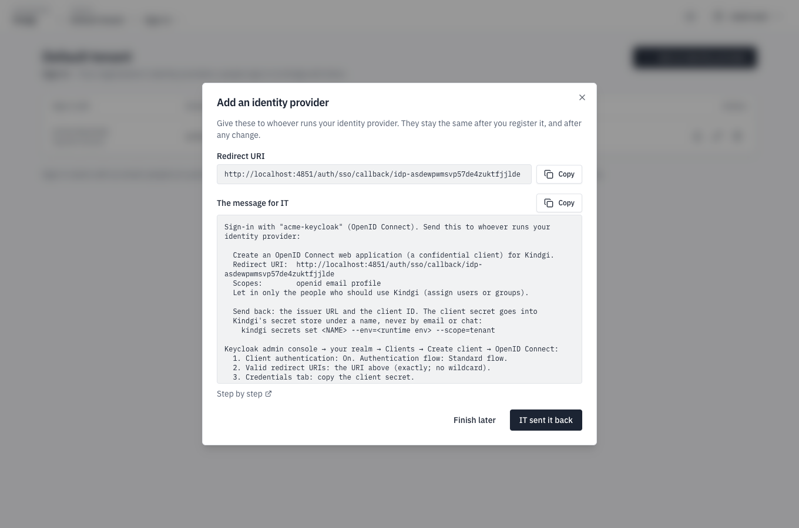
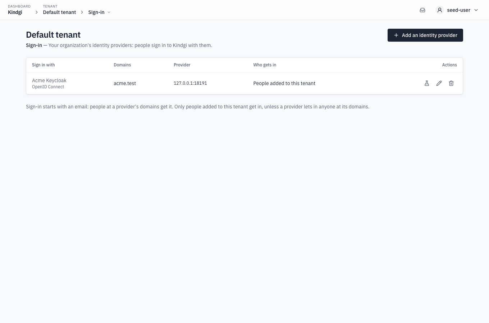

When you finish this page, your workspace's people sign in with your
organization's accounts, under its rules and its multi-factor sign-in. Kindgi
offers this sign-in to anyone whose email is on your domains, and lets in
only the people you've added.

Setting it up takes two people: you, an admin of the workspace, and whoever
runs your identity provider. This page calls them IT. You start in the CLI
and get what to send IT. IT creates the app on their side and sends back
what it gave them. You register it, and try it. The console's **Sign-in**
page does the same steps ([From the console](#from-the-console)).

## Before you start

- **Sign-in is on for your runtime,** and your domain is verified for your
  workspace ([Turn on sign-in](../../deploy/self-hosted/sign-in/)).
- **You're an admin of the workspace.**
- **The `kindgi` CLI reaches your runtime as you,** with the runtime's address
  exported as `KINDGI_API_URL` and your API key as `KINDGI_API_TOKEN`
  ([People and keys](../../deploy/people-and-keys/#api-keys)).
- **For `kindgi` commands:** Kindgi 0.2's CLI, which runs from any folder as
  `npx --yes @kindgi/cli@0.2` ([Install](../../start/install/)). Inside a pack
  project, `pnpm exec kindgi` runs the project's pinned CLI instead.

## 1. Get what to send IT

`start` gives you the URLs IT enters on their side, before anything is
registered:

```sh
npx --yes @kindgi/cli@0.2 sso providers start acme-kc --idp=keycloak
```

- `acme-kc` is the provider's id in your workspace. Pick one per identity
  provider.
- `--idp` adds that identity provider's own steps to the message: `google`,
  `entra`, `okta` or `keycloak`. Each one has a page with the steps in full
  ([Your identity provider](#your-identity-provider)).
- For a SAML provider, use `--kind=saml` instead of `--idp`. `start` then
  prints the URLs a SAML app asks for ([SAML](saml/)).

`start` prints the message for IT:

```text
Sign-in with "acme-kc" (OpenID Connect). Send this to whoever runs your identity provider:

  Create an OpenID Connect web application (a confidential client) for Kindgi.
  Redirect URI:  http://localhost:18096/auth/sso/callback/idp-ibhu3tdkkrjjjfllbjpu2uk3gm
  Scopes:        openid email profile
  Let in only the people who should use Kindgi (assign users or groups).

  Send back: the issuer URL and the client ID. The client secret goes into
  Kindgi's secret store under a name, never by email or chat:
    kindgi secrets set <NAME> --env=<runtime env> --scope=tenant

Keycloak admin console → your realm → Clients → Create client → OpenID Connect:
  1. Client authentication: On. Authentication flow: Standard flow.
  2. Valid redirect URIs: the URI above (exactly; no wildcard).
  3. Credentials tab: copy the client secret.
  4. Each person needs an email with "Email verified" on, or sign-in is refused.
Issuer: https://<keycloak-host>/realms/<realm>

Step by step: https://docs.kindgi.com/v0.1/guides/sso/keycloak/

Then register it:
  kindgi sso providers finish acme-kc --kind=oidc --issuer=<issuer> --client-id=<client-id> --client-secret-ref=<NAME> --domains=<your-domain>

These URLs stay the same after registering and after any `update`.
```

Send it to IT. The URLs are made from the runtime's `KINDGI_PUBLIC_URL`.
They stay the same after you register, after any `update`, and if you remove
the provider and register it again under the same id.

## 2. IT creates the app

IT follows your identity provider's page, with exactly the redirect URI that
`start` printed. IT then stores the client secret in Kindgi's secret store,
by name, so the secret never travels by email or chat:

```sh
npx --yes @kindgi/cli@0.2 secrets set ACME_KC_SECRET --env=production --scope=tenant
```

- `ACME_KC_SECRET` is the secret's name. The provider's registration keeps
  only this name. The secret stays in the store.
- `--env` is the runtime's environment, its `KINDGI_ENV`.
- `--scope=tenant` stores the secret for the whole workspace.

The command asks for the value twice, and doesn't show what you type.
Then it prints what it stored:

```text
Value:
Re-enter to confirm:
{
  "name": "ACME_KC_SECRET",
  "scope": {
    "kind": "tenant",
    "tenantId": "6c0bd33e-e941-439b-bd0c-c7e412db29fc"
  },
  "envName": "production",
  "versionId": 1
}

  Set ACME_KC_SECRET at tenant in production.
```

IT then sends back the issuer URL, the client ID and the secret's name.

## 3. Register what IT sent back

`finish` registers the provider, and offers it to people at your domains:

```sh
npx --yes @kindgi/cli@0.2 sso providers finish acme-kc --kind=oidc --issuer=http://127.0.0.1:18091/realms/acme \
  --client-id=kindgi-live --client-secret-ref=ACME_KC_SECRET --domains=acme.test --name="Acme Keycloak"
```

- `--kind=oidc` says the provider speaks OpenID Connect. A SAML provider
  takes `--kind=saml` and its metadata instead ([SAML](saml/)).
- `--issuer` is your identity provider's issuer URL. Here it's a Keycloak
  realm on the same machine.
- `--client-id` is the client ID IT sent back.
- `--client-secret-ref` is the secret's name in the store. `finish` never
  takes the secret itself.
- `--domains` are the email domains this provider is offered for. Sign-in is
  email first, so people find their provider by their email's domain.
  `finish` refuses to register without it:

  ```text
  Error: --domains=<your-domain> is required: sign-in is email first, so people find this provider by their email's domain
  ```

- `--name` is what the sign-in page's button says: "Sign in with Acme
  Keycloak".

Kindgi reads the issuer's endpoints from its discovery document when you
register. The registration that `finish` prints shows them:

```json
{
  "providerId": "acme-kc",
  "provider": {
    "providerId": "acme-kc",
    "kind": "oidc",
    "displayName": "Acme Keycloak",
    "domains": [
      "acme.test"
    ],
    "signIn": {
      "redirectUri": "http://localhost:18096/auth/sso/callback/idp-ibhu3tdkkrjjjfllbjpu2uk3gm"
    },
    "issuer": "http://127.0.0.1:18091/realms/acme",
    "clientId": "kindgi-live",
    "clientSecretRef": "ACME_KC_SECRET",
    …
  }
}
```

## 4. Add people, and try it

Only people already added to your workspace get in, by the email the identity
provider confirms. Add each person first, with their email
([Add a person](../../deploy/people-and-keys/#add-a-person)). Then get a link
to try the sign-in:

```sh
npx --yes @kindgi/cli@0.2 sso providers test acme-kc
```

`test` gives a link for someone at the provider's first domain.
`--email=<someone@your-domain>` makes it a link for that person instead.

```text
Open this in a browser and sign in as a person who's been added to this workspace:
  http://localhost:18096/auth/start/idp-ibhu3tdkkrjjjfllbjpu2uk3gm

Afterwards, the console shows who you are signed in as.
```

Open the link, and sign in as a person you've added. The console then shows
who you're signed in as. From then on, people sign in from the console's
sign-in page with their email ([Sign in to the console](sign-in/)). Someone
who isn't added is refused, even when the identity provider lets them
through.

## Change it, list it, remove it

`list` shows your workspace's providers, and `--table` prints them as a
table:

```sh
npx --yes @kindgi/cli@0.2 sso providers list --table
```

```text
PROVIDER  KIND  NAME           DOMAINS
────────  ────  ─────────────  ─────────
acme-kc   oidc  Acme Keycloak  acme.test
```

- **`get <id>`** shows one provider, with its sign-in URLs.
- **`update <id>`** changes a field in place: `--name`, `--domains` or a new
  `--client-secret-ref`, for example. `--remove=<field>` takes out an
  optional field, such as `displayName`. The URLs IT has don't change.
  Changing which identity provider is behind it signs its people out: a new
  issuer or client, or new SAML metadata or certificates. They then sign in
  again as usual. Renaming it or changing its domains doesn't sign anyone
  out.
- **`remove <id>`** takes it out of sign-in at once, and ends the sessions
  people opened through it. Its old links answer "That sign-in option is
  gone".

## From the console

A workspace admin does the same steps on the console's **Sign-in** page:

- **Add an identity provider** asks which one, and proposes an id. You choose
  a preset, another OpenID Connect provider, or a SAML 2.0 one. **Get the
  URLs** then shows what to send IT: the redirect URI and the message for IT,
  with your provider's steps and a link to its page here. For SAML, it shows
  the service provider's URLs instead of the redirect URI. **Finish later**
  closes it. Adding the same id again gives the same URLs.

  

- **IT sent it back** takes what IT returns: the issuer, the client ID and
  the client secret's name in your secrets, or the SAML metadata XML.
  **Check** looks the secret's name up, never its value. You then enter the
  domains and the button's name. **Register** adds the provider to sign-in.
- **The list** shows each provider with its domains, its host and who gets
  in. **Try** gives a sign-in link for someone at its domains. **Change**
  edits it in place, and warns you before a change that signs its people
  out. **Remove** takes it out of sign-in.

  

Whoever runs Kindgi can manage sign-in for every workspace themselves, with
`KINDGI_AUTH_TENANT_PROVIDERS=off`
([Turn on sign-in](../../deploy/self-hosted/sign-in/#who-manages-a-workspaces-identity-providers)).
The **Sign-in** page then says so, and lists the providers with **Try**
only. A workspace admin's change from the CLI or the API is refused too.

## Your identity provider

| Identity provider | Page | Checked live |
|---|---|---|
| Keycloak | [Keycloak](keycloak/) | yes, OpenID Connect and SAML (signed requests) |
| Google Workspace | [Google](google/) | yes, except the Workspace-only audience |
| Microsoft Entra ID | [Microsoft Entra ID](entra-id/) | yes, single-tenant OpenID Connect |
| Okta | [Okta](okta/) | no: steps from Okta's docs |
| Another OpenID Connect provider | [OpenID Connect](oidc/) | through Keycloak and Google |
| Another SAML provider | [SAML](saml/) | through Keycloak |

## An identity provider on a private network

Kindgi refuses an identity provider on a private network, such as an
internal Keycloak, unless the runtime's operator allows its origin with
`KINDGI_AUTH_PRIVATE_IDP_ORIGINS`:

```text
Error [identity-provider-invalid]: http://127.0.0.1:18091/realms/acme is not a public HTTPS address (loopback): the deployment's operator can allow its origin with KINDGI_AUTH_PRIVATE_IDP_ORIGINS
```

This page's local Keycloak was allowed that way:
`KINDGI_AUTH_PRIVATE_IDP_ORIGINS=http://127.0.0.1:18091`.

The runtime checks each connection to a workspace's identity provider as it
checks the other hosts a workspace names
([What a tenant can't make the server do](../../concepts/security/#what-a-tenant-cant-make-the-server-do)).
That covers its discovery document, and the token, keys and user info
requests at sign-in. An origin listed in `KINDGI_AUTH_PRIVATE_IDP_ORIGINS`
passes those checks.

## Next

- [Sign in to the console](sign-in/): what your people see, and what each
  message there means.
- [Sessions](sessions/): how long a sign-in lasts, and signing out.
- [Enterprise sign-in options](enterprise/): roles from your identity
  provider's groups, SCIM provisioning, and CLI sign-in.
