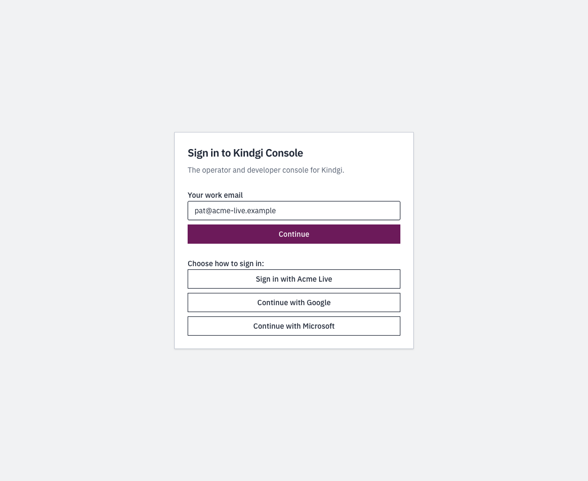
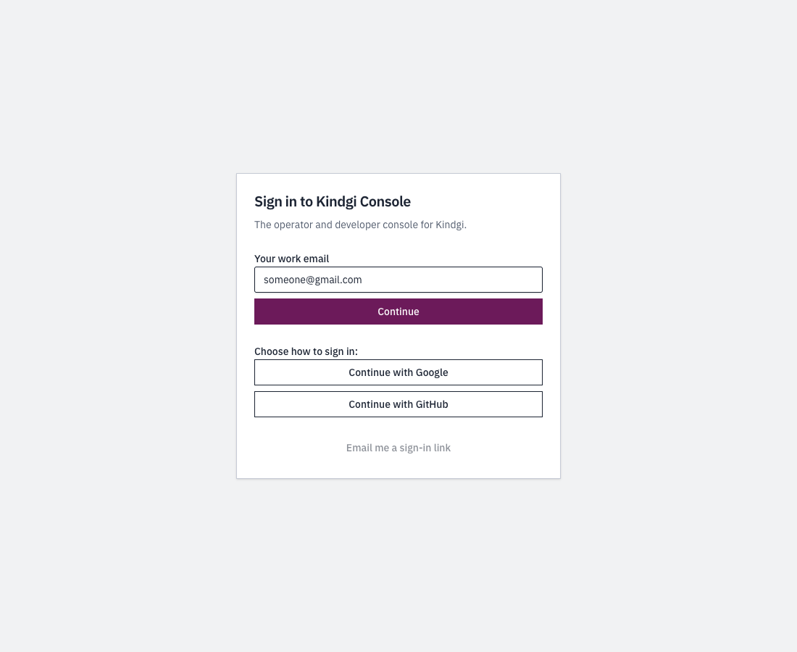
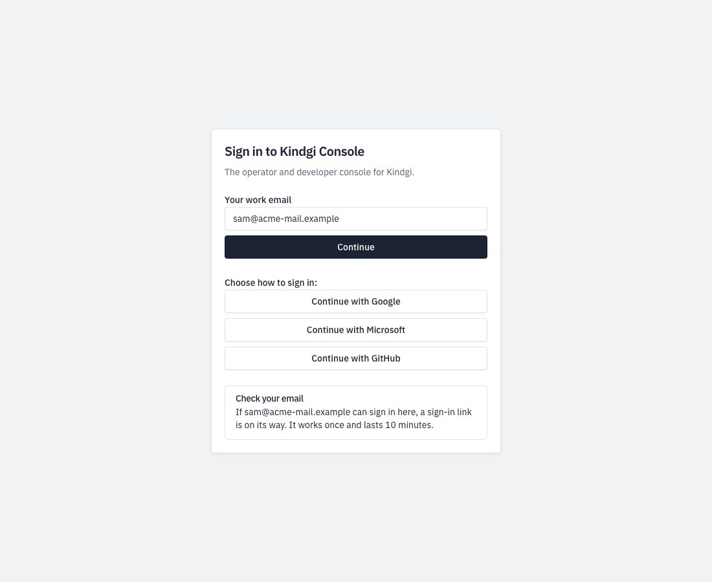
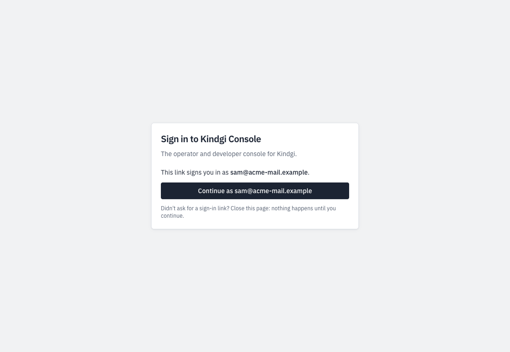
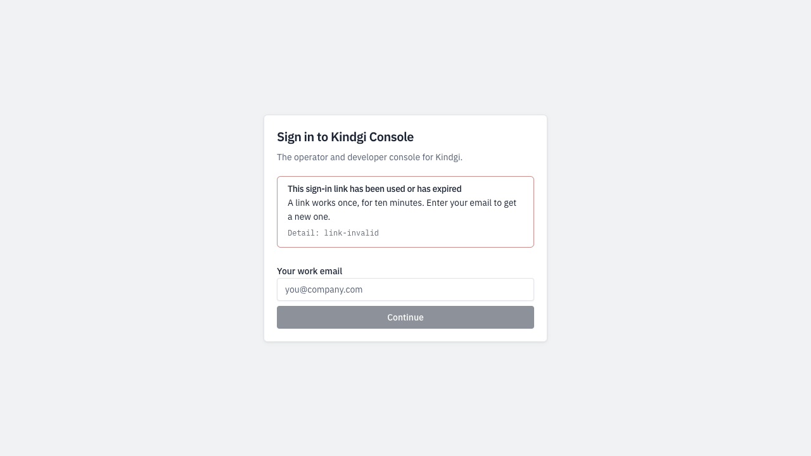
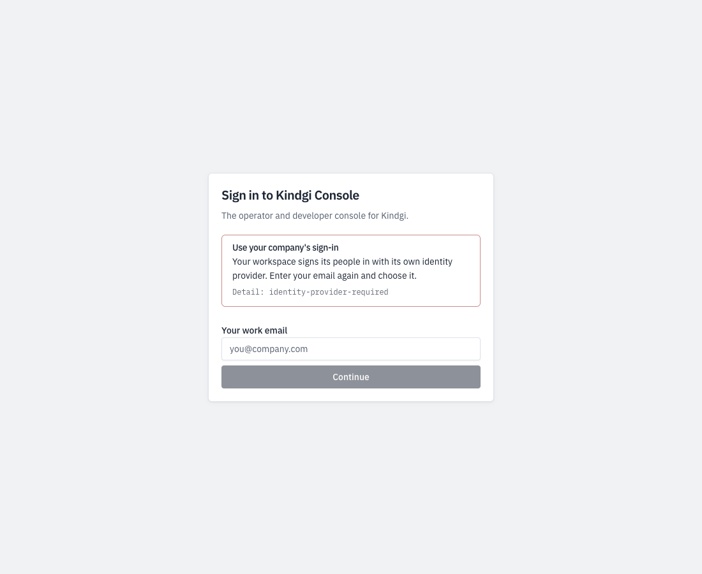
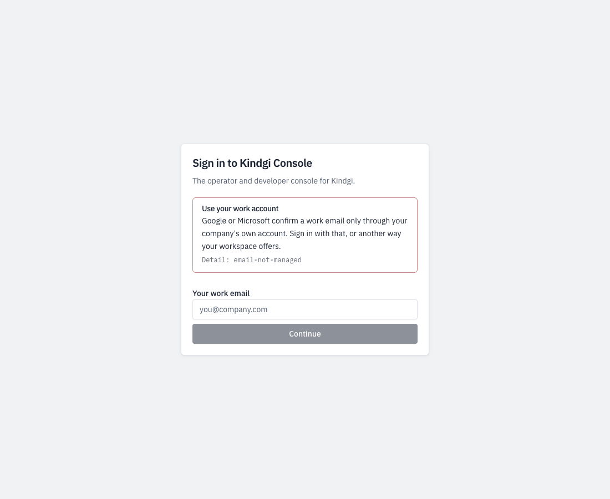

This page shows how you sign in to the console, and what each message on its
sign-in page means. Signing in starts with your email. The console then
offers the ways in that this deployment has for it. Whoever runs the
deployment chooses which ones ([Turn on sign-in](../../../deploy/self-hosted/sign-in/)).

## Your email first

Enter your email and **Continue**. The page then lists, under **Choose
how to sign in:**

- **Sign in with** your workspace's own identity provider, first, when your
  email's domain is set up for it;
- **Continue with Google** or **Continue with Microsoft**, by who hosts your
  domain's mail, or both when that can't be told;
- **Continue with GitHub**, when the deployment has a GitHub app;
- **Email me a sign-in link**, when the deployment sends them.

When your workspace has its own identity provider, it's the way in for your
domain, with Google or Microsoft for accounts your company manages. GitHub and
the emailed link aren't offered there. For `pat@acme-live.example`, whose
workspace signs in with "Acme Live":

For a Gmail address, Google and GitHub:

The buttons only point the way. Whichever you choose, you're let in only if
someone has already added you to a workspace, with the email your provider
confirms. If you're in several workspaces, the page asks you to **Choose a
workspace:** (the choice lasts five minutes).

A link to the sign-in page can fill your email in:
`https://kindgi.acme.com/console/login#email=pat@acme-live.example`. A
browser never sends the part after `#` to the server, so opening the link
puts the address in no request log. It reaches the server only when you
continue, as a typed one does, and the link signs no one in. Write a `+` in the
address as `%2B` (`#email=pat%2Bops@acme-live.example`): a plain `+` fills
nothing.

## A sign-in link by email

**Email me a sign-in link** sends a link to your address. The page answers the
same for any email:

The link opens a page that says which email it signs you in as. Nothing
happens until you choose **Continue as** your email: mail scanners open links
too, and this keeps them from using yours.

The link works once, for ten minutes. After that:

## When sign-in doesn't let you in

| The page says | What it means |
|---|---|
| Use your work account | Google or Microsoft confirm a work email only through your company's own account. Sign in with that, or another way your workspace offers. |
| Use your company's sign-in | Your workspace signs its people in with its own identity provider. Enter your email again and choose it. |
| You haven't been added here yet | Your sign-in worked, but nobody has added you to this workspace with this email. Ask an admin. |
| Your email isn't verified | Your identity provider says your email isn't verified. Verify it there. |
| No email came back | Your identity provider didn't send your email address. Your admin sets it to send the `email` claim or attribute. |
| You can't sign in here | This sign-in isn't linked to anyone who can use this workspace, for example because you were removed. |
| This is a different account | You used another account than the one you signed in with before, with the same email. Use your usual account. |
| That sign-in option is gone | It may have been removed. Enter your email again. |
| Sign-in was cancelled | Your identity provider didn't let the sign-in through. |
| That sign-in has finished | The choice of workspace lasts five minutes and works once. Sign in again. |
| Too many tries | Wait a minute, then try again. |
| Sign-in didn't complete | Something went wrong between your identity provider and Kindgi. The **Detail** line under it is what your admin needs. |

Each message ends with a **Detail** line: the code your admin can look up.
With Google or Microsoft, you may meet these two:

## With an API token

Where the deployment allows it, the page also has **Your API token**. Paste
a token of your own there, and it becomes a session. The browser doesn't
keep the token.

When the page says **There's no way to sign in here yet**, the deployment
has no way in turned on. Ask whoever runs it.

## The menu under your name

Once you're in, your name is at the top right of every page. Its menu has:

- who you're signed in as;
- **My access**: what you may do, and how you have it
  ([The console, by role](../../../deploy/authorization/#the-console-by-role));
- **Docs**, and below it the links the deployment adds
  ([Your own links in the console](../../../deploy/self-hosted/sign-in/#your-own-links-in-the-console));
- **Theme:** **System**, **Light** or **Dark**. System, to start with,
  follows your device's setting as it changes.
- **Times:** **Local** with your city, such as **Local (Toronto)**, or
  **UTC**. Local, to start with, shows times on your browser's clock.
- **Sign out** ([Signing out](../sessions/#signing-out)).

Each time names its zone either way, such as "25 Oct 2026, 1:08 AM EDT".
Its clock reads 12 or 24 hours as your browser's language does: 12 in
American English, 24 in British English, French or German. Only what the
console shows changes: the runtime keeps and sends times in UTC, so the API
and its clients see UTC. A few stay in UTC and say so: cost by day ("Spend
by day (UTC), by agent"), the project overview's "The last 7 days, by UTC
day", and
an Improve schedule's monthly cap ("A calendar month, UTC."). A schedule's
cron reads in the schedule's own zone
([Run on a schedule](../../runs/run-on-a-schedule/#in-the-console)).

Your Theme and Times are kept in this browser, not with your account:
another browser, or a new private window, starts at System and Local.

## Next

- [Sessions](../sessions/): how long you stay signed in, and signing out.
- [Set up SSO](../): connect your workspace's own identity provider.
