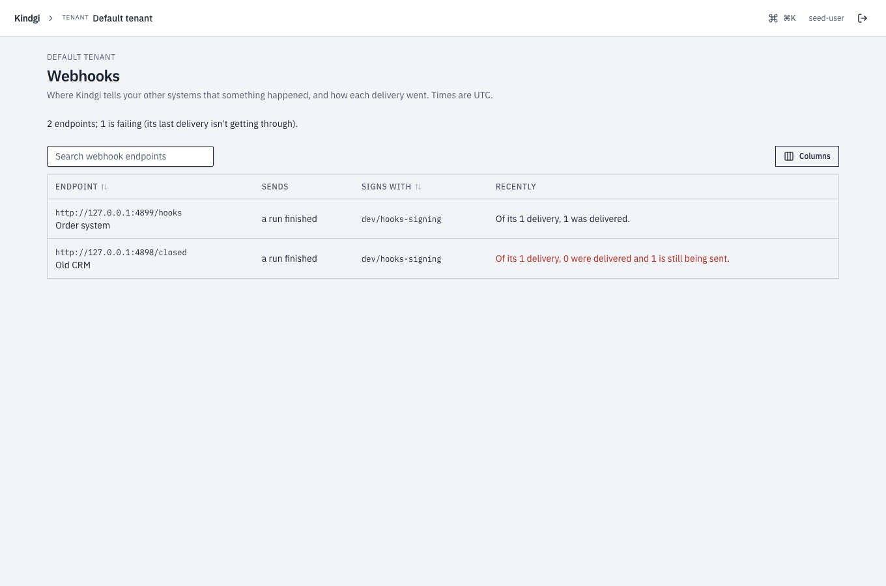
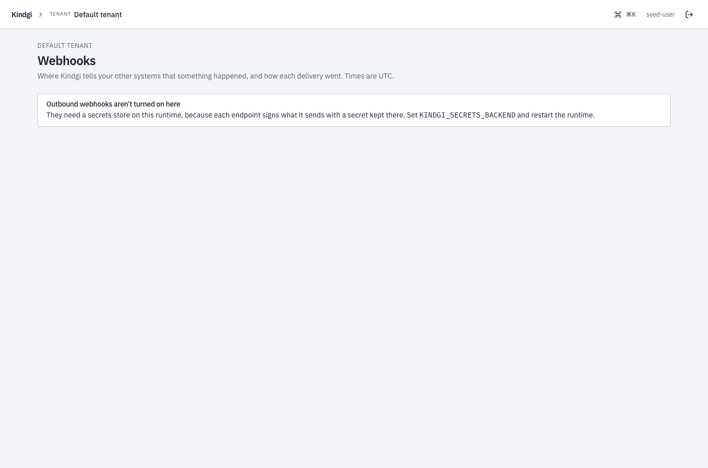

This page lists every event a webhook endpoint can get from Kindgi, what each
one carries, how deliveries are retried, and what the console shows about
them. To set an endpoint up, follow
[Get a webhook when a run finishes](../receive-run-finished/).

| Event | Sent when | Carries |
|---|---|---|
| `run.finished` | a run that isn't inside another run completes, fails or is cancelled | `data.run` |
| `improve-run.finished` | an Improve run ends | `data.improveRun` |
| `approval.requested` | an approval starts waiting for a reviewer | `data.approval` |

An endpoint gets the events its `events` list names. `parseEvent` in
TypeScript and Java, and `parse_event` in Python, read each of them. An event
type the client doesn't know yet — a newer runtime's — is rejected in
TypeScript and Python, and reads as a `WebhookEvent.Unrecognized` in Java;
either way, answer 2xx and move on.

## `run.finished`

```json
{
  "id": "d7bc2805-587c-4830-a36f-fddeb0b7a423",
  "type": "run.finished",
  "createdAt": "2026-10-03T20:16:24.554Z",
  "data": {
    "run": {
      "id": "c24869c1-9243-4531-920b-d657e05eac0b",
      "projectId": "bc654965-c4fb-4667-85f1-33e46f4a4f0c",
      "flowId": "acme.check-order-stock",
      "flowVersion": "0.1.0",
      "status": "completed",
      "dryRun": false,
      "failureMessage": null,
      "createdAt": "2026-10-03T20:16:24.465Z",
      "completedAt": "2026-10-03T20:16:24.554Z",
      "usage": {
        "calls": 0,
        "costUsd": 0,
        "tokens": { "prompt": 0, "completion": 0, "cacheRead": 0, "cacheWrite": 0, "reasoning": 0 }
      }
    }
  }
}
```

- **`status`** is `completed`, `failed` or `cancelled`. **`failureMessage`**
  says why a run failed.
- **`usage`** is what the run's model calls cost, its agent steps included:
  `calls`, failed ones too, `costUsd` and `tokens`. See
  [Cost per run and per customer](../../observability/cost-per-run/).
- **The event carries the run's identity and outcome,** never its input or
  output. Fetch the run with `runs.get` for its output. After `parseEvent` in
  TypeScript, `event.data.run.id` is a `RunId`, so it goes to `runs.get` as
  it is.
- **`webhook-id`**, a request header, is the event's id, the same on every
  retry.
- **The filter applies:** `flowIds`, `projectId` and `includeDryRuns`.
- **Every run that isn't inside another run sends it,** whatever started it:
  your app, the CLI, a schedule, a webhook trigger or a mail trigger. The
  runs inside it, such as an agent step's turn, don't. A test run's replays
  don't either.

### On an agent's run

When your app starts an agent's run, a turn in a conversation, the event is
the same with `flowId` `agent.turn`. Its `agent` says which agent ran:

```json
{
  "id": "62340028-b9ea-4b3c-911a-9958ecdf64de",
  "type": "run.finished",
  "createdAt": "2026-10-11T06:05:07.444Z",
  "data": {
    "run": {
      "id": "73628759-cb27-4813-94f7-f872bb3a78ef",
      …
      "flowId": "agent.turn",
      "flowVersion": "1.1.0",
      "status": "completed",
      …
      "agent": {
        "id": "acme.order-assistant",
        "version": "0.1.0",
        "conversationId": "9bd2328a-5c30-4cf9-ab15-4ddc74dc898d",
        "via": "latest"
      }
    }
  }
}
```

- **`agent.id` and `agent.version`** are the agent and the version that ran.
  **`conversationId`** is the conversation the turn belongs to.
- **`via`** says why that version ran:
  - `latest`: no version is pinned for the run's scope;
  - `pinned`: the version pinned for its scope;
  - `explicit`: your app named the version;
  - `conversation`: the conversation's own version.
- **`usage`** counts the agent's model calls, as on a flow's run.
- These are the fields `GET /v1/runs/<run-id>` shows. In Python,
  `parse_event` gives them as `event.data.run.agent`.
- A flow's run has no `agent`.

## Improve runs

An endpoint that lists `improve-run.finished` in its `events` gets one
when any [Improve run](../../improve/improve-an-agent/) ends, whoever started
it. The Improve run ends `completed`, `failed` or `cancelled`.

- **`data.improveRun`** is the Improve run as `GET /v1/improve-runs/<improve-run-id>`
  shows it.
- **Its outcome** names the suggested change it wrote, if it wrote one.
- **Of the filter, only `projectId` applies,** the Improve run's project. `flowIds`
  and `includeDryRuns` are about runs.

## Approvals

An endpoint that lists `approval.requested` gets one each time an approval
starts waiting for a reviewer. An escalation opens a new approval, so it
sends a new event. Assigning an approval later sends no second event: read
the approval for its `assignedTo`.

`data.approval` says which approval it is and who may decide it:

- `approvalId`, `projectId`, `requiredRole` and `title`;
- `assignedTo`, when it's assigned;
- `createdAt` and `expiresAt`;
- `url`, its page in the console, when the runtime knows its public address.

It never carries what the approval is about: no `context`, no tool call and
no run input. That stays behind sign-in.

- **Of the filter, only `projectId` applies,** the approval's project.
- **An approval that's rolled back before it's saved** sends nothing.

One, as an endpoint gets it, with the ids elided. Its `webhook-id` is the
approval's id. `assignedTo` and `expiresAt` appear when they're set:

```json
{
  "id": "…",
  "type": "approval.requested",
  "createdAt": "2026-10-10T01:37:31.198Z",
  "data": {
    "approval": {
      "approvalId": "…",
      "projectId": "…",
      "requiredRole": "standard",
      "title": "Refund over the limit",
      "createdAt": "2026-10-10T01:37:31.198Z",
      "url": "…/console/approvals/…"
    }
  }
}
```

To email the reviewers themselves instead, see
[reviewer email](../../approvals/decide-an-approval/#reviewer-email).

## Delivery

- **A delivery succeeds on a 2xx answer.** Any other answer, or none, is
  retried with backoff: about a minute later, then about five minutes
  later, then longer.
- **A delivery is at least once.** The same event can arrive twice, so
  deduplicate on `webhook-id`.
- **Outside development, every attempt checks the receiver's address
  again,** with the runtime's settings at that moment. An attempt to an
  address it refuses fails with `lastError: "url-refused"` and is retried
  like any other. Once you set `KINDGI_WEBHOOK_PRIVATE_NETWORKS=allow`, the
  queued retries to a private receiver go out.

[Verify a webhook](../verify-a-webhook/) has receivers that check the
signature and deduplicate.

## In the console

Tenant admins have **Outgoing webhooks**, in the tenant's sections: "Where
Kindgi tells your other systems that something happened, and how each
delivery went." It lists every endpoint the tenant sends to. Times are on
your own clock, or UTC
([The menu under your name](../../sso/sign-in/#the-menu-under-your-name)).



- **Each endpoint** has its address and its description, what it sends,
  such as "a run finished", and the secret it signs with, by name only.
  **Recently** says how its recent deliveries went: "Of its 1 delivery, 1
  was delivered." It's in red when its last delivery failed, or is being
  tried again after a failed attempt.
- **The list** has a search box and sorts by a column's header.
  **Columns** chooses which columns it shows.

An endpoint's page says what it sends and how it signs: "Sends a run
finished, signed with the secret dev/HOOKS_SIGNING (its value stays in the
secrets store)." Then it tells each delivery, newest first, as a story:

- "Delivered after 1 attempt";
- "Retrying after 2 attempts (nothing is listening at that address), next
  attempt …", or the receiver's answer instead, such as "(HTTP 500)";
- "Failed after 6 attempts: HTTP 500", once it has stopped trying;
- for a finished run, the run's outcome and **Open the run**.

The other reasons it gives are "it didn't answer in time", "its host name
doesn't resolve", "its address is one webhooks may not go to", "its TLS
certificate wasn't accepted" and "the connection failed". **All**,
**Failed**, **Being sent** and **Delivered** filter the list, and it sorts
by a column's header.


- **Send a test** queues a test event: "Queued: follow it below." It shows in
  the list as "a test".
- **Send again**, the button at the end of a delivery's row, queues that
  delivery once more: "Queued."
- **Remove** asks first: "Remove this endpoint? Nothing more is sent to it.
  Deliveries still waiting are marked failed. It can't be brought back: add
  it again to start over." Its old address then says "No endpoint by that id
  here: it was removed, or never existed.", with **All outgoing webhooks**.

A runtime without a secrets store sends no webhooks, and the page says so:
"Outgoing webhooks aren't turned on here". Endpoints sign with a secret kept
in the store, so set `KINDGI_SECRETS_BACKEND` and restart the runtime.


